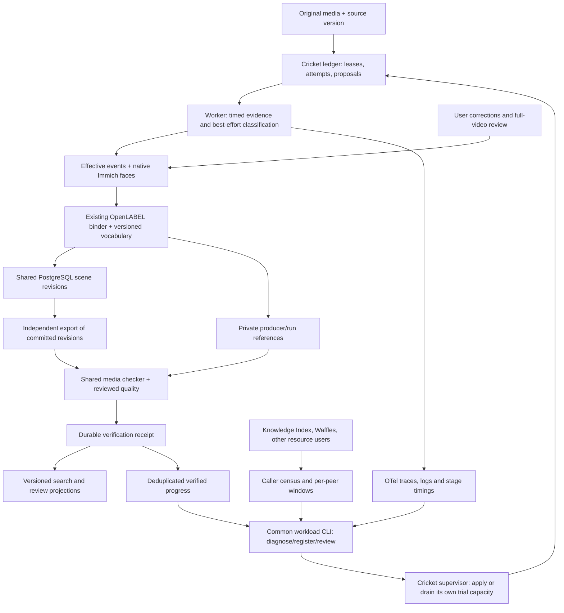
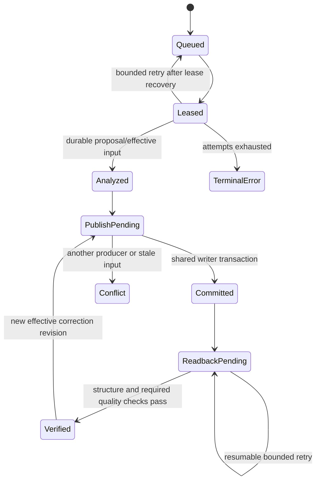

# Cricket on the shared-workload architecture

Date: 2026-11-27 (America/Los_Angeles). Design baseline:
[`b4a19672`](https://github.com/homeiac/home/tree/b4a19672cd37301206a5487c8f2e192c34f75bb7).

This design applies the [shared AI playbook](../methodology/distributed-ai-performance.md)
to cricket. The [implementation plan](../plans/cricket-shared-workload-implementation.md)
defines small PRs; the [checklist](../plans/cricket-shared-workload-checklist.md)
records completion and verification. Existing product behavior remains defined by
the [cricket feature plan](../plans/adil-cricket-highlights.md).

## Responsibilities and data flow

The diagram is the target integration, not a deployment claim. The common CLI,
checker, OpenLABEL adapter and synthetic PostgreSQL test already exist. Production
manifest generation, independent export, complete peer evidence and the capacity
actuator still require integration.

| Component | Authority and responsibility |
| --- | --- |
| Immich | Native asset, face-occurrence and person identifiers; originals remain intact |
| Cricket SQLite ledger | Operational leases, proposals, user corrections and publication input; never overwrite with a stale laptop copy |
| Shared OpenLABEL writer / PostgreSQL | Canonical saved annotations and append-only scene revisions |
| Readback checker | Structural evidence that referenced occurrences and relations exist in the committed revision |
| Reviewed cricket fixture | Semantic evidence about identity, outcome and interval; separate from structural validity |
| Search/GUI projections | Derived reads of verified generations; immediate review edits remain visible while publication catches up |
| Shared review CLI | Read-only diagnosis and fleet decision; successful command exit is not eligibility |
| Workload supervisor | Own dispatch counts, leases, draining, expiry, recovery and promotion |

Do not create a parallel face store or a second annotation writer. Another
producer's existing scene causes a publication conflict. Preserve it and reconcile
explicitly through the shared architecture; never replace the whole scene merely
because the cricket observations are newer.

## Job and publication lifecycle

Maintain separate states for analysis and publication. Analysis may complete while
face processing or readback is pending. A model response, an archived frame upload
and a successful schema check are not verified end-to-end completion.

P03 introduces a proposed publication outbox/receipt record in the operational
ledger, containing owner/album/source scope, source fingerprint, analysis version,
effective revision, producer/run identity, expected scene digest, committed scene
revision, evidence reference, verification state and bounded retry information.
Read the effective correction at a consistent ledger snapshot. Before committing
or promoting the read model, reject an obsolete source/effective revision.

The PostgreSQL write and SQLite receipt cannot be one transaction. Recovery must
look up the committed scene by its source/digest/revision and finish verification
without duplicating it. Identical retries use the shared writer's digest behavior.
A later correction creates a scene revision while preserving the action occurrence
ID. Dismissing a suggestion removes that action from the new effective scene,
retaining history. An actual cricket dismissal remains a saved delivery outcome.
Backups and rollback restore code/configuration, not old facts over newer edits.

## Identity, geometry and cricket meaning

Every returned native detection carries its real Immich face UUID, its optional
person UUID, original source and sampled-frame asset/timestamp. OpenLABEL object
UUIDs are occurrence references generated by the shared binder; they must never
be shown as invented native face IDs. An unnamed face remains individually
addressable. A detector miss is missing evidence, not a fabricated identity.

Frame indices identify ordered samples, not the original video's frame number.
Source-relative seconds and oriented image dimensions accompany each sample.
Face boxes use OpenLABEL pixel center-x, center-y, width, height. Preserve sampled
player coordinates and their evidence timestamp; do not imply continuous tracking
across a cut, occlusion or unsupported gap.

The featured-batter assumption is a user rule. Age at capture, a localized face,
nearby jersey clues and bounded continuity can support or contradict it. Bowling
identity requires its own evidence. A face-to-player actor relation requires an
unambiguous current association; a person assertion without that evidence remains
separate. Human edits override suggestions without changing Immich person labels.

Fours, sixes, unclear boundaries, dismissals, run-outs and attempted run-outs keep
separate stable vocabulary codes. Audio reactions and the aftermath support a
suggestion; an appeal alone does not establish a wicket. Continuing play supports
the attempted-run-out correction. Bowling wicket credit remains distinct from a
run-out during a bowling delivery. Clip bounds include the requested ten-second
lead-in, clamped to the original, and enough aftermath to review the outcome.

A successful no-event analysis needs a typed completion context so it can produce
a nonempty publication reference without manufacturing an action, person or face.
Its fields identify source/analysis version, stage completion and the no-event
reason. A pending detector must not be encoded as a completed negative. `cricket-2` adds `CRK.CTX.001` for this purpose; `cricket-1` remains accepted and
all prior action/outcome codes retain their meaning. Completion records contain
source/fingerprint, analysis version/digest, stage/state, result (`events_present`
or `no_event`) and reason. They require at least one sampled frame and completed
native detection on every recorded frame. Zero detected faces is valid; it does
not prove perfect face recall. The independent checker enforces this contract.
Legacy scene generation remains `cricket-1` unless supplied an explicit completion.
Run identity belongs in the publication manifest, so a retry in another run does
not manufacture a different canonical scene solely because its run ID changed.

## Run files and verification boundary

Reuse the [agent journey](../guides/shared-workload-agent.md) and the current
[reference schema](../../schemas/media-observation-reference.schema.json).

| Private run artifact | Required producer / content |
| --- | --- |
| `session.json` | Common intake: workload, run ID, media output kind, declared stages, resource graph and peers |
| `traces-and-logs.jsonl` | Closed OTLP capture with actual workload/run identity, host and stage spans |
| `metrics.jsonl`, `watermark-ns` | Closed counters/histograms and explicit cutoff |
| `prediction.json` | Immutable pre-change record; new bounded concurrency action required in P05 |
| `comparison.json` | Matched baseline/trial windows, census, budgets, quality and allocation evidence |
| `observations.jsonl` | Publisher manifest referencing committed typed occurrence revisions |
| `scene-readback.jsonl` | Independently queried PostgreSQL rows, not a copy of the proposed scene file |
| Owner receipt (new) | Actual applied allocation, verification/recovery result and promotion decision |

One comparison session/run ID covers its baseline, sealed intervention and trial.
Record phase-specific allocation revisions in private receipts and spans; exclude
only the registered knob from the fixed environment fingerprint. A reverse-order
repetition gets its own comparison session and a fresh baseline/prediction. A
changed model, cohort or peer mix invalidates the comparison rather than silently
changing its run context.

Each media reference has `contract_version`, `workload`, `run_id`, `album`, `asset`,
`revision`, `digest`, `vocabulary_release`, `collection`, `uid` and `evidence_ref`.
The referenced `workload` and `run_id` match the session and trace resource identity.
Readback includes the actual stored revision and digest. Check every typed relation
endpoint and deduplicate retry references. A separate reader/transaction queries
committed PostgreSQL state; the writer's return object is not independent readback.

Use the pinned schema accepted by `workload.py`, including its canonical digest
check. A matching version string alone is insufficient. The raw schema file hash
in older cricket notes and the CLI's canonical-JSON hash use different encodings;
do not compare them as if they were the same measurement.

## Telemetry and useful-work accounting

Follow the exact [field dictionary](../reference/workload-telemetry.md). The origin
is `service.name=cricket-indexer`; record `workload.run.id`, actual `host.name`,
nonzero OTLP IDs and declared `workload.stage.id`. Propagate W3C context through
queue/writer handoffs. A retry gets a fresh attempt span. Distributed runs retain
their causal context but export one-host diagnostic captures, as the current
checker requires. Do not relabel the caller host as the GPU host to satisfy it.

Measure queue, fetch/decode, model wait/execution, publish and verification
separately. A shared server's response time includes queueing and transport; do
not call all of it accelerator time. Mark direct accelerator children only when
the execution boundary is actually instrumented. Collect profiles/device samples
when a diagnosis needs them. Reuse the existing observability stack; local closed
files remain reproducible review inputs.

| Quantity | Boundary and deduplication |
| --- | --- |
| `workload.verified` | Integer `{item}` counter: one verified source/version/analysis completion at its owning stage/backend; persistent receipt prevents counting restart/retry twice |
| `completed_items` | Separate integer for the minimum-completion gate in each trial window |
| Comparison `verified` | Cricket source minutes (or a predeclared item unit), deduplicating original duration rather than summing overlapping clips/windows |
| Media checker reference count | Structural count of occurrence revisions; not videos processed or useful throughput |
| Corrected scene revisions | Separately report publication freshness and verification; do not inflate inference throughput by counting a relabel as a newly analyzed video |

Photo and video cohorts have separate size/difficulty buckets; do not improve a
video rate by substituting photos. Valid negatives can count once after their
completion context is verified. Cache reuse, benchmark replays and attempts remain
separate from unique production progress. The same successful source cannot count
again merely because a new run ID was assigned.

Frozen-cohort evaluations need separate receipts keyed by comparison, phase,
repetition and source/version, with evidence of fresh inference. Deduplicate retries
within that evaluation identity. Export evaluation counters into the private
comparison capture, never into the production completion series. They can count
fresh repeated evaluations for the ten-item gate while production counters continue
counting each original only once. Verify evaluation outputs with the same scene
contract, documenting reuse of an identical stored revision. A cache hit cannot
stand in for new inference. Compare peers using their real production deltas and
record the target's production rate too, so a benchmark cannot hide starvation of
its incumbent workers. Declare evaluation versus production units explicitly in
each comparison and never pool them.

The two common metrics are the monotonic item sum and the duration histogram in
seconds. Point labels are exactly `workload`, `stage_id`, `backend`; metric resource
attributes are limited to `service.name` and `host.name`. Trace/run/media IDs and
private evidence pointers stay out of metric labels. Preserve run-specific detail
in the private journal and traces.

## Shared capacity and supervision

Resolve both serving pools and their physical dependencies. Mac Bonsai callers
share Metal with direct Waffles processes. The registered pumped-piglet route
also exposes Frigate and Immich as possible peers. Extend the registry from live
inventory for affected CPU, decode, memory, I/O and publication pools; these routes
are planned work, not currently measured free capacity.

Compute the candidate ceiling from the tightest measured resource constraint
after baseline and scheduled-demand reservations. One four-slot server supplies
one shared allowance. Empty backlog, stale activity and no observed caller are
different states. Unknown clients join the census and must receive measurements.
No new capacity is eligible without complete affected-peer evidence.

P05 adds a bounded concurrency action with an immutable policy fingerprint,
scope, fixed cohort, ceiling, baseline/candidate/rollback allocations, deadlines,
sample minimum and sweep order. Current diagnosis only proposes ready-FIFO and
accelerator-co-tenant isolation interventions. Do not reuse either receipt for
worker scaling. Likewise, the caption controller's one-extra-lane policy does not
implement cricket's maximum-first sweep. The new contract registers an explicit
capacity experiment while retaining diagnostic evidence and all peer gates.

P06 introduces shared trial ownership. Proposed coordination uses an operational
PostgreSQL lease keyed by affected physical resource, an owner/run, fencing
generation, expiry and policy hash. Acquire the resource closure in a stable order
and atomically check all leases. Baseline work does not require a trial lease.
Every actuator competing for the same headroom must honor it before automatic
promotion is enabled; otherwise use an explicitly recorded single-operator trial
and hold on concurrent change. Do not assume an unmodified caption controller
already participates. DB time and fencing prevent a restarted stale owner from
promoting after another owner acquires the pool.

Only the cricket supervisor changes its own desired dispatch. At a claim boundary
it checks the current lease and policy generation. Existing leased requests finish
under bounded deadlines; lowering counts drains rather than discards their answers.
An expiry, restart, telemetry loss or resource-pressure gate restores last proven
dispatch. In-flight external requests cannot be reclaimed instantly: account for
their occupied slots until completion/timeout before admitting replacement work.

| Review result | Owner behavior |
| --- | --- |
| `observe_only` | Keep baseline; gather evidence |
| `hold` | Do not promote; if evidence was lost during an active canary, drain its extra work and verify recovery |
| `rollback` | Remove the trial allocation, preserve baseline and corrections, and verify peers recover |
| `eligible` | Complete repeat/order/quality checks, then persist the selected allocation; not automatic promotion |
| Input error/nonzero exit | Do not treat an invalid review as a successful trial |

After quality qualification, test the measured maximum shared allowance, descend
one pool at a time, then repeat eligible candidates in reverse order. Preserve
baseline allocations for cricket and peers; compare whole-workload progress, not
just a fast extra worker. Choose the fewest workers within 5% of the fastest
repeatable qualifying rate. Model/prompt changes require a new cohort/configuration
record and cannot be pooled with prior capacity measurements.

Apply the existing cricket gates: equal warmed windows of at least five minutes,
sampling gaps no longer than 15 seconds, ten durable completions per backlogged
indexing workload, matched demand/cohort/environment, preserved baselines, peer
throughput at least 90%, p95 growth at most 10% and no increase in terminal-error
rate. Tighter budgets remain binding. Use declared progress deadlines for long
jobs; insufficient comparable work is inconclusive. Service-only peers need a
declared measurable budget and supported contract; until then the affected pool
cannot pass admission. Re-census and requalify when workload mix or placement changes.

## Failure and rollout boundaries

Keep recognition and publication retries bounded and terminal failures inspectable.
Pending detection is not an identity result. A schema/readback failure retains the
last verified projection. A scene ownership conflict retains every prior accepted
fact. A changed effective correction invalidates an older publication candidate.
A capacity failure rolls back only the trial allocation, never the authoritative
ledger. Loss of telemetry blocks promotion and ends extra dispatch when needed.

Roll out in observation mode, then a private reviewed pilot, then the descending
capacity comparison, then a scoped versioned backfill. Use existing deployment
backups and Flux where applicable. Before reporting live completion, reconcile
ledger, manifest, PostgreSQL, readback, search generation and peer measurements for
the same run. Local tests and historical backfill totals do not satisfy that gate.
