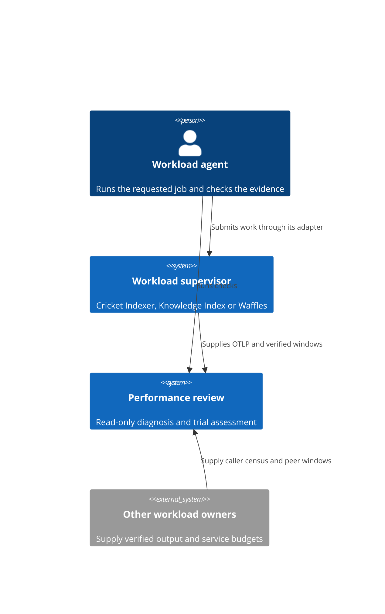
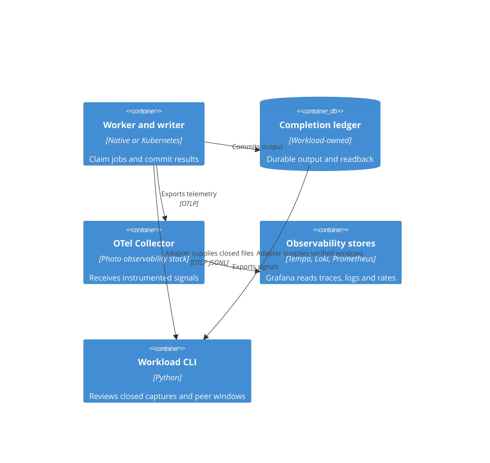
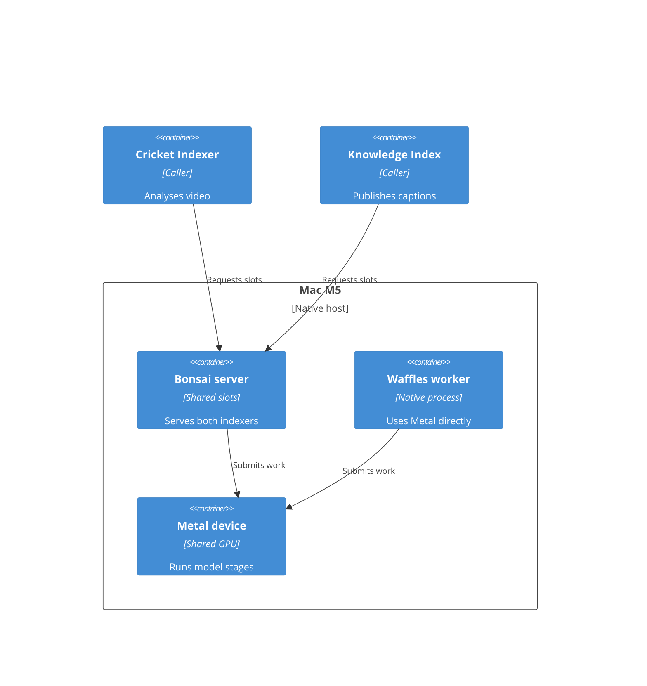

# Shared workloads in the homelab

## C4 context · who owns the change?

## C4 containers · where does evidence go?

## C4 deployment · who shares the hardware?

These are possible routes. The [registry](../../scripts/perf/shared-workloads.json) also covers pumped-piglet’s RTX and its Frigate and Immich peers. Determine activity from timestamped observations. A live snapshot covers aggregate activity; a matched trial also needs each affected caller’s quality and service measurements.

| Boundary | Runs today | Adapter work |
|---|---|---|
| Observe | Collector stack, Prometheus observer, OTLP file checks | Propagate caller identity and close windows per producer |
| Tune | Caption controller can add, recheck and remove one lane | Wire fleet review and resource coordination into each owner |
| Publish | OpenLABEL reference checker and PostgreSQL scene writer | Emit producer manifests for legacy outputs |

[Operating workflow](../methodology/distributed-ai-performance.md) · [Agent journey](../guides/shared-workload-agent.md) · [Media publication](media-workload-contract.md)
