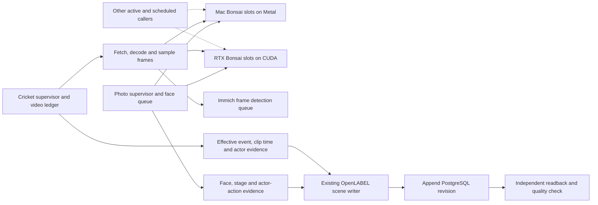

# Scaling family-photo observations alongside cricket

A family album should still tell you who did what after the cricket indexer starts analyzing matches. The scaling decision is how much work each backend can finish **and publish correctly** while every caller sharing that hardware keeps making progress. A free worker slot alone does not answer that question.

[Implementation plan](../plans/life-stage-action-scaling.md) · [Verification checklist](../experiments/life-stage-action/scaling-checklist.md) · [Distributed AI playbook used for this design](https://github.com/homeiac/home/blob/b4a19672cd37301206a5487c8f2e192c34f75bb7/docs/methodology/distributed-ai-performance.md)

## What we can reuse

The photo supervisor already coordinates Mac and RTX lanes against one SQLite checkpoint. Its work unit is a face occurrence in a photo. A lane claims it, saves intermediate results and records a disposition. The ledger distinguishes new completions, reused results, withheld observations and outstanding work. Preserve the current single supervisor and its restart lock. Keep SQLite local to that owner. Remote inference or CPU preparation can serve the owner without opening a second writer on a network share. End-to-end approval also requires reading back the published scene. [Worker](https://github.com/homeiac/home/blob/7256a36a9faed4cb0da4fe00b3ebcc09098eb1cc/scripts/knowledge-index/memory-acceptance/library_worker.py) · [Media publication contract](https://github.com/homeiac/home/blob/b4a19672cd37301206a5487c8f2e192c34f75bb7/docs/architecture/media-workload-contract.md)

The November 26 trial ran the same 12 marked faces four times per method on each backend. Ten faces had reviewed stages. These are benchmark completions and reviewed readings. Production publication has its own counter.

| Backend | Two calls → one call, faces/min | Stage and action both correct, out of 40 reviewed readings | Starting policy |
|---|---:|---:|---|
| Mac Metal, 4 lanes | 9.62 → 15.14 | 16 → 13 | Keep separate age and action calls. Only 45 of 48 joint attempts completed. |
| RTX 3070, 3 lanes | 14.04 → 21.53 | 17 → 24 | Keep one joint call where both fields are missing. All 48 attempts completed. |

Reuse valid partial work on either backend. Retain the reviewed cohort for regression testing and include new examples when coverage changes. Those lane counts establish the historical baseline. Available capacity when cricket arrives requires a fresh measurement. [Matched trial](../../scripts/knowledge-index/library-pass-comparison.json) · [Prior lane sweep](../../scripts/knowledge-index/library-backfill-tuning.json)

## Where the workloads meet

The lines show possible routes. Cricket records the exact source time for sampled video frames. Its dated identity evidence and human event corrections survive reanalysis. Preparation, Immich face detection and model inference can each saturate a different resource. A second Bonsai process on the Mac still shares one Metal device. Follow the RTX route through its VM to its physical GPU. Check host CPU, memory, disk, network and downstream write capacity on both routes. Consider still-fawn for bounded preview or decode work only after a trace identifies that stage and a matched trial demonstrates a gain. [Cricket runbook](https://github.com/homeiac/home/blob/b4a19672cd37301206a5487c8f2e192c34f75bb7/docs/runbooks/cricket-highlights.md) · [Resource map](https://github.com/homeiac/home/blob/b4a19672cd37301206a5487c8f2e192c34f75bb7/scripts/perf/shared-workloads.json)

## What counts as progress

| Workload | Scheduling and backlog | Outcome used to qualify a capacity change |
|---|---|---|
| Life stage and action | Distinct native face occurrences pending, running, newly completed, reused or withheld. Record retries and oldest ready age separately. | Unique expected face observations resolved in independently read-back scene revisions per minute, with actor/action quality checked on reviewed faces. Multiple faces can belong to one scene. Report reused and withheld separately. |
| Cricket video | Eligible source minutes, overlapping analysis windows, uploads waiting for Immich detection and events awaiting publication. | Unique source minutes covered per minute, counting overlapping intervals once. Report effective events published and read back separately. Preserve native face IDs, time offsets and correction precedence. |
| Other callers | Active and scheduled demand on the same physical resource, including baseline allocations. | Each caller’s own durable output or service budget. For example, completed face detection and progress in the caption queue. Track timeliness and errors for interactive services. |

Carry trace context from enqueue through claim, fetch/decode, inference, commit, publication and readback. Give each retry a fresh attempt span. Use run manifests to map a private face ID or event to its asset, revision, digest, occurrence and relation endpoints. Count the same accepted occurrence/version once across retries. Foreign scene ownership halts publication for that asset until explicitly composed. Keep the previous valid revision readable. Verify a corrected identity on the album surface as well as in PostgreSQL. Keep names, IDs, dates from photos and trace IDs out of metric labels. [Field dictionary](https://github.com/homeiac/home/blob/b4a19672cd37301206a5487c8f2e192c34f75bb7/docs/reference/workload-telemetry.md)

## How to investigate a slowdown

Start with a drop in durable completions on a closed window for one backend. Compare successful claim latency, source fetch, preview/decode, inference and publication. If claim time dominates, inspect the query plan for the actual claim inside its transaction and measure lock waits. An index on the queue alone does not prove that claim is cheap. If inference dominates, check the device with and without the measured competing load while protecting baseline work. If the ledger advances but readback stalls, follow writer and database spans before allocating another GPU lane. Seal the prediction and its failure condition before changing anything. [Diagnosis rules and evidence](https://github.com/homeiac/home/blob/b4a19672cd37301206a5487c8f2e192c34f75bb7/scripts/perf/otel-diagnosis.md)

## Who can change capacity

Use the existing workload CLI for intake, diagnosis and review. The photo and cricket supervisors retain their queues and apply their own changes. Designate one trial owner per shared pool and record its expiry and rollback allocation. The current resource registry groups callers under knowledge indexing, and the reviewer applies several strict sampling gates only to the cricket subject. Explicitly register photo life-stage/action, expose its output counters and exercise the same gates for either subject before a shared promotion. [Reviewer](https://github.com/homeiac/home/blob/b4a19672cd37301206a5487c8f2e192c34f75bb7/scripts/perf/shared_workloads.py) · [CLI and evidence files](https://github.com/homeiac/home/blob/b4a19672cd37301206a5487c8f2e192c34f75bb7/docs/guides/shared-workload-agent.md)

Freeze the input mix and record current, proposed and rollback allocations. Reserve baseline and scheduled peer demand first. Start the trial at the highest **measured remaining allowance** on one pool and step down only the trial increment. Repeat qualifying settings in reverse order. A new cricket arrival, backend change or external controller change invalidates that comparison. Take a new baseline under the new mix.

| Decision | Owner action |
|---|---|
| Observe only | Capture current production and its traces. |
| Hold | Leave proven capacity in place. Recover missing evidence, stale peers or incomparable cohorts. |
| Roll back | Drain the trial increment. Preserve in-flight claims, corrections and checkpoints. Verify baseline peer recovery. |
| Eligible | Repeat on matched inputs and inspect reviewed output. Persist the fewest lanes within 5% of the fastest repeatable qualifying rate, scoped to this workload mix. |

In Grafana, reuse the per-backend before/after layout. Put Mac and RTX rates, pass mode and lanes next to queue age, withheld/errors, peer budgets and the trial decision. Separate observed production, matched benchmark and independently published outcomes. Annotate cricket arrival and rollback on the time axis. A sprint is verified only after its dashboard panel is checked against the same time window and ledger. [Dashboard generator](../../scripts/knowledge-index/gen-dashboard.py) · [Shared tuning thresholds](https://github.com/homeiac/home/blob/b4a19672cd37301206a5487c8f2e192c34f75bb7/docs/runbooks/shared-indexer-tuning.md)
