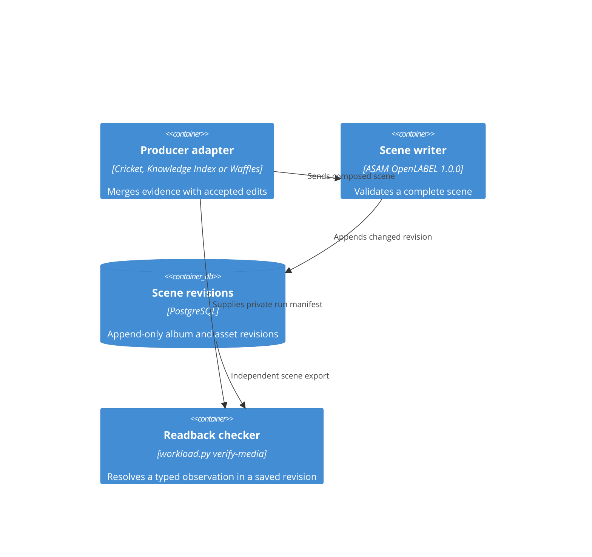

# Media workload contract

## Publication and readback

| What is being identified? | Key |
|---|---|
| Producer execution | OTel `service.name` and `workload.run.id` match manifest `workload` and `run_id` |
| Saved scene | `album`, `asset`, `revision`, `digest` |
| Occurrence | `collection`, `uid` within the scene |
| Meaning and evidence | `vocabulary_release`, private `evidence_ref`, workload-specific review |

OpenLABEL describes objects, actions, contexts and typed relations. Marken supplies the stable annotation identity and revision-history pattern. Correcting who batted keeps the action occurrence ID and appends a scene revision with the corrected participant. Preserve other producers’ accepted observations on that asset. A structural readback verifies the saved occurrence; the quality review verifies who batted. [Schema](../../schemas/media-observation-reference.schema.json) · [Repo ontology and writer design](https://github.com/homeiac/home/blob/7256a36a9faed4cb0da4fe00b3ebcc09098eb1cc/docs/architecture/photo-memory-ontology.md)

**Cricket publication.** The adapter validates effective events and native face checkpoints using the shared life-stage binder, validator and PostgreSQL writer. It refuses to overwrite another producer’s scene. Preserve the native face ID independently of person identity, sampled-frame pixels and exact source seconds. An ungrounded actor remains withheld; pending detection stays pending. Local validation and PostgreSQL publication are separate operations. [Cricket adapter and validation commands](../runbooks/cricket-highlights.md#openlabel-publication-adapter)

## Workload-neutral evidence boundary

The [shared adapter contract](../reference/workload-adapter-contract.md) reuses this
media checker; it does not replace native face IDs, stable occurrences, corrections
or PostgreSQL scene authority. Queue checkpoints and benchmark responses are not
canonical annotation readback. The generic native-output route rejects OpenLABEL
scenes and cannot be used as a weaker media verifier. Nonmedia adapters retain
their own schemas/stores; performance receipts and derived search/UI projections
remain evidence/projections, not another canonical content store.

Capacity finish-time accounting is a separate source-unit join. A count of scene
revisions cannot prove new reviewed source minutes or new unique faces. Missing
that accounting bridge keeps capacity review on hold even when scene validation
and peer budgets pass. No new media publication is performed by the shared tools.
