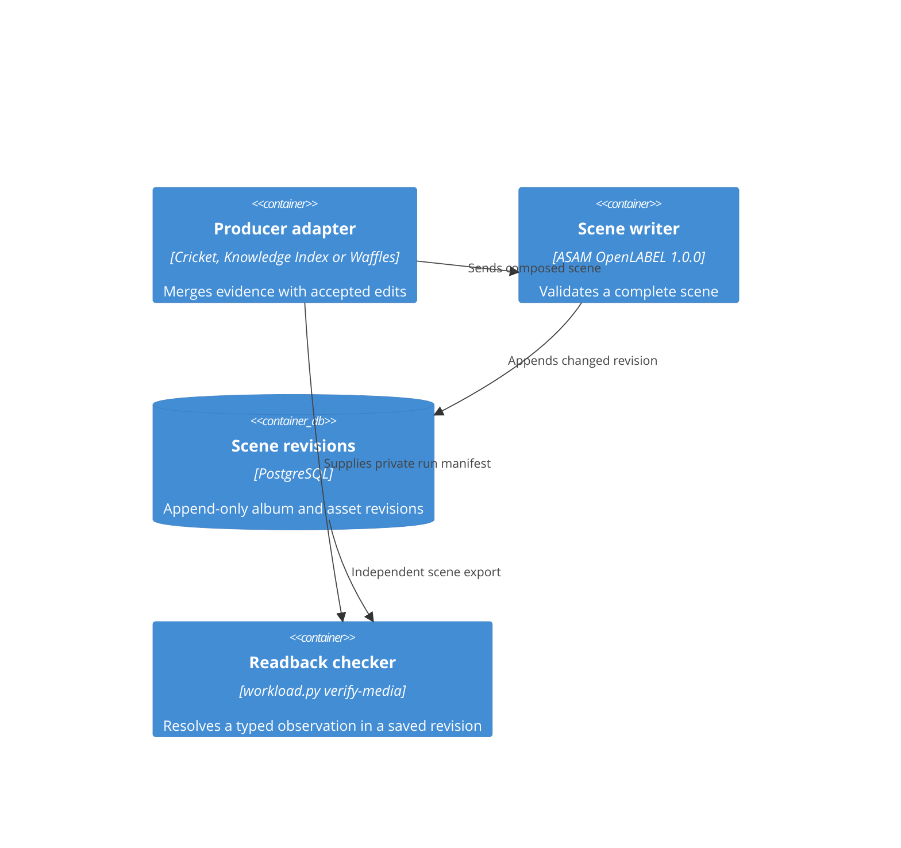

# Media workload contract

## Publication and readback

| What is being identified? | Key |
|---|---|
| Producer execution | OTel `service.name` and `workload.run.id` match manifest `workload` and `run_id` |
| Saved scene | `album`, `asset`, `revision`, `digest` |
| Occurrence | `collection`, `uid` within the scene |
| Meaning and evidence | `vocabulary_release`, private `evidence_ref`, workload-specific review |

OpenLABEL describes objects, actions, contexts and typed relations. Marken supplies the stable annotation identity and revision-history pattern. Correcting who batted keeps the action occurrence ID and appends a scene revision with the corrected participant. Preserve other producers’ accepted observations on that asset. A structural readback verifies the saved occurrence; the quality review verifies who batted. [Schema](../../schemas/media-observation-reference.schema.json) · [Repo ontology and writer design](https://github.com/homeiac/home/blob/7256a36a9faed4cb0da4fe00b3ebcc09098eb1cc/docs/architecture/photo-memory-ontology.md)

**Cricket publication.** The adapter validates effective events and native face checkpoints using the shared life-stage binder, validator and PostgreSQL writer. It refuses to overwrite another producer’s scene. Preserve the native face ID independently of person identity, sampled-frame pixels and exact source seconds. An ungrounded actor remains withheld; pending detection stays pending. Local validation and PostgreSQL publication are separate operations. [Cricket adapter and validation commands](https://github.com/homeiac/home/blob/d5eeda7bca28d238d828d120c38339f7846a6ede/docs/runbooks/cricket-highlights.md#openlabel-publication-adapter)
