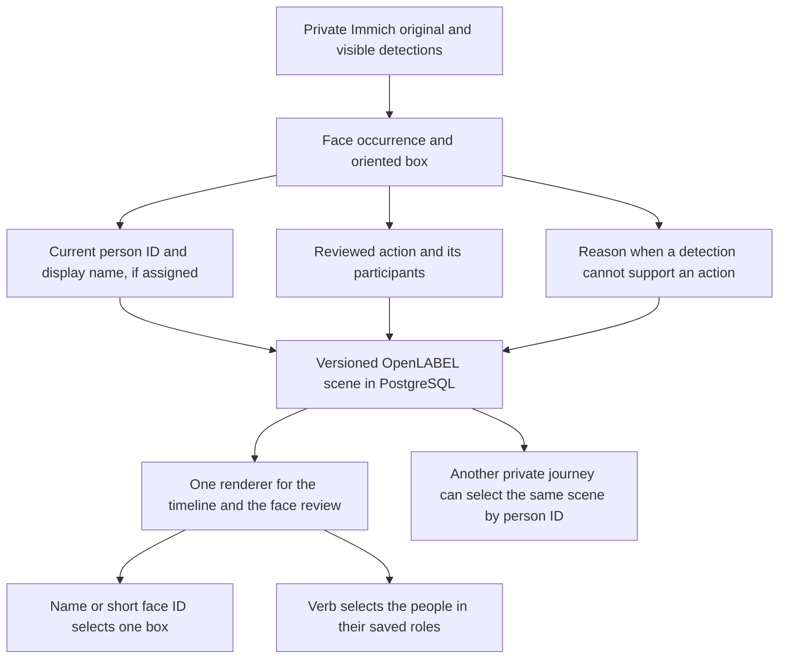
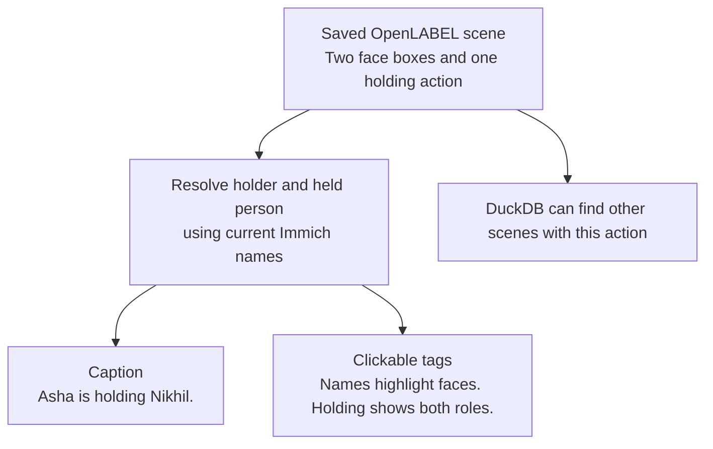
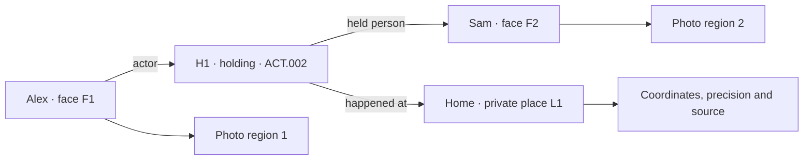
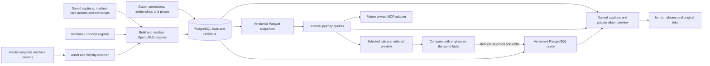
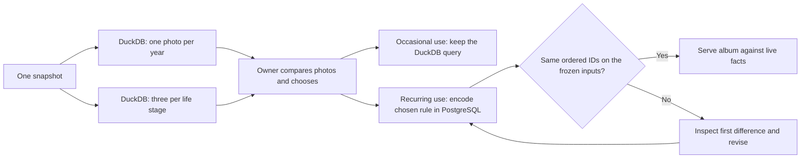
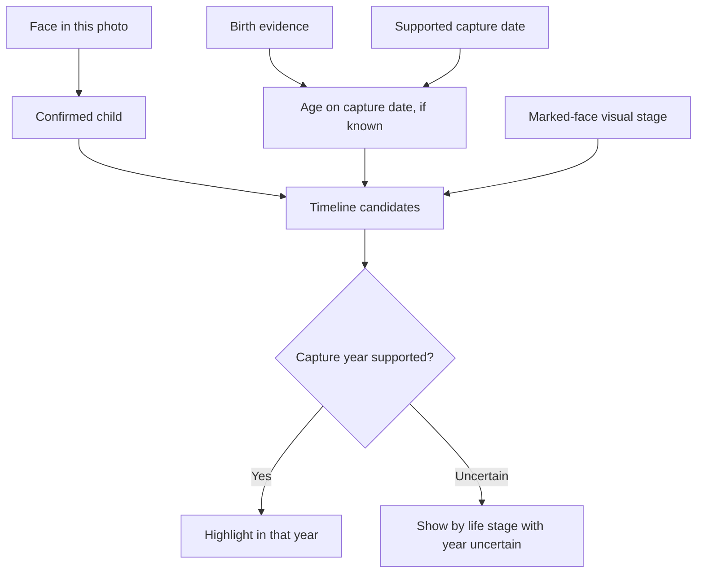
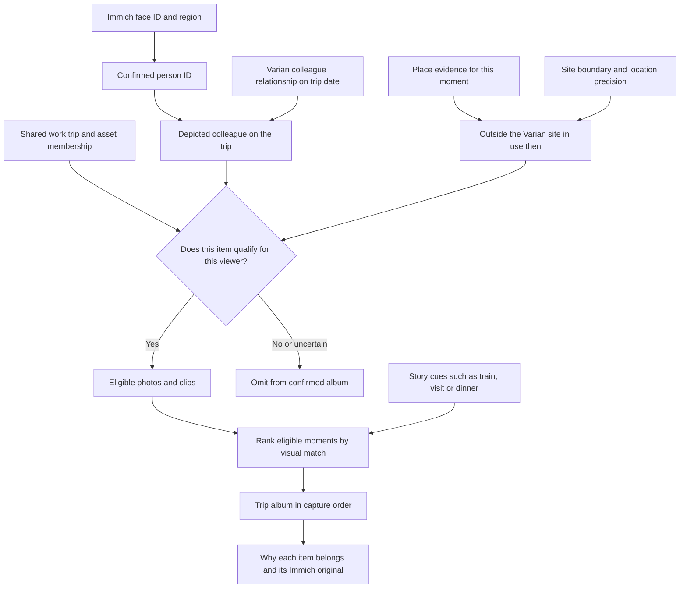
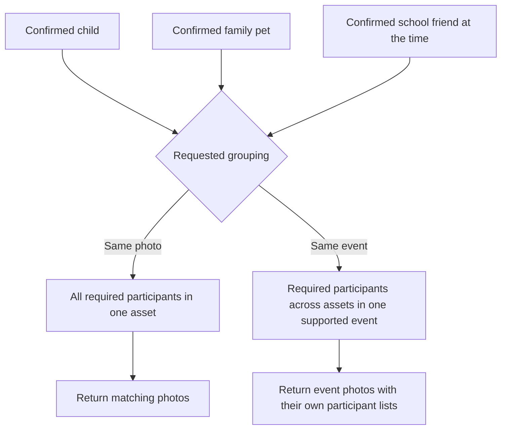
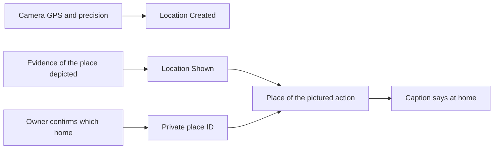

# Photo memory ontology architecture

Architecture and rollout status · November 26, 2026 · [Photo memory epic #228](https://github.com/homeiac/home/issues/228)

**Schema decision.** Use ASAM OpenLABEL 1.0.0 for saved photo and video scene annotations. It defines objects, geometry, actions and relations and lets us supply vocabulary for the meanings our albums need. [ASAM standard and JSON schema](https://openlabel.asam.net/V1-0-0/)

Give every reusable concept a stable code, and save each observation as a coded fact with evidence. A face ID identifies one face in one asset. A person ID connects that face to an identity over time. An action code says what the actor is doing. The album uses all three to write a sentence such as “Alex stands in a room with toys,” and a journey query can find the same photo by identity, activity, life stage or event. Renaming Alex changes the sentence without rerunning vision.

## What the approved journey proves

On November 26 the owner accepted the growing-up album as the reference for family journey cards. In one photo an unnamed woman in red holds a child on a sofa. Selecting her caption tag reveals her Immich face ID and outlines her face. Selecting *holds* outlines both her and the child, with a separate role for each. Another family journey can reuse that observation even if its subject is the holder.

**What shipped.** The source album has 88 assets. Its chronological view shows 83 photos. Five collage originals have their own catalogue with 46 component photos. Each component has a polygon in the oriented original, its verified faces and any supported actions. A collage file date can be correct while its component photos depict several years.

**What counts as coverage.** The 51 multi-person journey cards contained 195 native face detections. Forty-eight cards had an action for every detection. Three showed a reason beside the affected face links. The four exceptions were two detections of the same baby, a face in a framed picture and a face on an advertisement. This count measures detections; one photo can have several boxes for the same person. Only aggregate counts and timings go to Grafana.

**Where the reader sees it.** Both private HTML views render the same stored facts and link to the Immich original. Names in those files reflect the last publication. Refreshing the source snapshot and republishing resolves new names. Live name propagation, new native Immich description writes and full-library rollout each need separate evidence. [Publisher](../../scripts/knowledge-index/memory-acceptance/review_openlabel.py) · [Browser check](../../scripts/knowledge-index/memory-acceptance/check_openlabel_review.mjs)

## What the platform should answer

| Request | What the system must establish |
|---|---|
| Show my eldest son growing up | Confirmed identity across years, age or life stage with its basis, and a representative timeline across the available years |
| Show my colleagues traveling outside our site | Colleague relationships valid at event time, evidence of work travel, and location outside the relevant site's boundary |
| Show my son, our dog and his school friends | The particular people and pet, explicit friend relationships, and whether they must all appear in the same photo or across a supported event |

These queries use ordinary names and language. Codes make the facts consistent across models, libraries and consumers. See the [platform goals and definition of done](../plans/photo-memory-platform.md).

## How Marken and OpenLABEL fit together

OpenLABEL defines what we save. For “Asha is holding Nikhil,” one scene contains two person objects with face boxes, one holding action and two links saying who holds and who is held. PostgreSQL keeps the scene and its revision. Netflix’s Marken provides a precedent for retaining correction history. [ASAM OpenLABEL](https://www.asam.net/standards/detail/openlabel/) · [Netflix Marken](https://netflixtechblog.com/scalable-annotation-service-marken-f5ba9266d428)

The album is the first consumer of this schema. New actions, life stages and scene roles use vocabulary terms inside the same structure. Cross-photo facts such as employment dates, person aliases and access permissions live in their existing private tables. The first slice can deliver named captions and clickable tags without building a separate file exporter.

## What a word in the caption points to

In the synthetic caption “Alex is holding Sam at home,” each meaningful phrase links to a source record. The verb carries both readable text and a code.

| Phrase | Reference in this caption revision | What a reader can inspect |
|---|---|---|
| Alex | F1 → person P1 | The face box on this image and the current confirmed name |
| holding | Observation H1 → concept ACT.002 | Saved wording “holding”, normalized sense “hold a person in one's arms”, actor F1 and held person F2 |
| Sam | F2 → person P2 | A separate face box on the same image |
| at home | H1 → place L1 | Owner-confirmed place label and authorized GPS evidence if available |

Store caption text, revision and typed spans alongside the structured observation. Use the observation ID for this occurrence and the concept code for retrieval across photos. Rendering a new name regenerates span offsets against the new text. Use the oriented source image's dimensions and pixel coordinates for boxes; record the coordinate convention. Link “at home” only when place evidence supports the label. Camera GPS, the depicted location and the event location can differ. Authorize precise coordinates independently.

**How other formats fit.** OpenLABEL is the write contract for scenes. SKOS describes the vocabulary. Web Annotation selectors can identify words in the rendered caption. IPTC/XMP supplies fields when sending descriptions to photo apps. These serve different readers of the same facts. [OpenLABEL specification](https://www.asam.net/fileadmin/Standards/OpenLABEL/ASAM_OpenLABEL_BS_V1-0-0.html) · [SKOS](https://www.w3.org/TR/skos-reference/) · [Web Annotation](https://www.w3.org/TR/annotation-model/) · [IPTC Photo Metadata](https://iptc.org/standards/photo-metadata/iptc-standard/)

**Research precedents.** Visual Genome records relationships between boxes using a subject, predicate and object. Flickr30k Entities links phrases in captions to image regions. Together they illustrate both halves of the design. Our private identity directory and correction history supply continuity across photos. [Visual Genome schema](https://visualgenome.org/api/v0/api_readme) · [Flickr30k Entities paper](https://openaccess.thecvf.com/content_iccv_2015/papers/Plummer_Flickr30k_Entities_Collecting_ICCV_2015_paper.pdf)

**Acceptance example.** Select “holding” and assert the saved text, concept code, occurrence ID and actor/held bindings. Swap the roles in a negative fixture and require the test to fail. Rename either person and verify the revised text offsets still select the right words. Read both boxes back from the saved OpenLABEL scene and verify alignment on the oriented image. A share without GPS access must omit the coordinate value from the serialized payload.

## Design

- **Concept registry in Git.** Stable code, facet, definition, preferred label, synonyms, allowed roles, broader codes, status and replacement metadata. Use immutable codes, with separate display labels and hierarchy edges. Publish a versioned registry alongside validators and fixture changes. A label edit or hierarchy move keeps the code. A split or meaning change introduces new codes and records the migration. Historical observations retain their original registry version.
- **Facts and corrections in PostgreSQL.** Extend the existing enrichment write side for concurrency, uniqueness, corrections and revisions. The current private SQLite album ledger is an import source for the first slice. Keep existing captions, transcripts and model responses as evidence. Treat a coded observation and its human-readable rendering as separate records.
- **Parquet and DuckDB for reading.** Export versioned snapshots with a manifest and publish them atomically. DuckDB can join facts, broaden codes through a concept closure table, group by time and build a journey without a separate graph service. Export dirty partitions only where measured volume justifies it. Revisit a graph database if measured multi-hop workloads exceed an agreed latency budget or the relational graph becomes materially harder to maintain.
- **Immich for viewing.** Link to originals and publish managed private albums through the existing adapter. Keep the existing rules for native captions, dates and face labels. Test the actual description surface each app reads. The first slice exposes our named captions in the private review, with Immich for originals and album membership.
- **MCP as a future read adapter.** Apply an explicit per-caller share policy before selecting results. Return the allowed evidence, date precision and scoped links. Relationships, exact coordinates, faces, transcripts and originals require separate share permissions, with private defaults. Scope selection, aggregation and explanation to authorized facts.

## From exploration to a live album

DuckDB reads the private Parquet snapshot while the owner experiments. The unit promoted is a **selection rule** with typed parameters, ordering and a version. Its preview supplies the expected ordered asset IDs. PostgreSQL serves frequently used rules against current authorized facts. The original manifest and rule version let the owner reproduce the earlier preview.

See the [design contract](../plans/photo-memory-ontology-design.md#promoting-an-explored-query) for how to compare equivalent inputs, handle ties and test a correction.

## Identity, semantics and rendering

An asset ID identifies the catalogue item. An observed face uses a namespaced source ID such as `immich:<face-uuid>` or `photo-index:<face-id>`. Where both refer to the same detection target, an explicit crosswalk records the matching evidence. Never infer a crosswalk from shared names. A visible face currently resolves through its confirmed person link. Subject bindings may change after relabels, merges, splits or rejection. Prior revisions remain auditable. A deleted face invalidates its current binding until it can be verified again. Documentary evidence may name a person without proving which visible face is theirs.

An action is an observation with typed roles. In “Alex holds Sam,” the actor and recipient have separate evidence-backed links. A second action in the same photo gets a separate observation. An asset-level scene can say that children play where the specific child cannot be established. A nearby person, face tag, painting or collage panel cannot supply an actor by association. Keep a panel or clip reference where known. Age from a trusted capture date and confirmed birth year is a derived fact. Visual life stage is an independent observation and can disagree. Preserve whether a date is a capture date, file date, event date or candidate.

Compose findings from a few reusable facets. For example, use the action *stand*, a room setting, and separately captured clothing detail. Preserve relevant descriptive detail where supported. Keep people, places, organizations and pets as private entities rather than registry entries. Represent confirmed relationships with validity dates and evidence. “Work trip” requires explicit event evidence plus a supported site and colleague connection. GPS alone establishes neither purpose nor relationship.

The model proposes codes from a constrained catalogue and returns opaque face references provided by the worker. It may abstain or return uncoded detail. A validator checks allowed roles, namespace, scope, evidence and effective revisions before accepting a fact. A deterministic formatter resolves the current display name through the actor binding and fills a template. An LLM may summarize evidence for a longer story while citations and eligibility remain determined by the underlying facts.

## Precedents

### What to borrow from Netflix and Disney

| Published design | What carries over to a private album |
|---|---|
| Netflix’s *Building In-Video Search* describes how editors find shots across titles using ordinary phrases. Its *Clips* workflow keeps the source title and timecodes when editors assemble a reel. | Search for moments such as “boarding a train” within an eligible trip. Keep each highlight linked to its original photo or video time range. [Netflix in-video search](https://netflixtechblog.com/building-in-video-search-936766f0017c) · [Netflix Clips and editing workflow](https://netflixtechblog.medium.com/from-weeks-to-seconds-building-mega-assets-to-uncover-joyful-moments-b3cedcf37ffc) |
| Disney and Avid made Marvel’s editorial archive searchable from the editor’s workspace. The library preserves the relationship between a subclip and its source when an editor reuses it. | A photo can appear in several journeys under the same asset ID. An album entry leads back to the Immich original, even when the story uses just one moment from a video. [MovieLabs case study on the Marvel editorial library, pp. 3–4](https://movielabs.com/prodtech/case-studies/MovieLabs_Disney_Case_Study.pdf) |

**Marken decision.** Adopt Netflix’s pattern of giving an annotation its own ID, revision, typed target and optional region or time range. Netflix published a design for an internal service with a custom schema language. We retain revision and evidence links around the validated OpenLABEL scene. A marked face answers *who appears here?* Employment dates, trip membership and a site boundary answer *does this moment belong in the album?* Those facts need their own evidence and access rules. [Netflix Marken schema and architecture](https://netflixtechblog.com/scalable-annotation-service-marken-f5ba9266d428) · [Local field mapping and acceptance cases](../plans/photo-memory-ontology-design.md#how-marken-maps-to-our-records)

Borrow the separation between saved facts, search and analytics. Netflix used Cassandra, Elasticsearch and Iceberg for roughly 1.9 billion annotations at the time of publication. For this library, PostgreSQL owns the facts and corrections, DuckDB explores Parquet snapshots, and visual ranking can be rebuilt from saved evidence. Consider a dedicated search service when measurements on representative trips show a specific latency or retrieval-quality gap. [Netflix Marken storage, search and scale](https://netflixtechblog.com/scalable-annotation-service-marken-f5ba9266d428)

ICD-11 illustrates stable concept identifiers and composing coded detail. SKOS supplies useful conventions for preferred labels, synonyms, broader concepts and mappings. The photo registry borrows these design ideas and uses its own vocabulary and roles. [WHO ICD-11 reference guide](https://icdcdn.who.int/icd11referenceguide/en/html/01.02.04_general-features-of-icd11.html) · [W3C SKOS reference](https://www.w3.org/TR/skos-reference/)

See the [first-slice design and executable contract](../plans/photo-memory-ontology-design.md) for the source schema, migration and acceptance boundaries.

## Which parts can another photo app read?

OpenLABEL defines how to describe a scene with objects, actions and relationships. It also ships a standard tag set for driving scenarios. For personal and work albums, use existing terms where their meaning fits and publish the additional terms as a small versioned vocabulary. For example, `ACT.002` is our proposed code for physically holding someone. [ASAM OpenLABEL scope and starter set](https://www.asam.net/standards/detail/openlabel/)

| Reader or task | What to send | Adoption and limits |
|---|---|---|
| Immich, Lightroom or a photo editor | Readable caption and supported location fields in XMP | IPTC has broad photographic adoption. Individual fields vary by application. Verify the target app can read a field after export. [IPTC software support](https://iptc.org/standards/photo-metadata/software-support/) · [Immich XMP field matrix](https://docs.immich.app/features/xmp-sidecars/) |
| A scene annotation tool | OpenLABEL objects, regions and relationships with our vocabulary reference | Specialized vision tooling implements this format. The consumer needs the vocabulary to interpret the specific action code. [OpenLABEL specification](https://www.asam.net/fileadmin/Standards/OpenLABEL/ASAM_OpenLABEL_BS_V1-0-0.html) · [Vicomtech implementation](https://github.com/Vicomtech/video-content-description-VCD) |
| Our clickable caption | A link from each meaningful phrase to its face, action occurrence or place | Web Annotation selectors identify a text span or an image region. Our application resolves those targets to private records. [W3C Web Annotation](https://www.w3.org/TR/annotation-model/) |
| A journey query | Standard concept mappings plus private evidence | Schema.org supplies the colleague relationship. We supply the organization, people and dates required to answer the actual question. IPTC also has an age field for model-release workflows. Our album needs an age or life stage grounded to each depicted person. [Schema.org colleague](https://schema.org/colleague) · [IPTC field definitions](https://www.iptc.org/std/photometadata/documentation/userguide/) |

## How three different albums follow from the same facts

### A child growing up

Build the timeline from the same person's confirmed appearances. Other people in a group portrait have their own ages. If only the birth year and capture year are known, use the age reached during that year or a range. A photo from before the birthday can show a younger age.

### Colleagues traveling outside their work site

“Show me an album of my Varian colleagues when we traveled outside our site.” Imagine a station photo, a customer visit and a team dinner. An owner-confirmed trip record places the owner and colleagues on the same work trip. The owner can be behind the camera. For this people-focused album, each selected photo or clip must show at least one confirmed colleague who traveled on that trip.

A dinner on a personal vacation can look exactly like a dinner on a work trip. The shared work event, dated relationship and off-site place establish eligibility. Search ranks the eligible moments for the story. Where visual scores are missing, eligible items remain available in capture order. If the location uncertainty crosses the site boundary, the item stays out of the confirmed album. Each included item can explain which colleague, trip and place evidence qualified it, within the viewer’s permissions.

### A child, their dog and school friends

Keep a private identity for the particular pet. Require a confirmed friend relationship for the period. Showing up in a class photo establishes presence. It cannot by itself establish friendship.

## Which location does “at home” mean?

GPS is optional. A confirmed house in an old photo can support “at home.” A photo of a framed holiday picture taken inside that house can have different capture and depicted locations. For a collage, qualify the place by panel when evidence allows it. An authorized reader may see the label while coordinates stay private. [IPTC guidance on locations created and shown](https://www.iptc.org/std/photometadata/documentation/userguide/)
