# I Tried to Stop Paying Google for Storage. My Photos Were 4× Bigger Than My Bill Said.

**Date:** 2026-11-15 · **Updated:** 2026-11-16
**Tags:** google-photos, google-drive, onedrive, takeout, rclone, zfs, k3s, homelab, backup, self-hosting

> **Bottom line:** I copied all of my Google Photos, Drive and OneDrive onto my homelab, kept more than one
> copy, checked them, and then deleted the first **24 GB** from Google (**89.5 → 65.4 GB** used). Getting
> under Google's free 15 GB, so the $1.99/month plan can go, needs about 50 GB more. It took a weekend,
> disks I already owned, and it knocked my Kubernetes cluster over three times. This post is the map so
> you can skip the potholes.
>
> **Honest part first:** the saving is **$24 a year**. Do this for ownership and a backup you control,
> not for the money.

## How to read this post

This post is written top-down. Stop after any level and you still have the right idea.

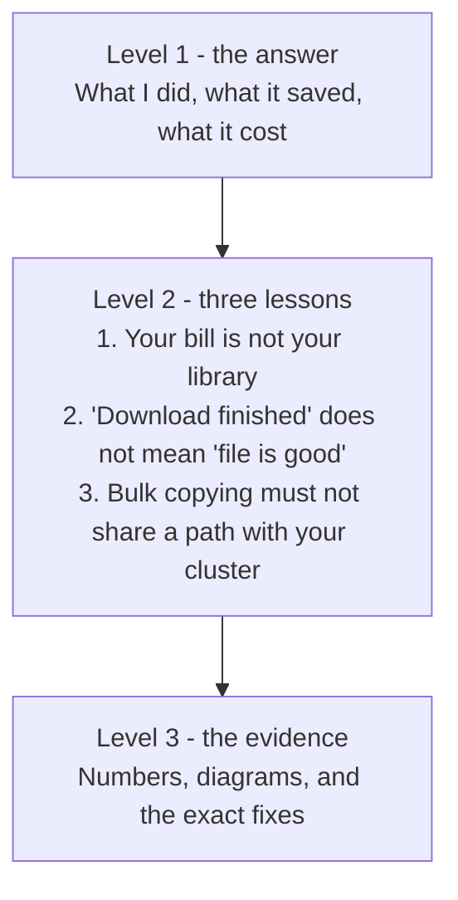

## Level 1 - the answer

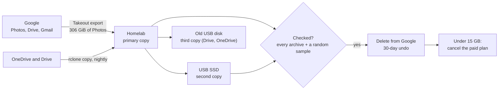

| | Before | Now |
|---|---|---|
| Google storage used | 89.5 GB of 100 GB | **65.4 GB** |
| Google Photos | 70.5 GB | **46.4 GB** |
| Photos safely at home | 0 | **all 306 GiB, 249,841 files** |
| Copies of the part I deleted | 1 (Google) | **3** (Google trash for 30 days, homelab, SSD) |
| Still to do for the free tier | - | about **50 GB** more |

## Level 2 - three lessons

### 1. Your bill is not your library

Google said Photos used **70.5 GB**. The export was **306 GB**. Photos uploaded in "High quality" before
June 2021 are free and never counted, but they are still exported. So **deleting old photos frees
nothing**. Only the part that counts is worth deleting, and that part needs a verified copy first.

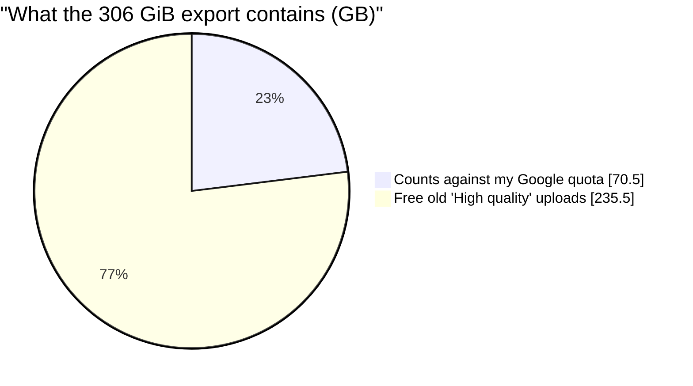

### 2. "Download finished" does not mean "the file is good"

Two of the eight big download files were **silently broken**: the right size, but with stretches of
zeros where data should be. The browser said "complete". Only unpacking them showed the damage. I fixed
both by re-fetching **44 MB** instead of re-downloading **104 GB**. Details in Part 5.

### 3. Bulk copying must not share a path with your cluster

Copying files to a slow USB disk made my Kubernetes node's database (on a *different*, fast disk) stall,
and the node dropped out three times. I first blamed the wrong thing. The real cause and the one-line
fix (cap the copy speed at what the slow disk can really do) are in Part 4.

## Level 3 - the evidence

### The setup in one picture

Aliases only; the real hostnames are in my private notes.

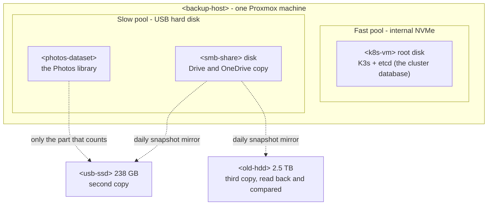

| Alias | What it is | Role |
|---|---|---|
| `<backup-host>` | Proxmox host, internal NVMe pool + a USB hard-disk pool | runs everything |
| `<k8s-vm>` | K3s VM; root disk on NVMe, a second disk on the USB pool | the cluster |
| `<smb-share>` | Samba in K3s | primary copy of Drive/OneDrive |
| `<photos-dataset>` | A ZFS dataset on the host's USB pool | primary copy of Photos |
| `<usb-ssd>` | 238 GB exFAT SSD | second copy, unplug-able |
| `<old-hdd>` | Old 2.5 TB disk with bad sectors | third copy, every file re-read and compared |

### Plain-English glossary

| Word | Meaning here |
|---|---|
| **Takeout** | Google's "download your data" tool. For Photos it is the only way to get an existing library. |
| **rclone** | A command-line tool that copies files to and from cloud drives. |
| **ZFS / zvol** | The host's filesystem; a *zvol* is a virtual disk made out of it. |
| **etcd** | The small database that holds the state of a Kubernetes cluster. It needs fast writes. |
| **fsync** | "Really write this to disk, and wait." etcd does it on every change. |

### Part 1 - Measure before you design anything

My bill said "89 GB". The breakdown said:

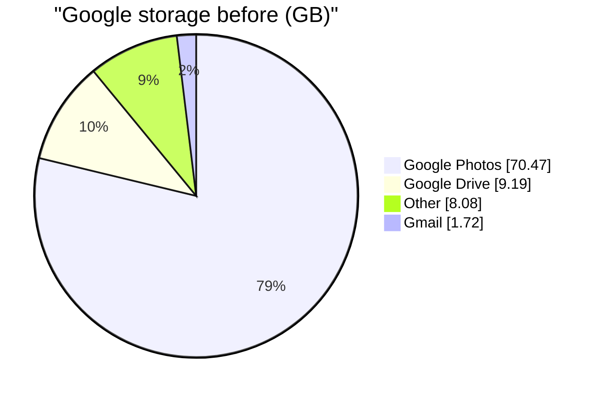

Drive, the thing every rclone tutorial is about, was **10%** of the problem. Photos was the problem.
Had I not measured, I would have built a lovely Drive pipeline and freed 9 GB. OneDrive was on the free
plan (4.2 of 5 GB), so there was nothing to reclaim there at all.

### Part 2 - Drive and OneDrive: the "easy" part (it was not)

A Kubernetes CronJob runs `rclone copy` every night, never `sync`, so a file that disappears in the cloud
stays in the backup. Changed files keep their old version in `.versions/<date>/`.

1. **23,650 files, 7.8 GB, 23 files a minute.** Drive's API is slow with small files. Four parallel
   transfers would take 17 hours; 16 with a shorter pause between API calls ran at **185 files a minute**.
2. **Two Google Docs had 700-970 character names** (chat prompts saved as titles). Linux allows 255
   bytes, so rclone failed them every night until I renamed them.
3. **rclone's shared Google sign-in is being retired.** Use your own Google Cloud project and a Desktop
   OAuth client. Leave the app in **"Testing"** and Google expires the sign-in every **7 days**, so the
   nightly backup silently dies weekly. "Publish app" stays greyed out until the branding page has a home
   page, a privacy link, and an authorized domain.
4. **OneDrive's interactive setup loops forever** on some accounts because it picks the **Personal
   Vault**, which the API cannot open. Ask Microsoft Graph for `/me/drive` and set the drive ID yourself.
   (The Vault stays un-backed-up; it needs a manual export.)
5. **OneNote notebooks are silently skipped** (0.7 GB). `--onedrive-expose-onenote-files` fixes it.

### Part 3 - Google Photos: there is no API anymore

Since **March 31, 2025** the Photos Library API only shows apps the photos *they* uploaded. rclone and
every other tool cannot read an existing library. **Takeout is the only complete route.**

Takeout can drop the export into Drive, but that spends cloud space you are trying to free. The other
option is download links, which normally means your laptop downloads 300 GB. My trick: a **browser that
lives in the homelab**.

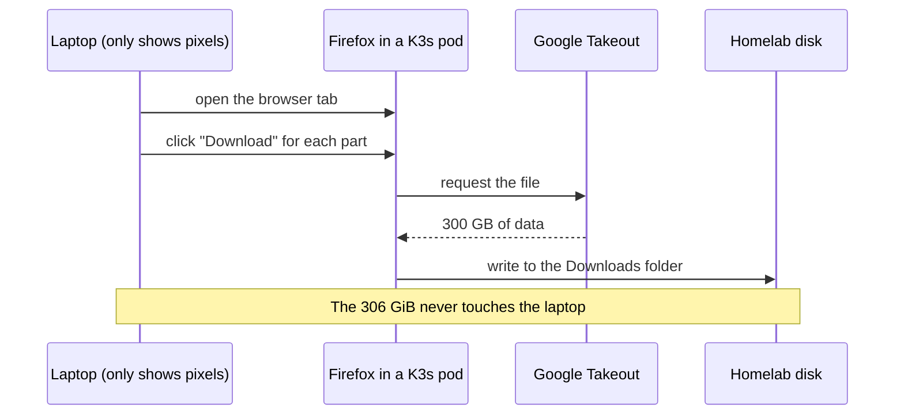

#### How I pick "the 70 GB" automatically

Every photo in the export has a small `.json` sidecar file. Its `creationTime` is when the photo was
**uploaded**, and anything uploaded on or after **2021-06-01** counts against the quota.

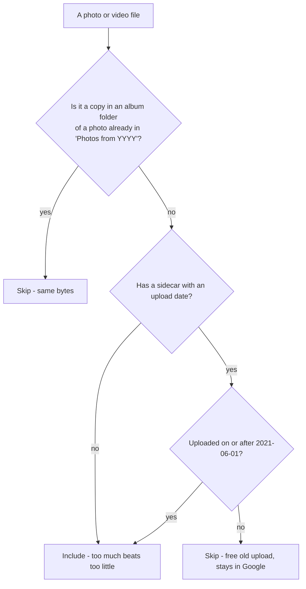

The matching has quirks: Takeout truncates sidecar names, numbers duplicates as `IMG(1).jpg` ↔
`IMG.jpg.supplemental-metadata(1).json`, and shares one sidecar with `-edited` copies. A photo and its
sidecar can even land in different archives. The first run of this rule took **38 minutes** just to read
the 120,000 sidecars from the USB disk, which is why I wrote [a plan to index them once](https://github.com/homeiac/home/issues/212).

### Part 4 - How copying files knocked over a Kubernetes cluster

This is the part I most want you to avoid.

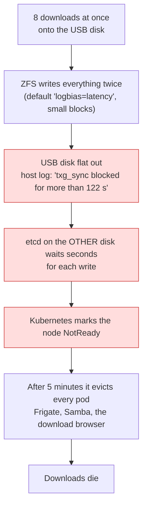

**First round of fixes (real, but not the whole story):**

1. `zfs set logbias=throughput <volume>`: large sync writes go straight to their final place instead of
   being written twice. Same durability, live, reversible.
2. Limit the USB disk to **20%** of the VM's pool of not-yet-flushed data (`bdi/max_ratio`), so it can't
   make every other writer wait.
3. The browser pod now tolerates a NotReady node for an hour, not 5 minutes, and has no CPU or memory limits.
4. Downloads land on the **NVMe** disk, not the USB one.

That helped, but the node kept dropping when I unpacked the archives. **The proof of a wrong diagnosis
came from measuring.** I wrote a tiny test: on the fast disk, "write 4 KB and flush" in a loop, while a
second process streams data to the slow disk.

| Test (fast-disk flush time while the slow disk is written) | typical worst 1% | worst single |
|---|---|---|
| Nothing else running | 2 ms | 2 ms |
| Slow disk busy | **4,240 ms** | **13.9 s** |
| After I gave each disk its own controller (my theory) | 4,336 ms | 11.6 s |
| Bypassing the VM's cache entirely | still stalled | 9.5 s |

My "shared controller" theory was **wrong**: it changed nothing. Sampling the host while the test ran
showed what was really happening:

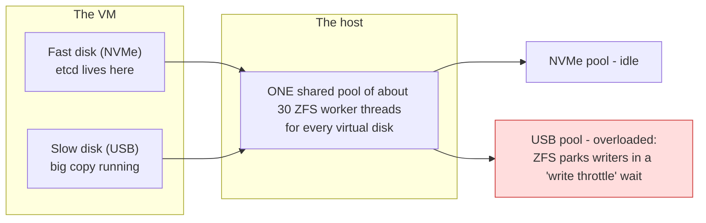

Up to **23 of 31** worker threads were stuck in the write-throttle wait. The virtual fast disk's requests
queued behind them. The VM was writing about **140 MB/s** into the host's cache; the USB disk absorbs
about **40**. The cache filled, ZFS started parking writers, and the fast disk paid for the slow one.

**The fix is one setting:** cap that virtual disk's write speed at what the USB disk can really do.

```
qm set <vm> --scsi1 <disk>,mbps_wr=35,mbps_wr_max=35   # applied live, no reboot
```

Result: the typical worst 1% fell from **4,240 ms to 5.2 ms**. One 12.6 s hiccup remains in 305 samples
(probably the USB disk itself pausing), so this is a big mitigation, **not** a guarantee. The
long-term fix is to keep bulk data off a ZFS-volume disk altogether: a normal dataset on the host,
shared into the VM.

**Three more things that hurt me the same weekend:**

- **A scheduled Proxmox backup froze the VM's filesystem** to snapshot it, which killed the guest agent
  and wedged etcd until I hard-restarted the VM. The backup job is paused until the big data disk is excluded.
- **I "suspended" a CronJob with kubectl.** Flux (GitOps) put it back, and it restarted an old job that
  loaded the VM all over again. **Pause things in git, not in the cluster.**
- **Do the unpacking on the host**, straight into a ZFS dataset, not inside the VM at all. That ended the outages.

### Part 5 - The two archives that were silently broken

When I unpacked the 8 archives on the host, two failed with `invalid compressed data` after a few minutes,
at the same place every time.

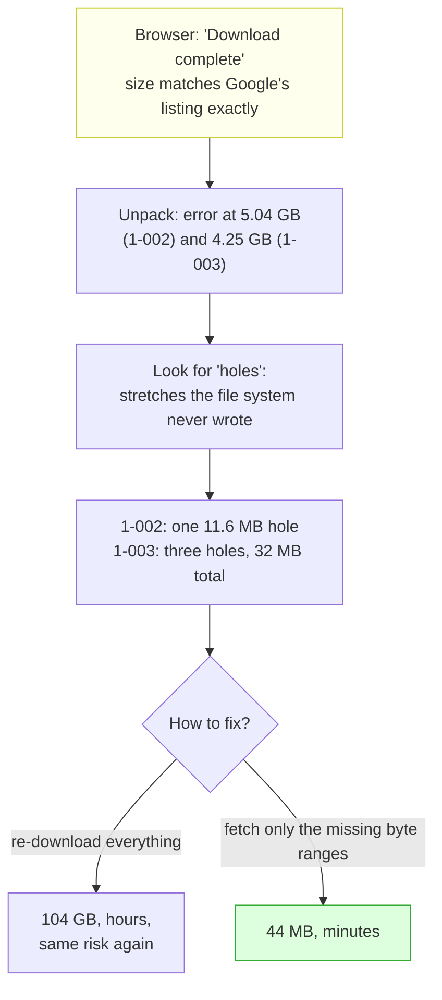

During the stalls the browser had written zeros over parts of the files. **A matching size proves
nothing.** I checked the other six archives for the same holes (none) and then repaired the two with
HTTP "Range" requests: ask Google for just bytes 5,041,553,408 to 5,053,145,088 of that file.

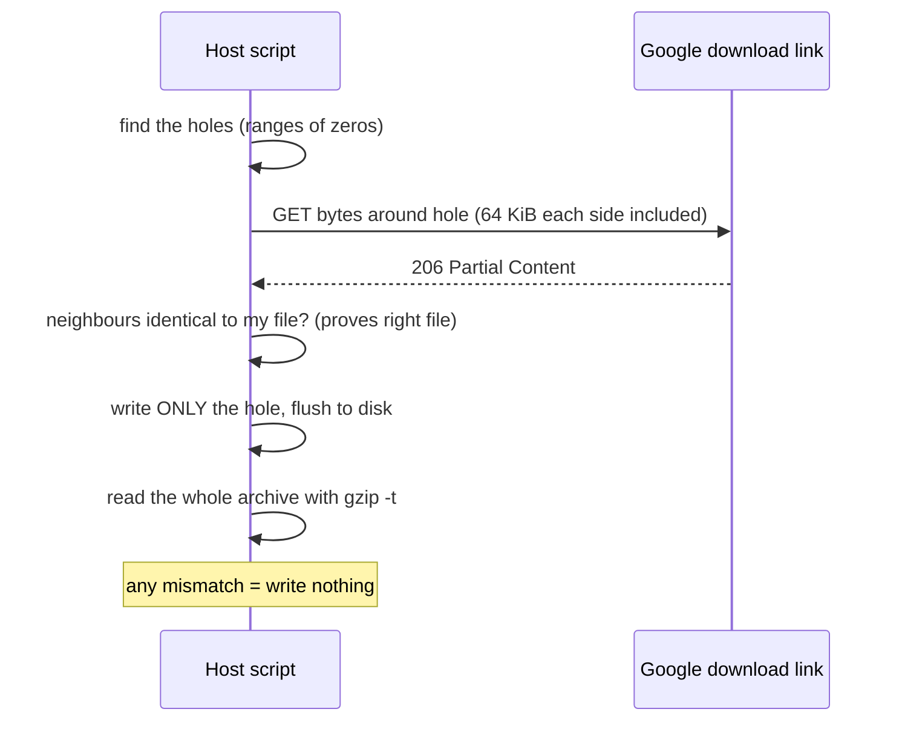

The link came from my browser (the one step I did by hand, so my login never went through a script), and
the script deleted it when it finished. After the repair, every archive passed a full read, and the
numbers reconcile exactly:

| Check | Result |
|---|---|
| Archives unpacked | 8 of 8 |
| Files in the library | 243,088 |
| Older versions kept (a later archive replaced the same path) | 6,753 |
| Sum | **249,841 = what the archives held** |
| Photos and videos | 118,987, from 1972 to 2026 |

### Part 6 - "Is the second copy good?" Sampling, honestly

I wanted to know the USB SSD copy was intact before deleting anything. Reading all 18,264 files back takes
about four times longer than a sample, so I used a random, year-by-year sample.

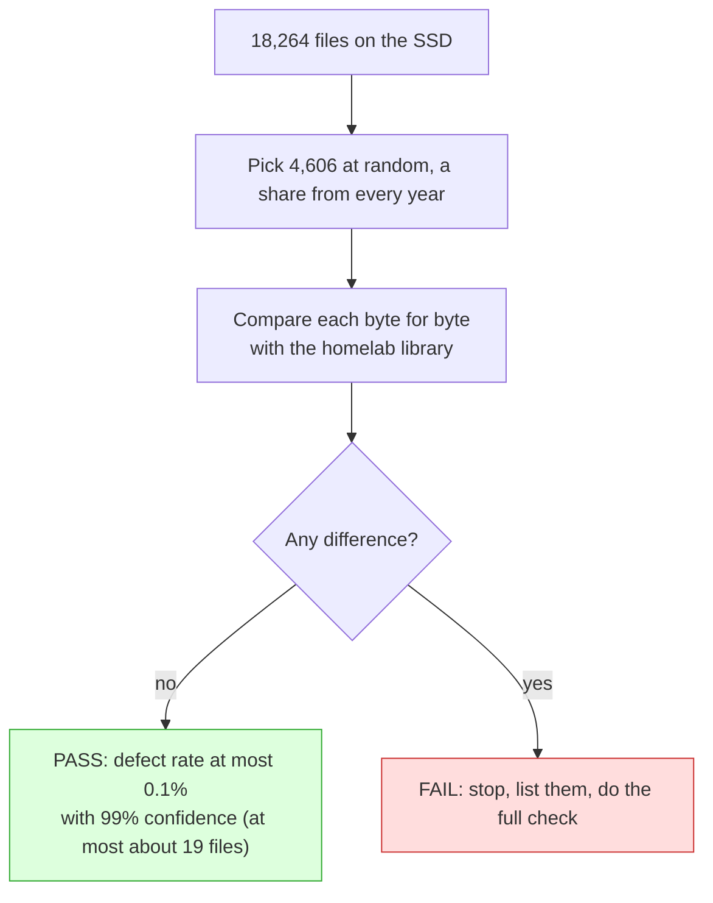

**Result: 4,606 of 4,606 identical.** I should be straight about what this is *not*: it is not "six
sigma". To show fewer than 3.4 bad files per million with 95% confidence you would need about **880,000**
samples, more files than exist. A sample can bound the defect rate; only a full read can prove zero. For
this decision it is enough, because the main library was already read in full when each archive was unpacked.
A photo is only lost if **both** copies are bad.

### Part 7 - The first deletion

Google's own page tells you what a delete will free, so I deleted by *year taken*, one clean date range
at a time, starting with the one that frees the most (2023: 1,680 items).

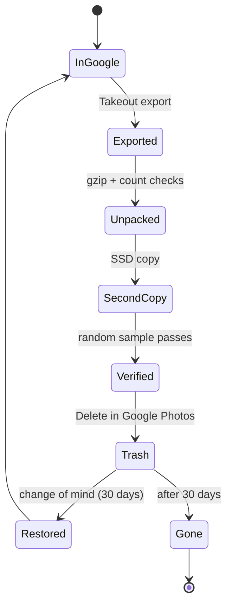

What I learned doing it:

- **Don't select from the search box.** Searching "2023" mixes date matches with "most relevant" picks.
  The date groups are exact: select the last day, scroll to the first, shift-click, and check that the
  count matches. (Eight "relevant" items sneaked into my selection; I deselected them.)
- **Google tells you what it will free** ("You will recover 25.8 GB"). I used that as a cross-check
  against my own library numbers (26.5 GB for the same year).
- **Don't empty the trash.** Google stopped counting the items the moment they were trashed (89.5 → 65.4 GB),
  so emptying only removes your 30-day undo.
- **Turn off Google Photos backup on your phone** first, or it may upload the copies still on the phone
  and refill what you just freed.

### Part 8 - The staircase to the free tier

The free tier is 15 GB. After all the Photos that count are gone, Drive (9.2 GB), "Other" (8.1 GB) and
Gmail (1.7 GB) still add up to about **19 GB**, so a few GB of Drive and "Other" have to go too.

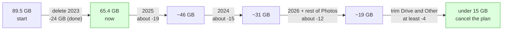

### The weekend

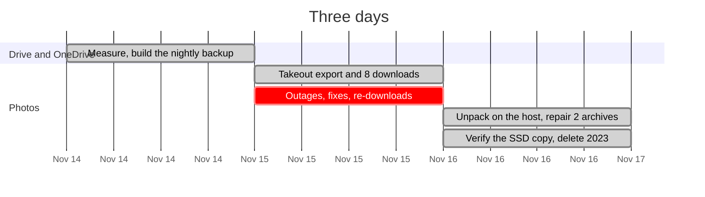

### Should you do this?

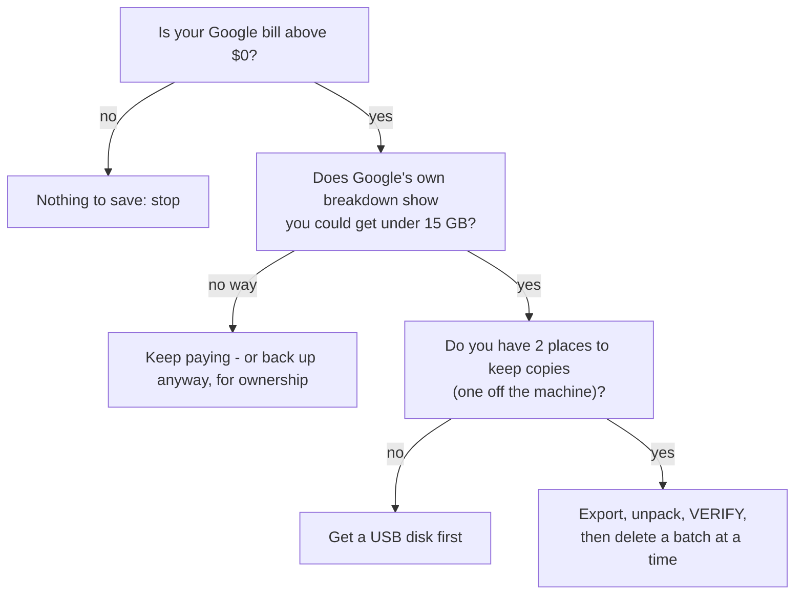

## What I'd tell you before you start

1. **Measure Google's breakdown first**, then export Photos and look at the real size.
2. **Old "High quality" photos are free.** Back them up, but deleting them saves nothing.
3. **Use your own OAuth client, in production.** "Testing" mode breaks your backup every 7 days.
4. **Don't trust "download complete".** Read every archive end to end (gzip test) and look for holes.
5. **Never run bulk copies on a disk path your cluster shares.** Cap the copy speed at the slow disk's
   real speed, and do heavy unpacking on the host.
6. **Pause things in git, not in the cluster** (or GitOps puts them back).
7. **Delete in batches, by date, and only what is verified in two places.** Leave the trash alone.
8. **Plan your secrets' escape hatch.** All of this runs on keys; see
   [The Key That Unlocks Everything](2026-11-15-the-key-that-unlocks-everything.md).

## What's next

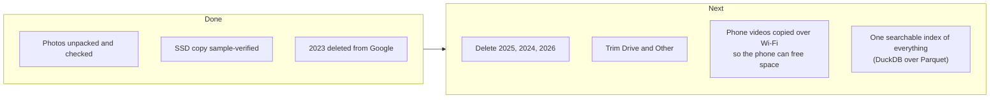

The index is the next big win: right now "which photos count against Google?" costs 38 minutes of
reading small files. Indexed once at ingest, it becomes a query that answers in seconds, and it
turns "is it safe to delete this?" into a database join. The plan is in
[issue #212](https://github.com/homeiac/home/issues/212).

---

*Companion posts:* the Drive/OneDrive build guide
([Delete From the Cloud Without Fear](2026-11-15-taking-my-files-back-from-google-and-onedrive.md); its
Photos steps are superseded by this post), the cluster outage the same weekend
([My K3s Cluster Restarted 1,200 Times](2026-11-15-k3s-restart-loop-ipv6-loopback.md)), and
[The Key That Unlocks Everything](2026-11-15-the-key-that-unlocks-everything.md).
