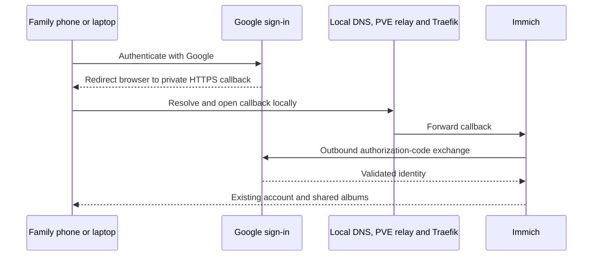
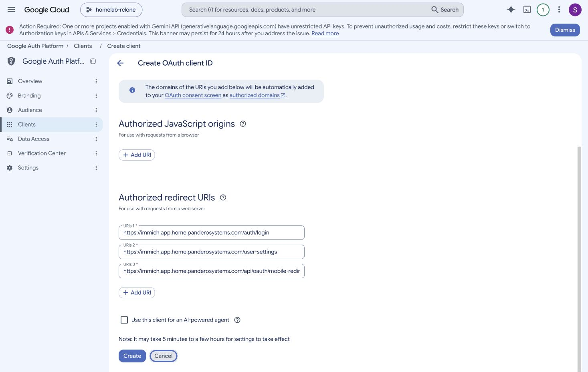
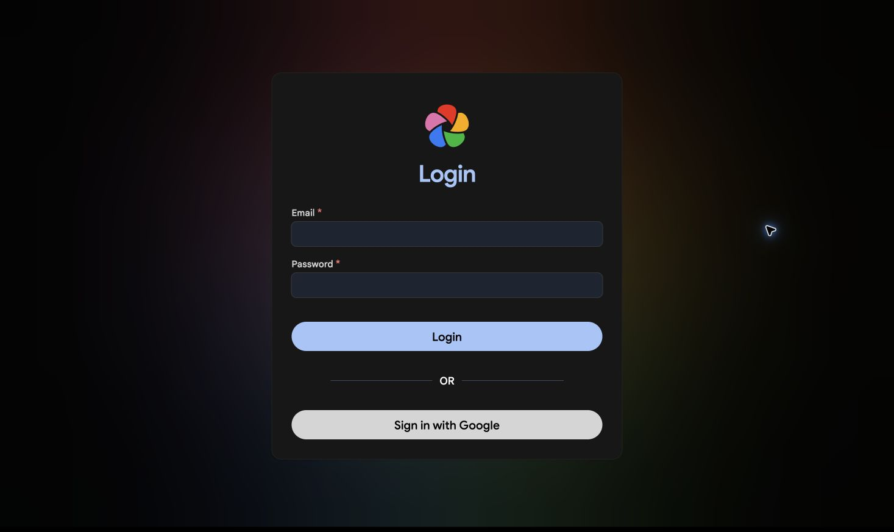

# A private photo platform for life, family and work stories

*Final results checked November 25, 2026, 10:31 a.m. Pacific. [Animated ten-slide presentation](local-photo-pipeline-slides.html) · [Measurements and screenshot provenance](assets/local-photo-pipeline/evidence.md).*

A map can show where a trip happened. A richer memory layer can help follow a child's interests across years, connect family gatherings in different homes, or trace a work journey across places and dates. **A platform for assembling those stories is the main value of this project.**

Immich is the gallery and a source of saved people/place context; a separate API sync preserves catalogue enrichment back into Immich custom metadata. The added layer makes **local descriptions**, confirmed names, dates, saved metadata and useful video speech available together in queryable datasets. A story can follow a person, activity or topic across the library rather than stop at one GPS-marked trip. The evidence remains attached to the source files, and uncertain speech can be left out instead of becoming an invented memory.

The initial indexing and enrichment work is now complete within the agreed scope: **85,889 photo groups have local descriptions, and 6,909 video groups have a saved story.** That supplies the material for cross-library narrative analysis. A dedicated automatic journey writer, knowledge graph and MCP interface have not been built; these are possible ways to use the completed data layer next.

Google's storage warning provided a practical reason to preserve and inventory the archive. Local backups and faster search are useful outcomes too. But the lasting benefit is being able to ask what happened across a period of life, then use saved evidence to build and check the answer.

| Value | Delivered result | Boundary |
|---|---|---|
| Reduce cloud-storage pressure | A local archive and inventory to check before reclaiming Google space | No measured decrease in Google quota is claimed |
| Keep local backups | Preserved originals/sidecars, versions and a separate USB copy workflow | Current USB policy covers a subset of Photos; it does not prove two complete copies or an off-site backup |
| Tell life, family and work stories | Queryable descriptions, people/date metadata and reliable video speech across years and places | Story synthesis must cite and check evidence; a dedicated automatic journey interface remains future work |
| Learn what improves the pipeline | Measured saved-output rates, portable Parquet and a Git-controlled tuning loop | GPU noise, model requests and completed files are different measurements |

## The finish line: useful coverage, with exceptions visible

The final read-only audit at **10:31 a.m. Pacific on November 25** found 118,987 media file paths in the catalogue. Album-folder copies inflate path counts. The coverage calculation maps copies using filename and size; it is **not content-hash deduplication**, and distinct year-folder entries are retained.

| Stage | Final result |
|---|---:|
| Photos described locally by RTX/Mac | **85,889 / 85,890 groups — 99.999%** |
| Videos described locally by RTX/Mac | **6,885 / 6,914 groups — 99.58%** |
| Videos with a visual description, including 24 cloud fallbacks | **6,909 / 6,914 groups — 99.93%** |
| Audio checked and story saved for captioned videos | **6,909 / 6,909 — 100%** |
| Current text reconciliations | **77,463 complete; 220 deliberately skipped; none queued** |
| Critical conflicts among completed reconciliations | **0** |
| Duplicate rows in the final video-story snapshot / repeated successful audio jobs | **0 / 0** |

The six source exceptions are one malformed PNG and five videos with missing or zero-filled content. They were diagnosed rather than given invented captions. Their originals remain unchanged, and leaving them out was accepted.

The local pipeline aims for **one successful visual description per item**. It saves that result and skips it on later scans. Failed requests may retry; a video story may add useful speech without repeating vision. A later explicit model/prompt upgrade would be a separate operation, not a routine second local pass.

For ordinary search and recall, we accepted local captions as the useful baseline. Their quality was assessed informally, not through a scored whole-library audit. Optional cloud comparisons and reconciliation are additional evidence; they are not requirements for calling the local archive useful.

## The end architecture


The storage host owns Takeout extraction and indexing. Drive and OneDrive use the existing Kubernetes `rclone copy` job into the backup area; Google Photos arrives through Takeout archives with JSON sidecars. Validation and atomic publication keep incomplete archives out of the visible library. Each ingested unit produces Parquet facts. Replaying a unit replaces its output instead of adding duplicate rows.

Immich reads the originals through a read-only external mount. Its saved metadata, places and named faces become caption context instead of being rediscovered for each request. The context exporter matches source path and file size, skips ambiguous matches, and preserves provenance. Optional cached place references can help; a cache miss proceeds without blocking the caption queue. Immich edits live in its database, so backing up originals alone does not preserve those edits. [Immich external-library documentation](https://docs.immich.app/features/libraries/).

PostgreSQL owns the photo application's jobs, leases, human labels and rejections. Published Parquet snapshots support DuckDB browsing and analysis. Recent PostgreSQL edits overlay those snapshots immediately: a refresh must never resurrect a rejected name.

Piglet owns caption inputs and durable outputs. Local capacity comes from RTX/Ollama plus an optional Mac/Metal worker. An optional Luna submitter on always-on still-fawn uses a shared reservation/accounting ledger and publishes into its own Parquet dataset. **This optional route sends images or video frames and context to a cloud service.** Local archival and captioning remain usable without it. Separate model outputs make comparisons explicit. Video audio is a separate resumable stage: Whisper on the Mac and spare CPU capacity produces timestamped speech; the story worker reuses the saved visual description. Difficult text interpretation and malformed/truncated local responses with usable evidence can use the authorized Luna/Codex route. That route sends selected transcripts and short saved descriptions, not fresh media.

Applications stay behind private Traefik access. Kubernetes resources use Git/Flux; host workers use versioned installers and systemd. Some components still use the feature branch's Flux preview: implemented architecture does not mean every rollout change has merged to main.

## Immich integration: a familiar gallery and reusable context

Immich is the everyday front door to the preserved archive. It reads originals through an external library, supplies dates and GPS/place browsing, and performs its own thumbnail, face, OCR and search processing. The integration reuses that work instead of treating Immich and the memory platform as disconnected systems.

| Direction | What moves | What it means |
|---|---|---|
| Originals → Immich | Read-only external-library files | The gallery uses the preserved archive; the pipeline does not rewrite originals |
| Immich → platform | Saved city/state/country, visible named people and face boxes | A private snapshot refreshes every 30 minutes; path/size matching skips ambiguous files |
| Platform → Immich | Existing catalogue captions, model provenance, tags, location/group context and prior face labels | A resumable API worker preserves these in the owned custom metadata record `home.knowledge-index.v1` |
| Platform → journey analysis | Local captions joined with people/date/place context and useful speech | A reusable evidence layer for questions across years, beyond browsing one trip |

The photo review application can import names from spatially matched Immich faces, displaying them as **From Immich**. It fills unnamed detections only, requires a clear mutual face-box match, and preserves existing names, cleared labels and rejections. Imported suggestions remain distinct from human-confirmed examples. The place/name snapshot also supplies caption context for the optional Luna route and place search/group suggestions in the photo application. See [context reuse and face matching](../../scripts/knowledge-index/photo_enrichment/README.md#reuse-names-and-places-from-immich).

The return path has an explicit boundary: **preserved custom metadata is not a native Immich description, tag, album or face assignment**. Native caption/GPS/date promotion is gated and native face transfer is disabled. The sync detects edits to its previously written record as conflicts instead of silently replacing them. It uses the Immich API, not direct writes to Immich's database. This protects both originals and human decisions. See the [integration runbook](../runbooks/immich-knowledge-index-reconciliation.md).

This also explains the earlier search confusion. Immich's native Description filter does not automatically search separately stored AI captions or our custom metadata record. The platform's DuckDB-backed queries operate on the saved enrichment datasets. Local caption completion, Immich's native job completion and custom-metadata synchronization are separate states; the final caption totals do not claim that every latest story is already searchable inside Immich.

## The local GPUs: count descriptions actually saved

“Ingest” hides three jobs: transferring/extracting originals, indexing metadata, and enriching media. The strongest throughput evidence here concerns **caption enrichment saved to Parquet**, not internet download speed.

| Change or trial | Before | After | Interpretation |
|---|---:|---:|---|
| Add Mac capacity to RTX | 16.0 saves/min | 22.3 saves/min | **39% higher observed throughput**, ten-minute production windows; 223 distinct saved items verified after |
| Batch barriers → continuous refill | 21.4 saves/min | 28.0 saves/min | The windows contained 38 vs. 1 videos; do not attribute the whole increase to scheduling |
| Sustain photos-first local work | — | 31.4 photos/min | 943 distinct photos, zero videos, 30 minutes; excludes Luna and cache hits |
| Mac benchmark: concurrent requests 4 → 20 | 9.62 saves/min; p95 48 s | 9.65 saves/min; p95 124 s | Throughput essentially flat; retain four slots |

The main throughput measure is **local photos/videos described per minute**, with RTX and Mac contributions shown separately. Count descriptions successfully saved to Parquet. Retries and optional cloud output do not inflate local completion. The 31.4 photos/min measurement estimates photo work only while both GPUs remain available; videos have a different cost.

### How speed improved

**Refill a free slot immediately.** A batch barrier makes a fast request wait for the slowest item in its batch. Continuous dispatch feeds available capacity while other requests remain in flight.

**Route work according to cost.** In one mixed window, photo model requests averaged 14.3 seconds versus 25.6 seconds for video. On the Mac, prompt evaluation alone was 4.3 seconds for photos versus 41.1 seconds for video. Photos-first scheduling and photo-first Mac routing made the chosen backlog cheaper to process. This prioritizes photos; it does not eliminate deferred video work.

**Reuse existing computation.** Immich supplies saved location and face context. Face matching reuses embeddings. Repeated Parquet scans became one streaming query with bounded batches. Optional place lookups no longer hold up the cloud queue.

**Stop when a knob stops helping.** Matched photo-only local trials with 24- and 48-item pages both saved 32/min. The Mac's 20-request experiment mostly added latency. Both results prevented tuning from becoming a search for ever-larger settings.

## Change one setting. Check if it helped.


*Same fixed UTC window. The applied-policy panel records continuous dispatch, page size 48, photos-first ordering and the activation time. Photo, video and query/write timings remain separate.*

The feedback loop is **change one Git setting → verify its applied time → watch short-window feedback → compare a complete window → verify persisted rows → keep or revert**.

The worker checks policy at queue boundaries, at most once every 30 seconds, resolving content by commit. Changes take effect after outstanding requests finish. Failed fetches retain the last valid settings. Dispatch tuning therefore does not require restarting the backfill or throwing away completed work.

Grafana combines a value stream map with stage durations, queue depth, slot occupancy, worker freshness, errors and host/VM utilization and saturation. The map exposes dependencies; its nodes use different units. Concurrent stage-operation seconds are not wall-clock flow efficiency, and “model request” includes service waiting, not only GPU execution.

Use the two-minute graph for feedback, then compare a full ten-minute window with both GPUs available and a similar media mix. The measurement tool checks Prometheus counters against saved Parquet rows:

```bash
CB_HOST=root@<storage-host> python3 scripts/knowledge-index/measure-bonsai-dispatch.py \
  --before <baseline-window-end-UTC> --after <candidate-window-end-UTC> \
  --minutes 10 --follow
```

At the sustained photos-first measurement, model requests accounted for about 96% of recorded stage time; queue reads and writes together were under 1%. That supported stopping queue-page tuning. The Luna trials also checked the local worker: it saved 112 and 128 photos in equal four-minute windows before and during the larger-batch trial. This was a useful guardrail, not proof of zero interference under every workload.

Historical before/after cards are recorded trials. For ongoing work, follow local saves per minute, split by RTX and Mac, plus remaining local coverage. See the [dispatch measurement procedure](../../scripts/knowledge-index/bonsai-dispatch.md) and [Luna operating policy and trials](../../scripts/knowledge-index/luna-backfill/README.md).

## Videos needed a story, not a pile of frames

We retained up to eight sampled moments, reduced preview size from 1,024 to 768 pixels, and asked for the main activity and visible changes in at most 256 output tokens. Four-frame variants lost useful event detail. The Mac used one video request rather than four competing requests; decoder threads were bounded too.

| Same six clips, model-request trials | Before | Selected settings |
|---|---:|---:|
| RTX, two concurrent requests | 5.96 videos/min | **8.73 videos/min — 46% higher** |
| Mac, four requests → one | 3.08 videos/min | **4.79 videos/min — 56% higher** |

These trials exclude decoding and warmup and use shared hardware. They do not predict full-library wall time or establish caption accuracy. In the selected trials the Mac had slightly lower mean request latency, but the RTX completed more clips per minute using two slots. “Which GPU is faster?” needs a workload and a metric.

Pictures alone missed what people were talking about. We therefore added **Whisper speech recognition as a backfill**, reusing finished visual captions. On six short clips plus a silence control (151.93 seconds total), the Mac processed speech in 7.90 seconds, the RTX in 26.73 seconds, and a small CPU worker in 147.42 seconds. These warm-service, beam-one samples exclude media extraction. The production choice used the Mac plus spare CPU capacity, leaving the RTX available for Immich.

All 6,909 captioned videos were checked: 2,059 had accepted speech, 4,128 had no speech detected, 93 had no audio stream, and 629 had uncertain speech. Those are pipeline classifications, not a human-labelled audit. All received a saved story, which may simply preserve the visual caption when speech adds nothing reliable. Seven repetitive transcripts within the speech-classified group were explicitly withheld during story assembly.

For difficult transcripts, the prompt asks for useful meaning attributed to speech, not claims about what is visible. A small text-level check retained clear commentary, translated a clean Tamil control, and withheld garbled text. It is not a full transcription or translation accuracy score. The final route recorded 509 production assessments: 224 useful, 261 unclear and 24 incidental; seven pilot/calibration requests are separate.

## Local value, with optional cloud help

The RTX 3070 and Mac together sustained **31.4 photos/min** in the bounded photo-only trial. At that rate, describing 70,000 photos would take **37h 09m**, assuming both GPUs remain available. That is a projection, not an observed run of those same inputs. Existing consumer hardware made local descriptions practical without a per-request API fee; combined electricity and hardware cost was not measured.

Luna supplied extra capacity. Its 70,000-photo milestone took **21h 46m elapsed**, approximately **15h 24m, or 41%, less** than the local projection. That interval includes other work and interruptions, so this is not a controlled race or a quality comparison.

Luna's original campaign published 71,643 photo and 6,064 video descriptions. It was seeded from the *then-uncaptioned* local queue, not as a second pass over everything. Consequently, **14,247 photo groups have a local description without a Luna description**. Reconciliation combines available pairs; an empty reconciliation queue means caught up with those pairs. It does not mean every image was checked by two models.

For ordinary search and recall, we accepted the local descriptions as the useful baseline. There is no scored accuracy audit of those 14K photos. A selective second opinion on weak descriptions or photos important to a particular story is more purposeful than requiring two captions everywhere. Zero critical reconciliation conflicts is not proof that the entire library is accurate.

The original Luna queue was created once; it does not define local completion. We do not need to buy a cloud opinion on every photo before using the local archive. For cloud-worker tuning, 4/8/20 concurrent requests produced about 31/53/66 saves/min in different media mixes. At 20 requests, increasing the batch from 24 to 48 with four preparation slots produced 62.6 to 69.3/min in sequential trials. Those are secondary cloud measurements, kept separate from the local results above.

| Cost measure | Amount | Meaning |
|---|---:|---|
| Local processing | **No per-request API fee** | Combined electricity and hardware cost was not measured |
| Full original Luna caption campaign, including pilot allowance | **~$43.33** | API-equivalent accounting for 77,707 captions; not an invoice or precisely the cost of 70K photos |
| Observed reconciliation unit rate | **$0.869 per 1,000 successful reconciliations** | Derived from a private usage interval; a forecasting rate, not a universal tariff |
| Selected audio-text interpretation, including pilot checks | **~$0.50** | Token-based API-equivalent accounting; separate from the observed reconciliation rate |

The tangible cost-saving mechanism was **reuse**: add speech to completed videos without vision work again, cache settled text requests, and stop recomputing unchanged stories. We did not measure a dollar amount saved by those avoided calls. Raw account readings stay in a private local database; the article and dashboard retain only the derived rate.

## Saved local descriptions become journey evidence

PostgreSQL handles changing records and concurrent application activity: reserve work, save a review, reject a candidate. Parquet provides portable outputs. DuckDB queries them for inventory and analysis without turning every historical fact into a transactional row.

`knowledge.duckdb` contains derived views. Rebuilding that catalog is different from re-extracting originals, recreating embeddings or rerunning captions. Normal ingest indexes the new archive's delivered paths; full backfill is an initial-load/recovery operation. Snapshot refreshes are deliberate work. Scanning all embeddings for each result page was an implementation problem, not a necessary DuckDB cost.

The face-matching fix opened one query and streamed 256-row batches. A bounded profile reduced later batch reads from approximately 0.96–1.16 seconds to 8–10 milliseconds, following roughly 0.86 seconds of setup. This measures the **read phase**, not a hundredfold improvement in total face matching. Likewise, the dashboard's quota-query comparison uses a configured 2,280-second sidecar-scan baseline; it is not a universal database benchmark.

With those pieces queryable together, a journey question can gather photos of a person, activity or topic across years and places, then return descriptions and source files to examine. A child's changing interests, family gatherings in different homes, or a work journey are possible uses. These examples describe what the platform can support, not journeys already generated by the project.

The local description is the default building block. Confirmed names, dates and reliable speech add context; optional cloud opinions remain separate. A future narrative interface can assemble and check this evidence while letting the owner choose what to share.

## Build the final system, step by step

These are steps for the final design. Scripts contain homelab-specific inventory and storage assumptions; adapt them before use elsewhere. Run from the repository root, choose the storage host from inventory, and keep credentials outside Git.

### 1. Measure sources and provision two destinations

Measure Drive and OneDrive separately from Photos and Gmail. Allow space for originals, sidecars, versions and extraction on the primary and second disk. Configure rclone on the storage host so the laptop is only the sign-in interface.

```bash
scripts/backup/cloud-backup-install-rclone.sh
scripts/backup/cloud-backup-auth-onedrive.sh
scripts/backup/cloud-backup-measure.sh
```

Reuse an existing encrypted Drive configuration with `cloud-backup-seed-gdrive-config.sh`, or configure a new provider remote. Google Photos uses Takeout here because Google's Library API focuses on app-created content following its March 31, 2025 changes. [Google's API update](https://developers.googleblog.com/en/google-photos-picker-api-launch-and-library-api-updates/).

### 2. Copy and ingest on the storage host

The existing cloud-drive-pull CronJob performs the Drive/OneDrive copy; the host performs Takeout extraction. Use `copy` semantics so source deletion does not delete destination files. Preserve overwritten versions through the backup workflow. Validate Takeout archives, retain JSON sidecars, and atomically publish completed extraction units. [rclone copy semantics](https://rclone.org/commands/rclone_copy/).

```bash
scripts/backup/cloud-backup-run-now.sh
scripts/backup/gphotos-ingest-ctl.sh start
scripts/backup/gphotos-ingest-ctl.sh status
```

The ledger skips completed archives. An index failure records pending recovery work without discarding preserved originals. Keep Takeout extraction and index builds outside the K3s VM's control-plane I/O path. See the [backup scripts](../../scripts/backup/README.md) and [host ingest implementation](../../scripts/backup/host/gphotos-ingest-host.sh).

### Family access: Google sign-in while Immich stays private

The Takeout backup setup already had a Google Cloud project and a Desktop OAuth
client for rclone. Immich uses a separate Web client in that same project. Keeping
the clients separate lets backup authorization and family login evolve independently.

The callback does not require a publicly reachable Immich server. Google redirects
the person's browser to the registered HTTPS URL; that browser reaches Immich over
the home network. Immich validates the identity using outbound HTTPS to Google.
Traefik continues terminating TLS with the existing certificate.



The Web client registers `/auth/login`, `/user-settings`, and
`/api/oauth/mobile-redirect` on the Immich origin. The last path returns Google
login to the iPhone or Android app. The same server address works on home Wi-Fi;
access away from home still needs the private network connection.



*Captured before credential creation. No client secret, client ID, personal email,
or authorization code is included.*



*The deployed login screen, captured with both credential fields empty.*

The client secret and deployment-specific URL live in SOPS-encrypted Helm values.
The chart renders configuration into a Kubernetes Secret. Password login stays
available, automatic Google registration is disabled, and family accounts must be
created explicitly. Google sign-in authenticates a person; album sharing controls
which photos that person can see.

Google Wi-Fi prioritizes ordinary internet access with a public secondary DNS
resolver. If a device uses that resolver, the private callback may fail, just as
opening Immich may fail. The accepted photo availability tradeoff and PVE failure
behavior are recorded in the [network architecture](../reference/google-wifi-immich-architecture.md).
The [sign-in runbook](../runbooks/immich-google-login.md) covers deployment and rollback.

On November 26, the Helm rollout completed, Google linked to the existing
administrator, and a fresh sign-out/sign-in returned to that same library.
The administrator role remained intact. This verifies the web flow from the
setup laptop; the family phone and iPhone app still need their own device tests.

### 3. Verify backup and restoration before cloud reclamation

Inspect the mirror targets before using `cloud-backup-install-mirror.sh`; check `cloud-backup-status.sh` and mirror reports. The current USB SSD policy copies Drive/OneDrive plus only the Photos quota-candidate subset because the full photo library does not fit. The additional HDD target excludes Photos. Thus this setup does **not** establish two complete copies of every photo. Expand destination capacity and coverage if that is the requirement; verify every proposed reclaim item independently. Verify selected files and metadata against **both** physical destinations, including hashes where available and restore/open tests. A successful mirror exit code alone is not that proof.

Cloud deletion is a separate reviewed operation. The quota view estimates candidates from sidecar rules; it is not Google's billing authority. This article does not claim completed reclaim automation or a measured decrease in cloud quota. Keep an off-site copy if removing the cloud copy.

### 4. Build the inventory; append new units thereafter

```bash
scripts/knowledge-index/install-duckdb.sh
scripts/knowledge-index/knowledge-index-ctl.sh install
scripts/knowledge-index/knowledge-index-ctl.sh backfill start
scripts/knowledge-index/knowledge-index-ctl.sh backfill status
scripts/knowledge-index/knowledge-index-ctl.sh quota-diff
```

The initial backfill covers existing files. Subsequent ingestion invokes the per-unit hook. Check pending units and compare the quota view with the independent sidecar oracle. The [index runbook](../runbooks/knowledge-index.md) documents schemas and recovery. Drive/OneDrive adapters and automated copy-proof refresh remain separate from the implemented Photos index.

### 5. Add Immich over preserved originals

Use the [versioned Immich manifests](../../gitops/clusters/homelab/apps/photo-enrichment/immich-pilot/) through Flux, a read-only external mount, persistent database storage and private Traefik access. Process metadata/thumbnails before downstream face, search and OCR work. Back up Immich's database too. Follow the [external-library guide](https://docs.immich.app/guides/external-library/) and [GPU OCR runbook](../runbooks/immich-ocr-gpu.md).

Native Immich indexing finished independently of captioning. The historical Grafana capture below predates the final enrichment audit and showed pending custom synchronization. Native indexing, custom metadata synchronization and caption enrichment have separate completion criteria; completion here does not certify every custom field was synchronized into Immich. Native Description search also does not automatically search our separately stored AI captions.

### 6. Add live review state and resumable captioning

Follow the [photo application's deployment guide](../../scripts/knowledge-index/photo_enrichment/README.md) for PostgreSQL, periodic Parquet export and the private review route. Preserve human decisions and provenance. Default review should focus on actionable suggestions for selected people, rather than treating every unnamed detection as mandatory work.

Evaluate a sample against the configured local endpoint before starting the resumable worker:

```bash
export CB_HOST=root@<storage-host>
export KI_ENDPOINT=http://<existing-ollama-service> KI_MODEL=bonsai-27b KI_API=ollama
scripts/knowledge-index/knowledge-index-ctl.sh enrich sample 20
scripts/knowledge-index/knowledge-index-ctl.sh enrich start
scripts/knowledge-index/knowledge-index-ctl.sh enrich status
```

Add the [Mac worker](../../scripts/knowledge-index/mac-bonsai/README.md) when available. For cloud assistance, follow the [Luna setup/cutover procedure](../../scripts/knowledge-index/luna-backfill/README.md): interactive sign-in, shared reservations and an estimated-cost budget. The original caption campaign and later text-reconciliation runners have distinct admission policies. Reuse saved Immich context. Keep model/version identities separate for intentional comparisons; retries should not duplicate successful outputs. The [audio/story worker](../../scripts/knowledge-index/audio-story/README.md) adds resumable Whisper and text-only story assembly to already-captioned videos; deploy its host bundle through the same GitOps Job/ConfigMap mechanism.

### 7. Instrument and tune with evidence

Deploy dashboards and alerts through Flux. Check freshness, errors, utilization and saturation at workload and host layers. Record a baseline, change one policy, verify its applied time, and compare persisted results and media mix. Keep a useful setting or restore the prior Git policy. `scripts/knowledge-index/check-promql.sh` validates expressions against Prometheus. The [Immich observability guide](../runbooks/immich-observability.md) covers native-processing signals.

## Lessons that changed the design

The hardest problems were often about deciding what work was still needed. A faster model does not help if the queue keeps manufacturing the same work.

| What happened | Root cause | What we changed |
|---|---|---|
| “Complete” meant different things on different panels | File paths, presumed copies, model outputs and reconciled pairs used different denominators | Show photo/video coverage by model, files versus groups, and eligible-story completion separately |
| Completed stories kept returning to the queue | 1,052 video groups had conflicting captions tied at the winning timestamp; an older view could select a different winner | Read raw saved rows and apply a full deterministic order; repeat scans of all 6,909 groups produced zero requeues |
| Seven stories repeatedly failed JSON parsing | All seven saved transcripts were dominated by repetition. One reproduced output repeated until the token limit, leaving an unfinished JSON string; the other historical response bodies were not retained | Filter repetition before inference, preserve raw evidence, record speech withheld, and send malformed/truncated local output with usable input to Luna instead of identical retries |
| Both GPU panels went blank after a host reboot | The coordinator was a temporary systemd unit that disappeared on reboot | Install a permanent service through Git + Flux Job/ConfigMap; repair drift without restarting unchanged work |
| The throughput graph kept rising and falling | Totals sampled every five minutes produced a staircase and misleading derived rates | Count durable saves directly; show freshness and rate windows |
| Twenty Mac requests barely beat four for photos | Requests queued behind the same capacity; p95 grew from 48 to 124 seconds | Keep the smaller useful concurrency; tune videos separately |
| “Not this person” still showed the rejected suggestion | The saved decision and analytical cache had different freshness | Overlay current PostgreSQL decisions and invalidate stale matches |
| Bulk archive copying disturbed Kubernetes | The import and control plane shared a storage path | Ingest on the storage host and inspect guest and host I/O together |

The final seven were resolved without another vision or speech-recognition pass and without additional model calls. Their stories retain the saved visual description and `repetitive_transcript_withheld` provenance. Saved transcripts were not rewritten. The failure was a bounded generation loop, not an unbounded process: the missing protections were input-quality checks, output validation and a recovery path that changed strategy.

The permanent-worker rollout was checked with 30 unique caption saves across a controlled service restart, with no repeated earlier successes. The final story audit found zero duplicate snapshot rows and no repeated successful audio jobs. Those are bounded validations of specific outputs, not a claim that every historical dataset is free of duplicate revisions.

## What “done” means here

The initial library is indexed and described to the accepted coverage level. Captioned videos have audio-aware or explicitly visual-only stories. Current reconciliation pairs are settled, critical conflicts are zero, and workers remain available for new inputs. Six damaged sources and 220 skipped text reconciliations are visible exceptions, not hidden pending work.

We stopped because the archive is useful, not because every optional model pass had been purchased. The completed memory layer can support life, family and work journey analysis across years and places, with selected originals used to verify important claims. A dedicated journey interface, knowledge graph or MCP server is a separate next step.

The result is more than a way to find a trip on a map: a private, queryable memory layer for building stories across a life. It can be enriched without starting over and maintained through measured changes. The [evidence register](assets/local-photo-pipeline/evidence.md) separates final results, historical trials and remaining boundaries.
