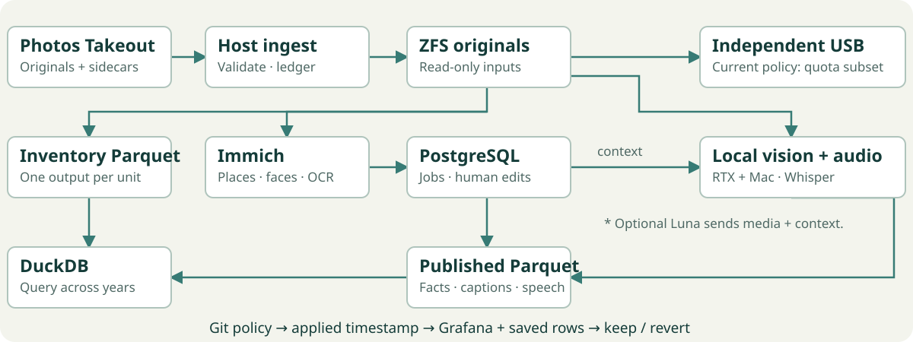
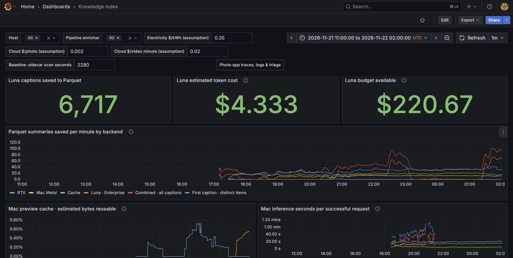
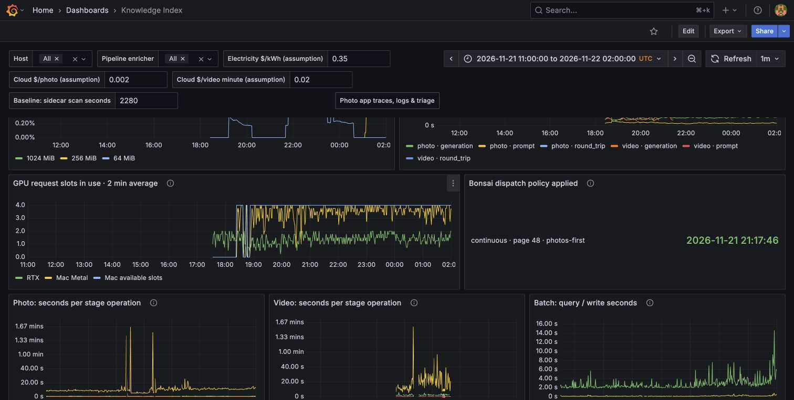

# Back up your photos. Find them faster.

*Updated November 21, 2026. [Animated ten-slide presentation](local-photo-pipeline-slides.html) · [Measurements and screenshot provenance](assets/local-photo-pipeline/evidence.md).*

Keep local copies of your photos, check them before deleting anything from Google, and make the library easier to search. Find photos by person, place or description. Along the way, test which database and processing choices actually save time.

The result is a preserved archive, an Immich library, a queryable inventory, and resumable photo/video captioning. Local RTX and Mac workers sustained **31.4 photos per minute over a measured 30-minute window**. An optional cloud caption worker reached **69.3 saves per minute** in a separate tuning trial. These measure different workloads and routes, not interchangeable benchmark scores.

| Value | What the system delivers | What remains a separate responsibility |
|---|---|---|
| Reduce cloud-storage pressure | An inventory of likely quota-consuming files and a path to verify local copies before reclaiming space | Copying files does not free Google quota; this report does not establish how much cloud storage was actually deleted |
| Keep local backups | Originals and sidecars, version preservation, ZFS and an independent USB copy workflow | Verify both copies and restoration; two disks in one home do not provide an off-site copy |
| Make images useful | Immich dates/GPS, thumbnails, search, faces and OCR; captions using saved context | Suggested names and generated descriptions still need appropriate confidence and review policies |
| Evaluate data pipelines and DuckDB | Durable progress counters, stage timings, portable outputs and Git-controlled live tuning | A busy GPU or a successful request is not necessarily completed, persisted work |

## The end architecture



The storage host owns Takeout extraction and indexing. Drive and OneDrive use the existing Kubernetes `rclone copy` job into the backup area; Google Photos arrives through Takeout archives with JSON sidecars. Validation and atomic publication keep incomplete archives out of the visible library. Each ingested unit produces Parquet facts. Replaying a unit replaces its output instead of adding duplicate rows.

Immich reads the originals through a read-only external mount. Its saved metadata, places and named faces become caption context instead of being rediscovered for each request. The context exporter matches source path and file size, skips ambiguous matches, and preserves provenance. Optional cached place references can help; a cache miss proceeds without blocking the caption queue. Immich edits live in its database, so backing up originals alone does not preserve those edits. [Immich external-library documentation](https://docs.immich.app/features/libraries/).

PostgreSQL owns the photo application's jobs, leases, human labels and rejections. Published Parquet snapshots support DuckDB browsing and analysis. Recent PostgreSQL edits overlay those snapshots immediately: a refresh must never resurrect a rejected name.

Piglet owns caption inputs and durable outputs. Local capacity comes from RTX/Ollama plus an optional Mac/Metal worker. An optional Luna submitter on always-on still-fawn uses a shared reservation/accounting ledger and publishes into its own Parquet dataset. **This optional route sends images or video frames and context to a cloud service.** Local archival and captioning remain usable without it. Separate model outputs make comparisons explicit.

Applications stay behind private Traefik access. Kubernetes resources use Git/Flux; host workers use versioned installers and systemd. Some components still use the feature branch's Flux preview: implemented architecture does not mean every rollout change has merged to main.

## Before and after: count saved descriptions

“Ingest” hides three jobs: transferring/extracting originals, indexing metadata, and enriching media. The strongest throughput evidence here concerns **caption enrichment saved to Parquet**, not internet download speed.

| Change or trial | Before | After | Interpretation |
|---|---:|---:|---|
| Add Mac capacity to RTX | 16.0 saves/min | 22.3 saves/min | **39% higher observed throughput**, ten-minute production windows; 223 distinct saved items verified after |
| Batch barriers → continuous refill | 21.4 saves/min | 28.0 saves/min | The windows contained 38 vs. 1 videos; do not attribute the whole increase to scheduling |
| Sustain photos-first local work | — | 31.4 photos/min | 943 distinct photos, zero videos, 30 minutes; excludes Luna and cache hits |
| Luna request slots 4 → 8 → 20 | ~31 → ~53 | ~66 saves/min | Different production media mixes; preparation became the next bottleneck |
| Luna: 20 requests, four preparation slots; batch 24 → 48 | 62.6 saves/min | 69.3 saves/min | About 11% higher in sequential production trials, not identical-input benchmarking |
| Mac benchmark: concurrent requests 4 → 20 | 9.62 saves/min; p95 48 s | 9.65 saves/min; p95 124 s | Throughput essentially flat; retain four slots |

The local photos-first rate estimates a photo backlog only while both GPUs remain available. Videos cost differently. We ran two models on some of the same photos. Two descriptions of one photo still count as one photo done. To measure library progress, count **files getting their first description**.



*Actual dashboard capture; fixed window November 21 11:00–November 22 02:00 UTC. The combined-output and first-caption lines answer different questions. Screenshot dollar figures are configured estimates, not an invoice or independently measured savings.*

### How speed improved

**Refill a free slot immediately.** A batch barrier makes a fast request wait for the slowest item in its batch. Continuous dispatch feeds available capacity while other requests remain in flight.

**Route work according to cost.** In one mixed window, photo model requests averaged 14.3 seconds versus 25.6 seconds for video. On the Mac, prompt evaluation alone was 4.3 seconds for photos versus 41.1 seconds for video. Photos-first scheduling and photo-first Mac routing made the chosen backlog cheaper to process. This prioritizes photos; it does not eliminate deferred video work.

**Reuse existing computation.** Immich supplies saved location and face context. Face matching reuses embeddings. Repeated Parquet scans became one streaming query with bounded batches. Optional place lookups no longer hold up the cloud queue.

**Separate preparation from model concurrency.** At 20 Luna requests, frame preparation plus its wait exceeded median model-request duration. Increasing preparation workers from four to six reduced throughput from 62.6 to 55.9 saves/min in the 24-job trials. Returning to four preparation slots with a 48-job batch produced 69.3/min. More workers was a hypothesis to measure.

**Stop when a knob stops helping.** Matched photo-only local trials with 24- and 48-item pages both saved 32/min. The Mac's 20-request experiment mostly added latency. Both results prevented tuning from becoming a search for ever-larger settings.

## Change one setting. Check if it helped.



*Same fixed UTC window. The applied-policy panel records continuous dispatch, page size 48, photos-first ordering and the activation time. Photo, video and query/write timings remain separate.*

The feedback loop is **change one Git setting → verify its applied time → watch short-window feedback → compare a complete window → verify persisted rows → keep or revert**.

The worker checks policy at queue boundaries, at most once every 30 seconds, resolving content by commit. Changes take effect after outstanding requests finish. Failed fetches retain the last valid settings. Dispatch tuning therefore does not require restarting the backfill or throwing away completed work.

Grafana combines a value stream map with stage durations, queue depth, slot occupancy, worker freshness, errors and host/VM utilization and saturation. The map exposes dependencies; its nodes use different units. Concurrent stage-operation seconds are not wall-clock flow efficiency, and “model request” includes service waiting, not only GPU execution.

Use the two-minute graph for feedback, then compare a full ten-minute window with both GPUs available and a similar media mix. The measurement tool checks Prometheus counters against saved Parquet rows:

```bash
CB_HOST=root@<storage-host> python3 scripts/knowledge-index/measure-bonsai-dispatch.py \
  --before <baseline-window-end-UTC> --after <candidate-window-end-UTC> \
  --minutes 10 --follow
```

At the sustained photos-first measurement, model requests accounted for about 96% of recorded stage time; queue reads and writes together were under 1%. That supported stopping queue-page tuning. The Luna trials also checked the local worker: it saved 112 and 128 photos in equal four-minute windows before and during the larger-batch trial. This was a useful guardrail, not proof of zero interference under every workload.

Historical before/after cards are recorded trials. Separately labeled current-rate lines describe the present run. See the [dispatch measurement procedure](../../scripts/knowledge-index/bonsai-dispatch.md) and [Luna operating policy and trials](../../scripts/knowledge-index/luna-backfill/README.md).

## PostgreSQL and DuckDB each have a job

PostgreSQL handles changing records and concurrent application activity: reserve work, save a review, reject a candidate. Parquet provides portable outputs. DuckDB queries them for inventory and analysis without turning every historical fact into a transactional row.

`knowledge.duckdb` contains derived views. Rebuilding that catalog is different from re-extracting originals, recreating embeddings or rerunning captions. Normal ingest indexes the new archive's delivered paths; full backfill is an initial-load/recovery operation. Snapshot refreshes are deliberate work. Scanning all embeddings for each result page was an implementation problem, not a necessary DuckDB cost.

The face-matching fix opened one query and streamed 256-row batches. A bounded profile reduced later batch reads from approximately 0.96–1.16 seconds to 8–10 milliseconds, following roughly 0.86 seconds of setup. This measures the **read phase**, not a hundredfold improvement in total face matching. Likewise, the dashboard's quota-query comparison uses a configured 2,280-second sidecar-scan baseline; it is not a universal database benchmark.

## Build the final system, step by step

These are steps for the final design. Scripts contain homelab-specific inventory and storage assumptions; adapt them before use elsewhere. Run from the repository root, choose the storage host from inventory, and keep credentials outside Git.

### 1. Measure sources and provision two destinations

Measure Drive and OneDrive separately from Photos and Gmail. Allow space for originals, sidecars, versions and extraction on the primary and second disk. Configure rclone on the storage host so the laptop is only the sign-in interface.

```bash
scripts/backup/cloud-backup-install-rclone.sh
scripts/backup/cloud-backup-auth-onedrive.sh
scripts/backup/cloud-backup-measure.sh
```

Reuse an existing encrypted Drive configuration with `cloud-backup-seed-gdrive-config.sh`, or configure a new provider remote. Google Photos uses Takeout here because Google's Library API focuses on app-created content following its March 31, 2025 changes. [Google's API update](https://developers.googleblog.com/en/google-photos-picker-api-launch-and-library-api-updates/).

### 2. Copy and ingest on the storage host

The existing cloud-drive-pull CronJob performs the Drive/OneDrive copy; the host performs Takeout extraction. Use `copy` semantics so source deletion does not delete destination files. Preserve overwritten versions through the backup workflow. Validate Takeout archives, retain JSON sidecars, and atomically publish completed extraction units. [rclone copy semantics](https://rclone.org/commands/rclone_copy/).

```bash
scripts/backup/cloud-backup-run-now.sh
scripts/backup/gphotos-ingest-ctl.sh start
scripts/backup/gphotos-ingest-ctl.sh status
```

The ledger skips completed archives. An index failure records pending recovery work without discarding preserved originals. Keep Takeout extraction and index builds outside the K3s VM's control-plane I/O path. See the [backup scripts](../../scripts/backup/README.md) and [host ingest implementation](../../scripts/backup/host/gphotos-ingest-host.sh).

### 3. Verify backup and restoration before cloud reclamation

Inspect the mirror targets before using `cloud-backup-install-mirror.sh`; check `cloud-backup-status.sh` and mirror reports. The current USB SSD policy copies Drive/OneDrive plus only the Photos quota-candidate subset because the full photo library does not fit. The additional HDD target excludes Photos. Thus this setup does **not** establish two complete copies of every photo. Expand destination capacity and coverage if that is the requirement; verify every proposed reclaim item independently. Verify selected files and metadata against **both** physical destinations, including hashes where available and restore/open tests. A successful mirror exit code alone is not that proof.

Cloud deletion is a separate reviewed operation. The quota view estimates candidates from sidecar rules; it is not Google's billing authority. This article does not claim completed reclaim automation or a measured decrease in cloud quota. Keep an off-site copy if removing the cloud copy.

### 4. Build the inventory; append new units thereafter

```bash
scripts/knowledge-index/install-duckdb.sh
scripts/knowledge-index/knowledge-index-ctl.sh install
scripts/knowledge-index/knowledge-index-ctl.sh backfill start
scripts/knowledge-index/knowledge-index-ctl.sh backfill status
scripts/knowledge-index/knowledge-index-ctl.sh quota-diff
```

The initial backfill covers existing files. Subsequent ingestion invokes the per-unit hook. Check pending units and compare the quota view with the independent sidecar oracle. The [index runbook](../runbooks/knowledge-index.md) documents schemas and recovery. Drive/OneDrive adapters and automated copy-proof refresh remain separate from the implemented Photos index.

### 5. Add Immich over preserved originals

Use the [versioned Immich manifests](../../gitops/clusters/homelab/apps/photo-enrichment/immich-pilot/) through Flux, a read-only external mount, persistent database storage and private Traefik access. Process metadata/thumbnails before downstream face, search and OCR work. Back up Immich's database too. Follow the [external-library guide](https://docs.immich.app/guides/external-library/) and [GPU OCR runbook](../runbooks/immich-ocr-gpu.md).

Native Immich indexing can finish while captioning or custom-metadata reconciliation remains pending. At the captured endpoint, native queues were zero, while synchronization still had pending assets and conflicts. These have separate completion criteria.

### 6. Add live review state and resumable captioning

Follow the [photo application's deployment guide](../../scripts/knowledge-index/photo_enrichment/README.md) for PostgreSQL, periodic Parquet export and the private review route. Preserve human decisions and provenance. Default review should focus on actionable suggestions for selected people, rather than treating every unnamed detection as mandatory work.

Evaluate a sample against the configured local endpoint before starting the resumable worker:

```bash
export CB_HOST=root@<storage-host>
export KI_ENDPOINT=http://<existing-ollama-service> KI_MODEL=bonsai-27b KI_API=ollama
scripts/knowledge-index/knowledge-index-ctl.sh enrich sample 20
scripts/knowledge-index/knowledge-index-ctl.sh enrich start
scripts/knowledge-index/knowledge-index-ctl.sh enrich status
```

Add the [Mac worker](../../scripts/knowledge-index/mac-bonsai/README.md) when available. For cloud assistance, follow the [Luna setup/cutover procedure](../../scripts/knowledge-index/luna-backfill/README.md): interactive sign-in, one active submitter, shared reservations and an estimated-cost budget. Reuse saved Immich context. Keep model/version identities separate for intentional comparisons; retries should not duplicate successful outputs.

### 7. Instrument and tune with evidence

Deploy dashboards and alerts through Flux. Check freshness, errors, utilization and saturation at workload and host layers. Record a baseline, change one policy, verify its applied time, and compare persisted results and media mix. Keep a useful setting or restore the prior Git policy. `scripts/knowledge-index/check-promql.sh` validates expressions against Prometheus. The [Immich observability guide](../runbooks/immich-observability.md) covers native-processing signals.

## Interesting, weird problems

| Symptom | Actual cause | Useful lesson |
|---|---|---|
| Copying an archive disturbed Kubernetes | Bulk writes through the VM/storage path could stall control-plane I/O | Ingest on the host; inspect guest and host I/O together |
| Correct-size archive would not decompress | File length did not prove valid content | Validate archive integrity; range repair verifies returned byte ranges |
| Throughput rose and fell every five minutes | Row totals were sampled every five minutes; a trend over that staircase manufactured waves | Measure durable saves directly and label the rate window |
| Twenty Mac requests barely beat four | Additional requests waited behind the same capacity; p95 grew 48 → 124 seconds | Measure latency as well as throughput |
| Cloud work stopped when the laptop slept | Submission/accounting depended on an intermittently awake client; missing usage retained a budget hold | Use an always-on submitter and explicit shared accounting state |
| “Not this person” still displayed the same name | A saved rejection and cached analytical view had different freshness | Overlay live PostgreSQL decisions and invalidate stale matches |

The durable result is preserved data, useful enrichment, and a feedback loop that can tell whether the next change actually helps. The [evidence notes](assets/local-photo-pipeline/evidence.md) distinguish measurements, architectural facts and outstanding work.

### November 22: why both local worker panels went blank

Piglet rebooted at **8:15:59 p.m. Pacific on November 21**. The local caption worker had been started as a temporary systemd service. It disappeared on reboot and did not start again. Its last heartbeat was at 8:13:49 p.m. Both the RTX and Mac panels use this worker's reports, so both showed “No recent report.” That does not establish a GPU failure. Luna had a separate, current heartbeat.

The November 22 inspection found the local service absent and inactive. Recovery needs a permanent service that starts at boot, using the saved worker settings and existing completed outputs. This read-only diagnosis did not restart it. The cause of the host reboot has not been established.
