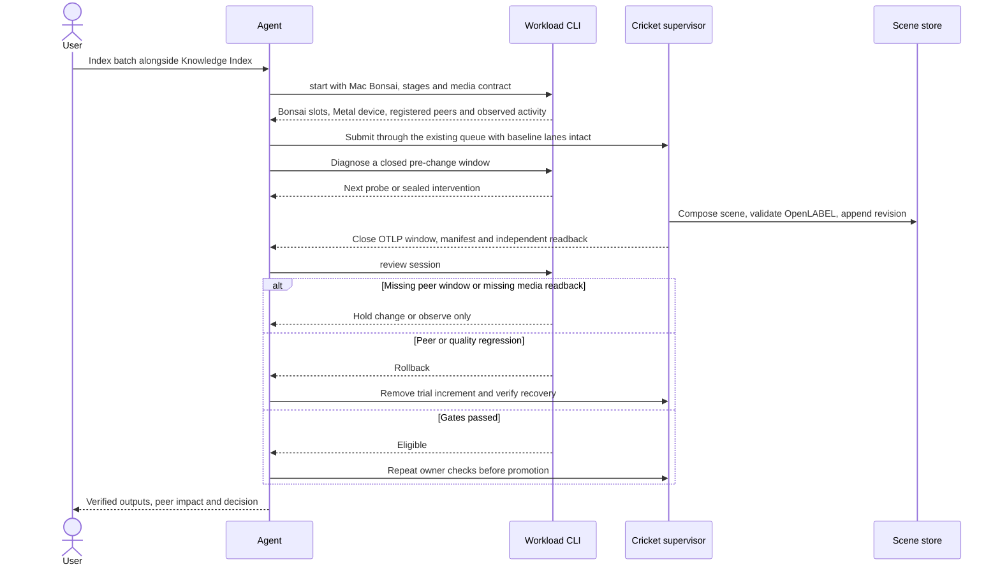

# Agent journey · run Cricket while Knowledge Index is active

**Request** — “Index this cricket batch. Keep Knowledge Index running and preserve existing annotations.”



**Start.** From the repo root, give each run a private directory. The command resolves the resource graph, samples Prometheus with `--live` and creates the session once.

```sh
run=$(mktemp -d)
cli=scripts/perf/workload.py
python3 "$cli" start --session "$run/session.json" --live \
  --workload cricket-indexer --run-id cricket-batch-01 --output-kind media \
  --resource mac-m5/bonsai-slots --stage ingest --stage classify --stage publish
```

**Execute.** For Cricket, use the existing [local validation and publication adapter](../runbooks/cricket-highlights.md#openlabel-publication-adapter). Validate before publication. A validated scene file alone cannot serve as a database readback. Submit through the existing workload supervisor. Its adapter writes the following files beside `session.json`. Baseline workers keep claiming. Cricket capacity tuning starts at the highest measured shared allowance, descends, then repeats eligible candidates in reverse. Preserve every peer's reservation throughout. The [bounded registration contract](../reference/capacity-trial-registration.md) is available for offline preparation; capacity phase review and actuation remain pending, so registration cannot admit a live trial.

| Run file | Supplied by |
|---|---|
| `traces-and-logs.jsonl`, `metrics.jsonl`, `watermark-ns` | Adapter’s closed OTLP exports and cutoff in Unix nanoseconds |
| `comparison.json` | Trial adapter’s measured baseline, trial, per-caller budgets and `action` matching the sealed prediction. Omit for observation only |
| `observations.jsonl`, `scene-readback.jsonl` | Media publisher’s run references and independent PostgreSQL export |

**Diagnose before a change.** On the closed baseline window, run `python3 "$cli" diagnose --session "$run/session.json"`. A supported intervention creates `prediction.json` once. An ambiguous result requests a probe. Keep the baseline capture and receipt. Close the trial window before review.

**Review.** Set `ASAM_OPENLABEL_1_0_SCHEMA` to the local pinned schema for media. One command checks trace and metric labels, the registered intervention, peer outcomes and scene readback.

```sh
python3 "$cli" review --session "$run/session.json"
```

Read `fleet_review.decision` before changing capacity. Exit 0 means the review ran, including a hold or rollback. Input or contract errors return nonzero. The CLI has no production actuator. Closing the final run requires the workload’s own quality evaluation and ledger reconciliation. [Workflow](../methodology/distributed-ai-performance.md) · [Telemetry fields](../reference/workload-telemetry.md) · [Comparison format](../../scripts/perf/otel-diagnosis.md)

## Verify the publisher on this checkout

Use the shared module in `scripts/knowledge-index/memory-acceptance` for the publisher's `--shared-module` argument. The full ingest, UI and deployment tools follow the [Cricket feature stack](https://github.com/homeiac/home/pull/269).

With PostgreSQL's `initdb` and `pg_ctl` on PATH, a Python environment with the test dependencies and psycopg 3, and `ASAM_OPENLABEL_1_0_SCHEMA` set, run `scripts/perf/verify-cricket-publication.sh`. It publishes a synthetic correction twice, reads both revisions back, checks their references, and verifies that another producer's scene survives a rejected write. The database lives in a temporary directory and accepts only local Unix-socket connections.
