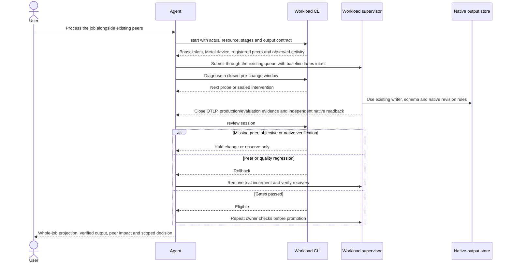

# Agent journey · run a workload alongside its peers

**Request** — “Process this backfill, preserve other workloads and existing data, and measure when the whole job will finish.”



**Agree on ownership.** Before a shared experiment, follow the [coordination contract](../methodology/distributed-ai-performance.md#coordinate-chats-before-changing-shared-capacity). When chat messaging is authorized, ask the existing owners for their effective settings and active trials. Name one actuator per physical pool. Record the handoff and retain the protected worker allocations. Drain the outgoing trial, verify cleanup and acquire a fresh baseline before the next owner's trial.

| Record | Evidence needed |
|---|---|
| Ownership | Pool, actuator owner, reviewing chat, acknowledgment, expiry and rollback allocation |
| Protection | Baseline workers, scheduled callers, CPU requests, system margin and measured device/memory limits |
| Trial | Frozen cohort and settings, measured maximum, descending candidates, equal windows and reverse repeats |
| Qualification | Workload-owned reviewed scores (for example stage/action/both), abstentions, verified useful output, every peer's progress and service budget |
| Closure | Selected setting or tested rejection for each backend, cleanup/recovery, journal/checklist, commit and live Grafana before/after readback |

A diagnostics-only sample may finish while the requested tuning remains active. If the user requests consolidation, retain unmeasured arms and report the best supported measured setup. Otherwise continue through the [completion gate](../methodology/distributed-ai-performance.md#complete-the-requested-tuning-outcome) before marking the tuning task done.

**Discover the fleet.** For scaling work, complete the [stage-by-pool coverage](../methodology/distributed-ai-performance.md#discover-capacity-beyond-the-current-routes) before selecting a serving route. Maintain a workload policy with `pools`, `proxmox_inventory` and `stages`. Each stage has a versioned `profile` and `evidence` by pool, using the existing planner contract. Resolve the inventory path relative to the policy. Invoke the planner explicitly in inventory mode.

```sh
python3 scripts/perf/plan-compute-trials.py "$policy" --inventory --as-of "$evaluation_date"
```

The read-only planner emits `PREFLIGHT + CANARY` for unmeasured stage/pool pairs and `REASSESS` for expired or changed profiles. It schedules discovery. The owner supplies real readiness and quality receipts before admitting work.

| Stage | Physical pool | State | Next action or evidence |
|---|---|---|---|
| Life-stage/action inference | Mac Metal | Baseline | Record four protected lanes and measured output. |
| Life-stage/action inference | RTX 3070 | Baseline | Record three protected lanes, peer demand and measured output. |
| Life-stage/action inference | still-fawn CPU | Unmeasured | Probe runtime, available memory and source access. Then time the same reviewed faces and record quality and net fleet gain. |
| Preview preparation | still-fawn CPU | Candidate | Compare measured preview cost and transfer overhead before deciding whether moving it helps. |
| Applicable stage | Every other physical CPU/device | Discovered | Measure, demonstrate incompatibility or record an owned deferral and revisit trigger. |

These rows illustrate the photo workload. They require current evidence for each run. Keep the full discovered table with the run receipts. An unmeasured CPU stays visible when a GPU experiment is held.

**Start.** Give each run a private directory and actual workload/run IDs. The command
resolves the resource graph, samples declared observers with `--live` and creates the
session once. This example is a media adapter, not a prescribed model or allocation.
For nonmedia use `--output-kind other --native-adapter "$adapter"`; for a registered
service-only target use `--output-kind service --service-objective "$objective"`.
The [adapter contract](../reference/workload-adapter-contract.md) gives required fields.

```sh
run=$(mktemp -d)
cli=scripts/perf/workload.py
python3 "$cli" start --session "$run/session.json" --live \
  --workload "$workload" --run-id "$run_id" --output-kind media \
  --resource "$pool" --stage ingest --stage classify --stage publish
```

**Execute.** For Cricket, use the existing [local validation and publication adapter](../runbooks/cricket-highlights.md#openlabel-publication-adapter). Validate before publication. A validated scene file alone cannot serve as a database readback. Submit through the existing workload supervisor. Its adapter writes the following files beside `session.json`. Baseline workers keep claiming. Capacity tuning starts at the highest measured shared allowance, descends, then repeats eligible candidates in reverse. Preserve every peer's reservation throughout. The [bounded registration contract](../reference/capacity-trial-registration.md) is available for offline preparation; capacity phase review and actuation remain pending, so registration cannot admit a live trial.

| Run file | Supplied by |
|---|---|
| `traces-and-logs.jsonl`, `metrics.jsonl`, `watermark-ns` | Adapter’s closed OTLP exports and cutoff in Unix nanoseconds |
| `comparison.json` | Trial adapter’s measured baseline, trial, per-caller budgets and `action` matching the sealed prediction. Omit for observation only |
| `observations.jsonl`, `scene-readback.jsonl` | Media publisher’s run references and independent PostgreSQL export |
| `native-observations.jsonl`, `native-readback.jsonl` | Nonmedia adapter's native IDs/schema/content and independently saved execution provenance |
| `completion_objective` in `comparison.json` | Fixed remaining work; baseline/trial unique production rates, verified backend maps and separate evaluation count |
| Saved attempt/health captures | Hashed source/version/execution identity, profile, mode/reuse, raw timing and actual sample timestamps |

**Diagnose before a change.** On the closed baseline window, run `python3 "$cli" diagnose --session "$run/session.json"`. A supported intervention creates `prediction.json` once. An ambiguous result requests a probe. Keep the baseline capture and receipt. Close the trial window before review.

**Review.** Set `ASAM_OPENLABEL_1_0_SCHEMA` to the local pinned schema for media. One command checks trace and metric labels, the registered intervention, peer outcomes and scene readback.

```sh
python3 "$cli" review --session "$run/session.json"
```

Read `fleet_review.decision` before changing capacity. Exit 0 means the review ran, including a hold or rollback. Input or contract errors return nonzero. The CLI has no production actuator. Closing the final run requires the workload’s own quality evaluation and ledger reconciliation. [Workflow](../methodology/distributed-ai-performance.md) · [Telemetry fields](../reference/workload-telemetry.md) · [Comparison format](../../scripts/perf/otel-diagnosis.md)

## Replay and interpret the shared decision

Use saved evidence, not another live query, when checking a conclusion:

```sh
python3 scripts/perf/completion_objective.py "$objective" --at-ns "$cutoff_ns"
python3 scripts/perf/observe-shared-workloads.py \
  --registry "$registry" --input "$saved_response" --at "$cutoff_seconds"
```

The same finish-time function feeds `workload.py qualify-capacity`. That offline
path preserves original peer controls, checks native accounting and returns
`not_admitted`/`proceed=false` while ordered execution/repetition/lease gates remain
pending. Peer-budget pass is not promotion; replay throughput is not production.
Use the [capacity reference](../reference/capacity-trial-registration.md), not a FIFO
prediction or one-increment feedback controller, for maximum-first registration.

The existing media checker and nonmedia `verify-native` are architecture-specific.
A native adapter does not rewrite its business schema or create another canonical
store. Missing saved execution provenance, unknown native first creation or a
missing media accounting bridge keeps verification incomplete. Service targets use
measured SLO objectives and do not manufacture durable item counts.

Archive the closed private captures and native reader artifacts persistently with
verified hashes/permissions. Journals contain aggregate results, source/policy/adapter
versions and immutable references. For bottleneck attribution, require matched
stage and device/co-tenant evidence; otherwise report unknown. Label charts as
before/during the added workload so a rejected increment is not confused with a
rejected incumbent backend.

## Verify the publisher on this checkout

Use the shared module in `scripts/knowledge-index/memory-acceptance` for the publisher's `--shared-module` argument. The full ingest, UI and deployment tools follow the [Cricket feature stack](https://github.com/homeiac/home/pull/269).

With PostgreSQL's `initdb` and `pg_ctl` on PATH, a Python environment with the test dependencies and psycopg 3, and `ASAM_OPENLABEL_1_0_SCHEMA` set, run `scripts/perf/verify-cricket-publication.sh`. It publishes a synthetic correction twice, reads both revisions back, checks their references, and verifies that another producer's scene survives a rejected write. The database lives in a temporary directory and accepts only local Unix-socket connections.
