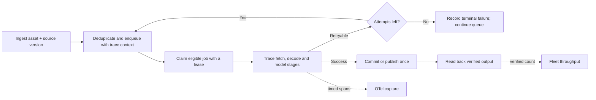
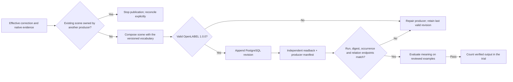
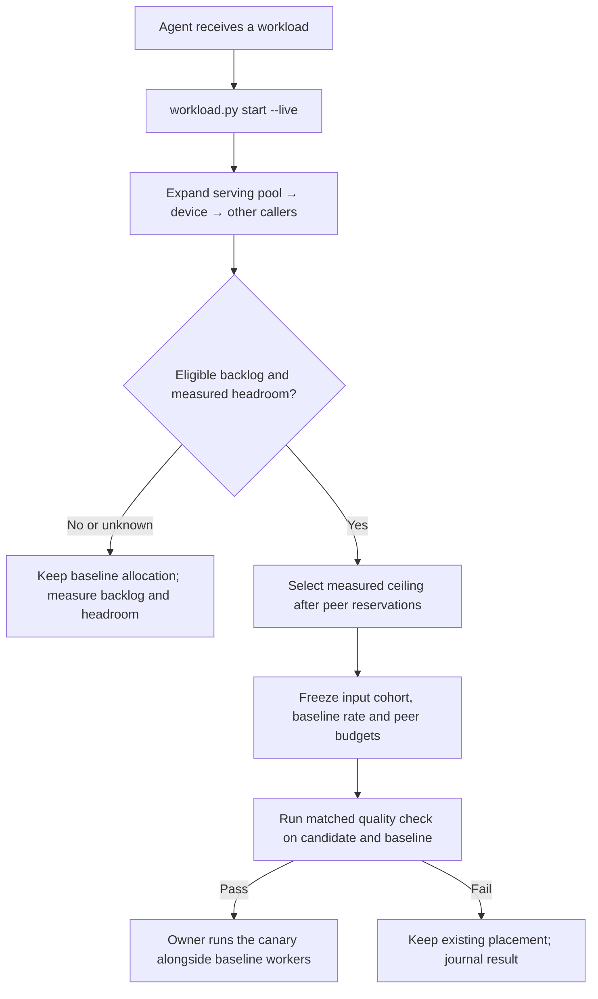
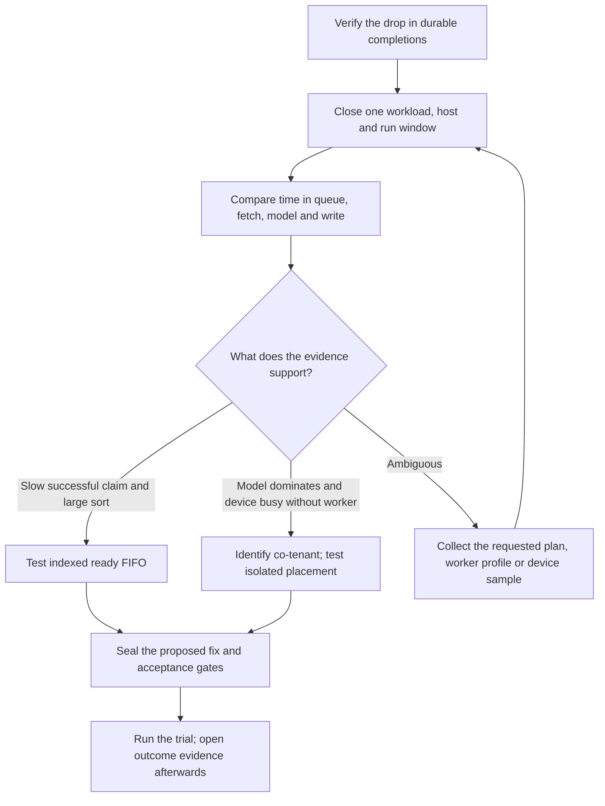
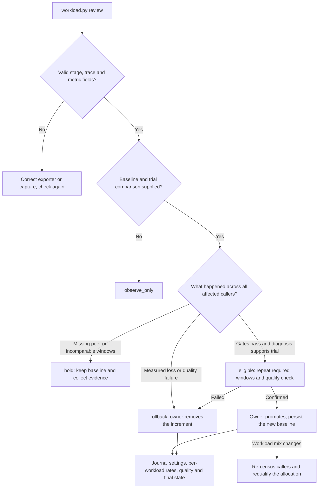

# Running AI workloads on shared compute

## 1. Ingest and trace a job

This is the adapter contract for new work. Propagate the parent context to a separate writer. A retry gets a fresh attempt span. Store trace and asset IDs in private evidence; export bounded metric labels. [Field dictionary](../reference/workload-telemetry.md)

### Media publication gate

Declare `--output-kind media` at intake. The review command runs the shared checker when supplied the manifest, readback and pinned schema. Missing publication evidence prevents eligibility. Human corrections retain stable occurrence IDs across revisions. [Publication contract](../architecture/media-workload-contract.md)

## 2. Place the work

`start` discovers registered peers. Add `--live` for current exporter observations. For a workload with a capacity adapter, the planner selects a pool from ready backlog and free worker equivalents. For Cricket, reserve scheduled and active demand, test the highest measured shared allowance, then sweep down one pool at a time. Repeat in reverse order and choose the fewest workers within 5% of the fastest repeatable qualifying rate. A caption controller that can actuate only one extra lane tests that increment against the same peer budgets. [Cricket operating policy](https://github.com/homeiac/home/blob/1587fbc1b7722c7ed2530deae46540cdc19e730f/docs/runbooks/shared-indexer-tuning.md) · [Agent commands](../guides/shared-workload-agent.md)

## 3. Trace the bottleneck

These are the two implemented diagnosis rules. A GPU sample alone cannot identify the competing process. In the Waffles replays, the indexed SELECT fell from 1,662 to 0.286 ms. Metal delivered 345 → 627 → 375 photos/min across busy, isolated and restored phases. [Receipts and replay commands](../experiments/waffles/otel-replay/README.md)

## 4. Tune live and scale

Compare each workload in its own units. For media producers, run `verify-media` against an independent PostgreSQL readback and check the reviewed output separately. The review command emits decisions. The owning supervisor changes capacity. [Telemetry fields](../reference/workload-telemetry.md) · [C4 architecture](../architecture/distributed-ai-workloads.md) · [Adapter inputs](../../scripts/perf/otel-diagnosis.md)
