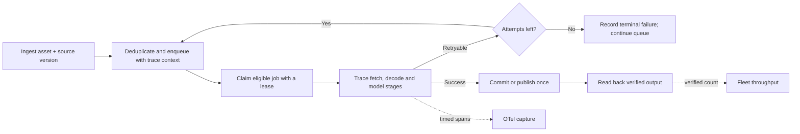
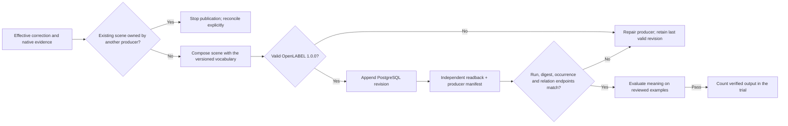
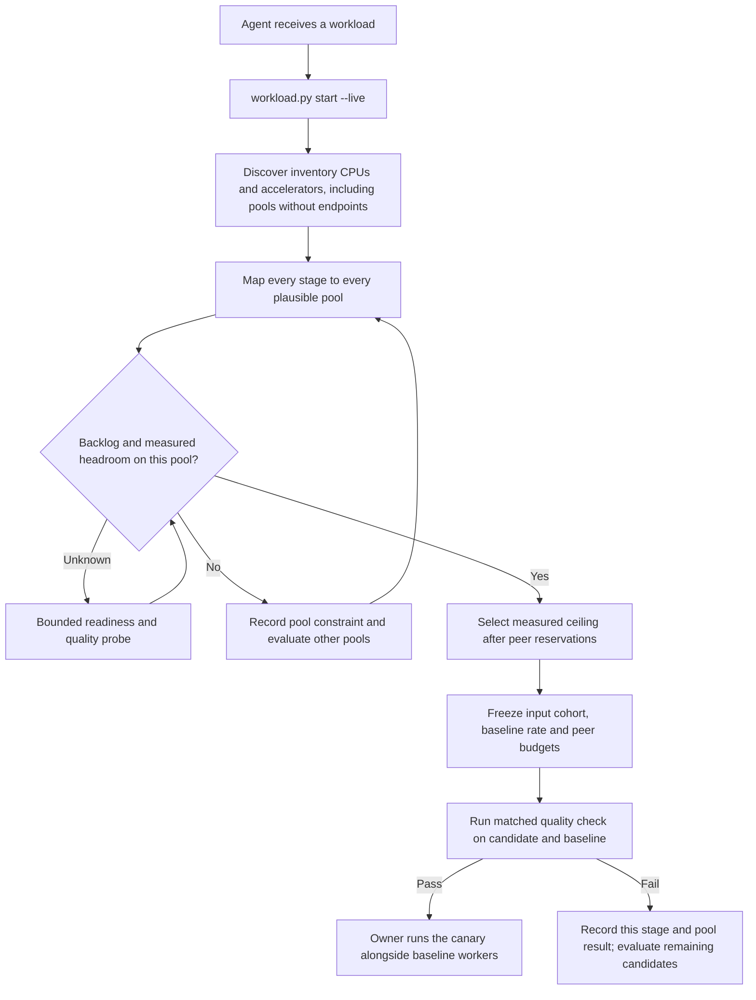
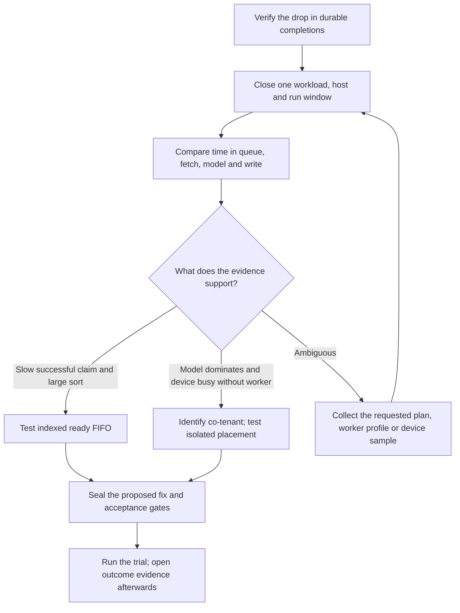
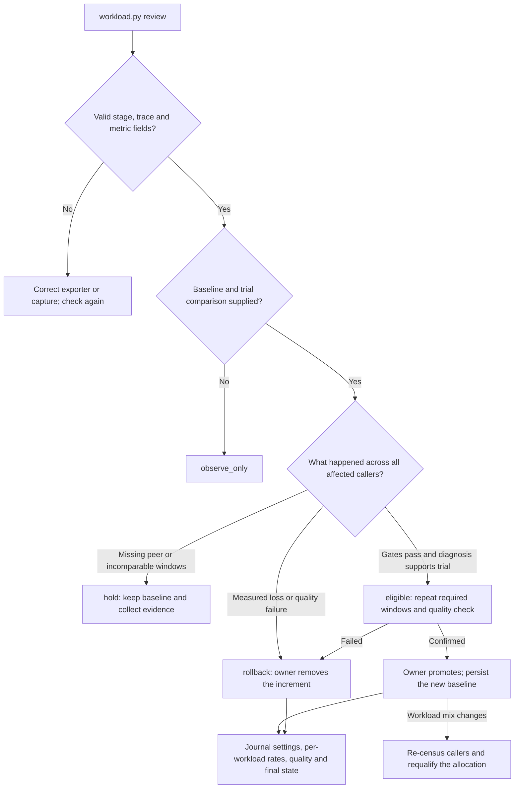

# Running AI workloads on shared compute

## 1. Ingest and trace a job

This is the adapter contract for new work. Propagate the parent context to a separate writer. A retry gets a fresh attempt span. Store trace and asset IDs in private evidence; export bounded metric labels. [Field dictionary](../reference/workload-telemetry.md)

### Media publication gate

Declare `--output-kind media` at intake. The review command runs the shared checker when supplied the manifest, readback and pinned schema. Missing publication evidence prevents eligibility. Human corrections retain stable occurrence IDs across revisions. [Publication contract](../architecture/media-workload-contract.md)

## 2. Place the work

`start --live` discovers registered routes and their peers. Complete the fleet discovery below before choosing an allocation. For each ready candidate, select the measured shared allowance after active and scheduled reservations. Sweep downward, repeat in reverse order, and choose the fewest workers within 5% of the fastest repeatable qualifying rate. [Operating policy](../runbooks/shared-indexer-tuning.md) · [Agent commands and coverage format](../guides/shared-workload-agent.md)

### Discover capacity beyond the current routes

**Required whenever queued work remains and a user asks to scale, tune or find spare capacity.** Start with `proxmox/inventory.txt`, the local Mac and currently observed guests and pods. Enumerate physical CPU pools and accelerators, including nodes without a model endpoint. Map fetch, decode, preview, inference, transcription, OCR and publication stages as applicable. Deduplicate host, VM and pod capacity and identify shared memory, storage and network dependencies.

Use the existing `scripts/perf/plan-compute-trials.py POLICY --inventory` to expand stage-by-pool candidates. The policy must include the Mac CPU and accelerators and point `proxmox_inventory` at the repository inventory so newly listed physical CPUs receive rows. Every missing row of evidence gets a readiness probe. Record each candidate's next action, owner and evidence in the workload checklist.

Occupied GPU slots establish that pool's current allowance. Continue with independent CPU pools or other devices. CPU inference, a different model and CPU preparation each require their own measured result. A CPU can contribute useful parallel throughput even when its individual request takes longer. Measure added verified output and reduced queue drain time after transfer, startup and peer costs. Different models or quantizations must pass the same reviewed quality checks.

A missing endpoint calls for a bounded readiness check of model fit, available runtime, source access, CPU/memory limits and peer demand. Use existing deployment and queue paths for a canary when feasible. Preserve baseline workers. An offline host or a blocked provisioning dependency gets concrete evidence, a next action and a revisit date. Keep other pools moving when a constraint applies to only one pool.

### Completion gate for a scaling investigation

The workload checklist must account for every plausible stage and inventoried pool. Each row ends with a measured result, a specific incompatibility or a bounded deferral with owner and revisit trigger. Include input/model/prompt versions, elapsed time, quality, useful throughput, transfer costs and peer impact. Historical results expire when the workload or backend profile changes.

**“GPU full” and “CPU probably slow” leave discovery open.** Close a CPU candidate using a timed, quality-checked sample or a demonstrated constraint such as insufficient available memory or an offline host. A saturated GPU and an untested still-fawn CPU means the next action is a still-fawn readiness probe. If CPU inference fails to add useful throughput, record that result and check CPU preparation only where stage timings predict an improvement.

The route graph and `workload.py review` do not currently enforce fleet coverage. The operator records and checks this completion gate alongside the machine decision. An `eligible` result on one pool approves only that measured scope.

### Coordinate chats before changing shared capacity

When the user authorizes coordination, identify the chats already operating each pool and exchange aggregate status before starting a trial. Record one actuator owner per physical pool, the protected allocation, scheduled reservations, current experiment, expiry and rollback setting. A serving pool and its underlying CPU, memory and device share the same accounting. Readiness and independent evidence review can proceed under separate owners. Only the actuator owner launches, stops or resizes trial inference on that pool.

For a handoff, the outgoing owner stops new submissions, drains in-flight requests, verifies process/port/lock cleanup and reports the last effective allocation. The incoming owner acknowledges ownership and collects a clean baseline after the previous trial drains. Keep immutable run settings and closed measurement windows. Conflicting owners or expired ownership hold the affected trial. Other independent pools can continue after their own checks.

Use authorized chat messages for results and ownership. Keep images, raw answers and account readings in private storage. Share aggregate scores and repository references where sufficient. If automatic review rejects a payload, record the failure and use a permitted reduced payload. Ownership remains unconfirmed until the receiving chat acknowledges it.

### Complete the requested tuning outcome

A readiness probe or single correct answer starts qualification. To select a setting, measure the shared allowance after peer reservations and system demand, use an aggregate CPU quota as well as thread/context limits, then test from that ceiling downward. Keep input, model, prompt and quality cohort fixed within comparisons. Test the same applicable quality baseline when comparing combined and separate calls. Parsing success alone does not establish actor/action accuracy.

Reuse production clients, parsers and validators in the trial harness. Check saved-response replay first, including accepted fenced JSON and null/withheld responses. Correct an adapter mismatch before repeating its immutable candidate, and preserve the failed diagnostic receipt.

Use equal warmed windows, fresh caller-attributed outputs, peer latency/error limits and reviewed stage/action scores. Repeat qualifying candidates in reverse order and apply the existing 5% selection rule. Compare total useful throughput within the same workload and units, including the continuing GPU workers and CPU increment. Group backends of one workload before evaluating its throughput and latency/error budgets. A backend rate decrease is diagnostic evidence and can coexist with a qualifying total gain. Preserve explicitly reserved worker allocations. Apply a per-backend rate floor only when an existing service requirement or user instruction establishes it. Protect distinct workloads separately against their own budgets. Exclude retries, cached benchmark repeats and withheld outputs from new verified output. Include abstentions and failures in quality denominators.

For a request covering still-fawn and Mac CPU, keep both backend rows open until measured acceptance or rejection. A failed two-thread probe leaves other admissible settings open. A candidate that loses quality or total throughput is rejected, followed by cleanup and verified peer recovery. If no candidate qualifies, record CPU allocation zero with the tested bounds and reason. Changed workload mix or external interference requires a new baseline.

Tuning completion requires a per-backend before/after record with original, tested, rejected and selected allocations, quality scores, total throughput, timestamps and receipt references. Update the experiment journal and checklist, commit/push the result, let Flux publish the dashboard, and independently read back the served panel values. Keep implementation, local tests, deployment and live verification distinct. An actual external blocker needs concrete evidence and a recorded next action.

## 3. Trace the bottleneck

These are the two implemented diagnosis rules. A GPU sample alone cannot identify the competing process. In the Waffles replays, the indexed SELECT fell from 1,662 to 0.286 ms. Metal delivered 345 → 627 → 375 photos/min across busy, isolated and restored phases. [Receipts and replay commands](../experiments/waffles/otel-replay/README.md)

## 4. Tune live and scale

Compare each workload in its own units. For media producers, run `verify-media` against an independent PostgreSQL readback and check the reviewed output separately. The review command emits decisions. The owning supervisor changes capacity. [Telemetry fields](../reference/workload-telemetry.md) · [C4 architecture](../architecture/distributed-ai-workloads.md) · [Adapter inputs](../../scripts/perf/otel-diagnosis.md)
