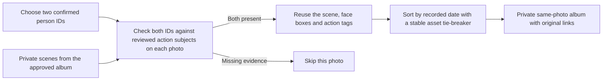
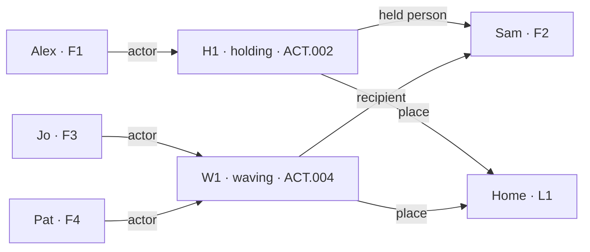
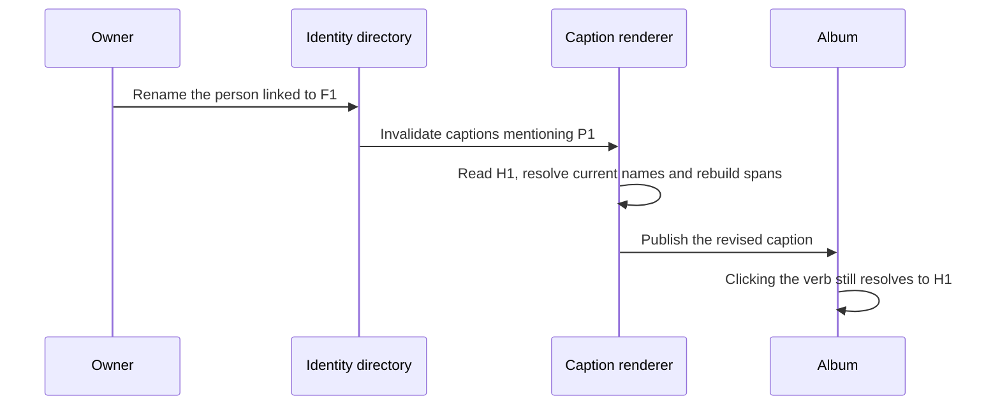

# Photo memory ontology design and delivery contract

Delivery contract · November 26, 2026 · [Architecture](../architecture/photo-memory-ontology.md)

## First slice

Prove one change on the growing-up album. A saved action has a stable code and is tied to the exact observed face used as its actor. The caption uses the current confirmed name. A rename or relabel updates the relevant caption and retrieval results without new vision calls. Reuse the completed action evidence and existing private face mappings. Keep rollout within the first album until existing identity and journey gates pass.

### Accepted reference and next family slice

The owner accepted the chronological growing-up cards on November 26. The reference run exercised 663 clicks on 83 journey cards. The two reader surfaces share one renderer. The private scene and face review retain the original IDs, exact geometry, literal evidence and action roles. See the [architecture and measured coverage](../architecture/photo-memory-ontology.md#what-the-approved-journey-proves).

| Case | Required reader behavior | Check |
|---|---|---|
| Several people in one photo | Give each verified subject a visible action. An unnamed participant has a short native face ID, a full ID on selection and a highlight on the correct face. | For each native detection on a group card, find exactly one subject row, an explicitly reviewed alternate detection on a subject row, or a visible reason. Click through on the chronological page. |
| One person acts on another | Selecting the verb highlights the actor and the affected person. Selecting a person highlights just that occurrence. | Compare roles and oriented boxes to the private review. A role swap fails even if both boxes are present. |
| Repeated detection, framed image or advertisement | Explain the exception on the affected card. Keep supported actions for everyone else. | Count a partially covered photo once. Never count a withheld detection as a new actor. |
| Life stage and recorded year disagree | Keep the recorded date, show the visual stage with its basis and mark uncertainty. | Keep the three disputed dates visible in the reference. A second subject does not inherit the first subject’s birth year or stage. |
| Collage | Keep the original in the catalogue with its component polygons, per-component face links and supported actions. | Exclude the parent from journey selection and prohibit a role pairing faces from different components. |

**Next slice — two people together.** Use two confirmed person IDs to request a same-photo family journey from the approved private collection. The first example is Asha and Adil together. Each person must have a reviewed subject action in that photo. Keep one copy of each original, the other participants’ verified actions and the Immich original link. Show the recorded date with its stated certainty. Exclude collages and embedded photographs for this slice. A lone appearance, the same display name on a different ID, and appearances in separate photos fail the selection.



**Exit check.** Independently intersect the two subjects’ reviewed face assignments, check exact ordered membership, then exercise names, verbs and original links in the generated album. Replay with reversed subject order and verify identical membership and zero new vision calls. Confirm source-stage counts in Grafana. Measure selection and rendering against these frozen inputs. Broader library discovery, age estimates for a second person and relationship-based eligibility remain separate slices.

Read visible, nonblank OCR regions for the authorized album in a single query alongside the face snapshot. Store one OpenLABEL tag per native OCR ID, with its text and normalized polygon. Project the same tags into the timeline, catalogue and together views. Verify each region against the source, including ordering, browser highlighting and replay after removal.

For each disputed phrase, give the model the original caption, the phrase under review and the later evidence about that phrase. Identify the subject by its saved face reference. A second pass checks the resulting sentence for incorrect actors, unsupported claims and lost observations. A failed check can trigger one targeted rewrite. Keep unresolved proposals out of published captions. Ordinary captions without a dispute skip this work. Generate pairs with `review_openlabel.py --participant-jobs`. Run `scan_caption_participants.py JOBS PRIVATE_OUTPUT --reconcile` for local proposals. Add `--sol-review` to send only the disputed wording, the findings and the local draft for independent review through the existing Codex login. The scanner caches proposals and unresolved outcomes. Run the same settings into two empty output directories. Use `check_caption_reconciliation.py PRIVATE_EXPECTATIONS RUN_A RUN_B` to check that both runs preserve the required facts and omit the disputed ones. Wording can vary. Album publication still requires the accepted action spans to match the evidence and subject face.

A reviewed correction supersedes the earlier action in both the sentence and the queryable scene. A person visible on a video-call screen can have a face link and a visible action such as smiling. Record the depiction on that face occurrence. A physical same-photo query excludes it for that subject while remaining eligible for other people physically present. Verify replay, the rendered sentence and absence of the rejected action from the current revision.

### Initial catalogue

These are proposed local codes for the pilot. OpenLABEL supplies scene structures and a driving-scenario tag set. Use SKOS labels and mappings for our registry. [ASAM OpenLABEL](https://www.asam.net/standards/detail/openlabel/) · [W3C SKOS](https://www.w3.org/TR/skos-reference/) Codes remain stable when wording or taxonomy structure changes.

| Code | Facet | Preferred label | Required semantics |
|---|---|---|---|
| `ACT.001` | Action | Stand | One actor; placement and clothing are optional facts |
| `ACT.002` | Action | Hold | One or more grounded holders. A named held person requires a separate grounded role |
| `ACT.003` | Action | Sit | One actor; place or surface optional |
| `AGE.001` | Life stage | Baby or toddler | Visual evidence or a documented age-map derivation with stated basis |
| `AGE.002–006` | Life stage | Preschool age, school-age child, teen, young adult, adult | Follow the approved private age map. Store an exact age separately with its date and basis |
| `REL.002` | Relationship | School friend of | Confirmed people, school context and effective period |
| `ACT.004` | Action | Wave | One or more grounded actors. Add a recipient when supported |
| `MED.001` | Media form | Collage | Several constituent images; file and member capture dates may differ |
| `REL.001` | Relationship | Colleague of | Confirmed private relationship and validity interval |
| `EVT.001` | Event | Work travel | Corroborated purpose and location with event membership |

### Logical records

| Record | Fields that matter |
|---|---|
| `concept`, `concept_edge` | Immutable code, facet, label, synonyms, allowed role schema, registry release, broader edges, lifecycle and replacements |
| `face_observation`, `face_person_revision` | Asset, namespace and source face ID, region and optional clip/panel, confirmed person, independent evidence and effective revision |
| `observation`, `observation_role` | Stable observation ID, asset and scope, code and registry release, producer and source revision, disposition, typed actor/recipient/object and evidence |
| `literal_evidence` | Preserved raw caption, source segments, capture date candidates with precision, coordinate/place evidence and owner corrections |
| `relationship`, `event`, `event_member` | Private entity IDs, code, validity/capture interval, relationship or event evidence, explicit membership and confidence |
| `projection_manifest` | Source watermark, registry version, policy revision, snapshot ID, covered partitions and rerender status |

Use an idempotency key derived from scope, source evidence revision, observation kind, actor/region and producer policy. Multiple actions for one face are allowed. Different inference runs may propose different values; the accepted revision is selected deterministically from current evidence and owner corrections. Unknown is an explicit disposition. Owner corrections persist across replay and take precedence within their scope. Commit the fact, its evidence links and any invalidations together. A rename updates text projections by person ID. A face reassignment invalidates projections and eligibility for the affected face observations by face ID. Registry label changes update rendering and search vocabulary. Semantic changes re-evaluate affected code assignments only.

### Canonical scene fixture

Persist one validated OpenLABEL document per asset revision in PostgreSQL. Index its objects, actions and relations for DuckDB and album queries as derived rows. Key the face crosswalk by asset and object UID so the same local UID in two photos never joins their identities. The crosswalk keeps the stable Immich face ID. A rename updates the person directory and rendered names. A correction to a scene produces a new revision.

This synthetic scene uses numeric string UIDs. Person objects 1 and 2 have face boxes. Action 3 has our vocabulary code for holding. Relations 4 and 5 link the action to its two participants. The arrows run from the action to each person. New verbs use the same schema. [Pinned ASAM JSON Schema](https://openlabel.asam.net/V1-0-0/schema/openlabel_json_schema.json)

```json
{
  "openlabel": {
    "metadata": {"schema_version": "1.0.0"},
    "objects": {
      "1": {"name": "participant-1", "type": "person", "object_data": {"bbox": [{"name": "face", "val": [254.5, 79.5, 75, 83]}]}},
      "2": {"name": "participant-2", "type": "person", "object_data": {"bbox": [{"name": "face", "val": [320, 132.5, 56, 61]}]}}
    },
    "actions": {"3": {"name": "holding", "type": "ACT.002"}},
    "relations": {
      "4": {"name": "holder", "type": "actor", "rdf_subjects": [{"type": "action", "uid": "3"}], "rdf_objects": [{"type": "object", "uid": "1"}]},
      "5": {"name": "held person", "type": "held_person", "rdf_subjects": [{"type": "action", "uid": "3"}], "rdf_objects": [{"type": "object", "uid": "2"}]}
    }
  }
}
```

At write time validate the document against ASAM 1.0.0, then validate referenced UIDs, role directions and allowed terms against the recorded vocabulary release. The holding code and role names above belong to our vocabulary. The enclosing asset revision stores its evidence, policy and vocabulary release.

### How Marken maps to our records

Use Marken as a reference design. Its schema distinguishes the observation, the entity it describes and the version of the data format. The following mapping lets us keep those distinctions in the existing stores. [Netflix Marken schema](https://netflixtechblog.com/scalable-annotation-service-marken-f5ba9266d428)

| Marken field or pattern | Photo memory design |
|---|---|
| `annotationId.id` and `annotationId.version` | Keep one observation ID across corrections. Give each accepted revision its own evidence trail. |
| `associatedId`, region and time range | Target the canonical asset and, when applicable, its oriented face region, collage panel or clip interval. Resolve a face occurrence to a person through the current confirmed mapping. Store geographic evidence on the place record. |
| `annotationType` and `annotationTypeVersion` | Version the observation record format independently of the concept registry. Changing a field layout and renaming the label for “hold” are different operations. |
| Completed annotation runs | Publish a rebuilt projection through its manifest when the scoped run is complete. A failed rebuild leaves the last complete snapshot reproducible. Current owner exclusions and access revocations take effect on the live read path immediately. [Netflix annotation ingestion design](https://netflixtechblog.com/data-ingestion-pipeline-with-operation-management-3c5c638740a8) |

## One image, several actors and actions

A role is a separate row keyed by occurrence, role and participant. The same face may take part in several occurrences. Each supported participant carries its own face reference. In this synthetic scene, Alex holds Sam while Jo and Pat wave at Sam. An observer in the background has a presence record only.



### From stored action to visible words

Use the [Asha and Nikhil diagram](../architecture/photo-memory-ontology.md#how-marken-and-openlabel-fit-together) as the reader-facing example. To check the three outputs against one accepted observation, render the caption, click each name and the verb, then read back the stored OpenLABEL scene. The names must select the two expected face regions, the verb must select H1, and action 3 must preserve object 1 as the holder and object 2 as the held person. Swapping those roles must fail the check even if both face boxes are correct.

The following synthetic fixture is the expected caption view derived from that scene and a confirmed place. In this view F1, F2 and H1 refer to object 1, object 2 and action 3 respectively. Identifiers are illustrative. The image is already oriented, with origin at its top-left. The saved word “holding” links to this specific observation as well as the shared verb concept.

```json
{
  "caption": "Alex is holding Sam at home.",
  "caption_revision": 1,
  "asset": {"id": "image-1", "width_px": 600, "height_px": 260},
  "faces": [
    {"id": "F1", "person": "P1", "xywh_px": [217, 38, 75, 83]},
    {"id": "F2", "person": "P2", "xywh_px": [292, 102, 56, 61]}
  ],
  "observation": {
    "id": "H1", "code": "ACT.002", "source_words": "holding",
    "participants": [{"role": "actor", "face": "F1"}, {"role": "held_person", "face": "F2"}],
    "place": "L1"
  },
  "place": {"id": "L1", "label": "home", "basis": "owner-confirmed", "gps": null},
  "spans": [
    {"range": [0, 4], "ref": "F1"}, {"range": [8, 15], "ref": "H1"},
    {"range": [16, 19], "ref": "F2"}, {"range": [20, 27], "ref": "L1"}
  ]
}
```

Read the span ranges as start-inclusive, end-exclusive Unicode code-point offsets into this caption revision. Store coordinate system, precision, evidence and visibility when GPS is available. In the saved OpenLABEL scene, the first box is `[254.5, 79.5, 75, 83]` in center-based coordinates. Round-trip both boxes against the source image. [W3C text position selector](https://www.w3.org/TR/annotation-model/#text-position-selector) · [OpenLABEL geometry specification](https://www.asam.net/fileadmin/Standards/OpenLABEL/ASAM_OpenLABEL_BS_V1-0-0.html)



### Fixtures for journey acceptance

| Journey | Must match | Must distinguish |
|---|---|---|
| Growing up | Same confirmed child as an infant and at a later age, including a photo without GPS | File creation year vs capture year, visual estimate vs confirmed age, separate ages in group photos |
| Off-site colleagues | People with overlapping employment on the trip date, supported work travel together and a location outside their site | Vacation with a colleague, travel before joining the employer, on-site meeting, uncertain boundary |
| Child, dog and school friends | The child, the identified pet and a confirmed friend under the selected same-photo or same-event rule | Unrelated dog, painted dog, unconfirmed classmate, people from different events |

For the multi-person fixture assert both actors of W1 and its one recipient. Assigning an action to the observer fails. Export the caption and authorized location through the proposed photo metadata adapter and read them back in Immich. Verify the directional role query separately in DuckDB. [Immich supported XMP fields](https://docs.immich.app/features/xmp-sidecars/)

**Varian trip fixture for `ontology_journey`.** Use synthetic IDs for a station photo, a customer visit and a dinner clip. Link each to a confirmed trip shared by the owner and the depicted colleague. Include a visually similar vacation dinner and a meeting at the home site. Give the vacation dinner the highest visual score. The eligible set must contain exactly the three trip items. A dinner search should surface the eligible dinner clip and open its original at the recorded interval. Removing all visual scores must preserve the eligible set. Revoking the dinner face assignment must remove the clip when that was its only qualifying colleague. Recheck under a viewer who lacks access to the relationship and assert that neither the clip nor the private explanation leaks. See the [Varian album diagram](../architecture/photo-memory-ontology.md#colleagues-traveling-outside-their-work-site).

## Promoting an explored query

1. **Compare previews.** Use one versioned Parquet snapshot, viewer scope and subject ID for both candidate rules. Show the actual selected photos and gaps. Record the chosen grouping, limit, filters, ranking, treatment of missing values and final asset-ID tie-breaker.
2. **Encode the chosen behavior.** Implement a parameterized PostgreSQL query over the corresponding facts. Bind subject, viewer and any pet or event filter explicitly. Use a read-only fixture populated from the same snapshot for parity. A live database that has advanced beyond the snapshot cannot serve as the parity fixture.
3. **Compare before enabling.** For identical parameters and visibility, assert array equality of asset IDs including order and multiplicity. On failure, report the first differing position and the applicable ranking or eligibility evidence. Keep the current serving version until parity passes.
4. **Verify live use.** Run the saved rule through the ordinary album entry point. Add an eligible photo, correct a face and replay the request on a private fixture. Verify the expected membership changes, retained owner exclusions, reachable originals and zero duplicate memberships. Revisit the saved rule for another confirmed person. Record response latency and inference-call deltas.

| Contract case | Expected result |
|---|---|
| Two candidates tie on date and rank | Both engines select the same winner using the documented asset-ID tie-breaker |
| Missing capture date, rejected face, private asset or owner exclusion | Each engine follows the frozen rule and viewer policy, including an empty result when applicable |
| Same IDs in a different order or one ID repeated | Parity fails and the candidate serving version stays inactive |
| Changed face or newly eligible photo after promotion | The live result follows current facts. The frozen preview remains reproducible |
| One-off exploration | DuckDB returns the preview without registering a PostgreSQL serving query |

## Processing and migration

1. **Freeze a private baseline.** Include the clothing-modified subject sentence, multiple people performing different actions, an unknown face, a wrong-face rejection, a painted figure, a collage and mismatched file/capture dates. Use known-ground-truth counterexamples and save original output digests. Capture current face namespaces and crosswalk coverage.
2. **Import facts in shadow mode.** Resolve each existing face-linked observation using the frozen face/asset evidence. Retain the raw action. Map a small vocabulary with deterministic rules first. Save unmapped and ambiguous evidence separately. No full rescan. Sample results for semantic accuracy before changing any consumer views.
3. **Switch the read path for one album.** Generate names and actions from accepted coded observations. Compare coverage and ordered membership to the fixture. Verify current names and supported actions on the cards, and open the originals. Rollback switches the reader to the previous projection while preserving evidence and corrections.
4. **Add one journey query at a time.** First implement growing-up with the existing date and age map; then off-site colleagues and child/pet/friends as separate slices. Define same-photo versus same-event in the parsed query. Return matching evidence, exclusions and gaps alongside candidate assets. Evaluate DuckDB request latency on the private snapshot before adding an alternative store.

## Executable acceptance contract

Extend the [existing acceptance checker](../../scripts/knowledge-index/memory-acceptance/check.py) with independently scored task IDs. Freeze expectations before the live run. An implementation PR can close one row after its checks pass. The rows below specify the proposed assertions.

| Task ID | Fixture and executable assertion |
|---|---|
| `ontology_registry` | Validate saved scene JSON against ASAM OpenLABEL 1.0.0 and all codes and role types against the vocabulary release. Reject unknown codes, hierarchy cycles and reuse of retired IDs. A label-only change preserves stored codes and their observed meaning. |
| `ontology_grounding` | Exact set equality for accepted `(asset, face namespace, face ID, code, role)` tuples. Zero swaps, forbidden alias links or named facts from unclear/painted/collage controls. Ensure separately recorded actors stay distinct. |
| `ontology_caption` | Actual user-facing caption uses the actor's current name in the sentence, preserves supported details and names each separately verified actor. A person rename changes displayed text; a face reassignment updates matching IDs and text. Assert zero new vision calls and byte-identical raw evidence. |
| `ontology_journey` | Compare exact candidate sets and ordered highlights to approved queries. Uncertain dates produce neither invented capture years nor spurious milestones. Check work-travel and pet negatives before enabling those journeys. |
| `query_promotion` | Compare both previews, select a rule, bind a second subject and pass every promotion contract case above. Read the saved album back through the app and record zero model calls for selection. |
| `ontology_replay` | Retry and resume the same input, replay a rename and inject one malformed reply. Assert identical observation IDs, zero duplicates, preserved corrections and progress on unrelated items. |
| `ontology_privacy` | Assert forbidden assets and private relationships are absent from IDs, counts, snippets and follow-up lookups. Telemetry and fixtures committed to Git contain no private names, IDs, texts or locations. |

Pair each shipped stage with live Knowledge Index dashboard evidence. Show scoped accounting, unresolved bindings, code coverage, error/retry and duplicate counts, queue and freshness, latency/throughput, and ETA where meaningful. Record comparable before/after windows and quality checks. Tune the measured bottleneck with the same quality bar. This extends the [existing stage definition of done](photo-memory-acceptance-design.md).

### Small PR sequence

1. Pin the ASAM OpenLABEL 1.0.0 schema, validate the canonical scene fixture and check both role directions against the registry. Gate on `ontology_registry`.
2. Private import and durable per-face observations for one album. Gate on `ontology_grounding` and replay.
3. Named action rendering, rename/relabel invalidation and reader verification. Gate on `ontology_caption`.
4. Growing-up query and DuckDB projection. Gate on `ontology_journey` and privacy.
5. Promote the selected growing-up rule into a parameterized PostgreSQL query. Gate on `query_promotion` and live album readback.
6. Each later journey, and a future authorized MCP integration, gets its own scope, deployment and verification.

Update the implementation plan and the active issue before changing the chosen PR. Keep registry design, face-grounding and new journey tests independently reviewable.
