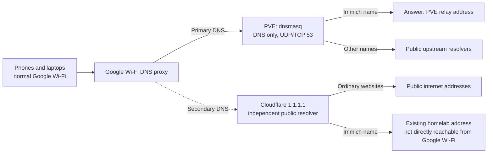
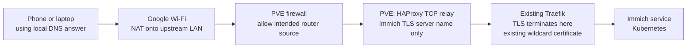
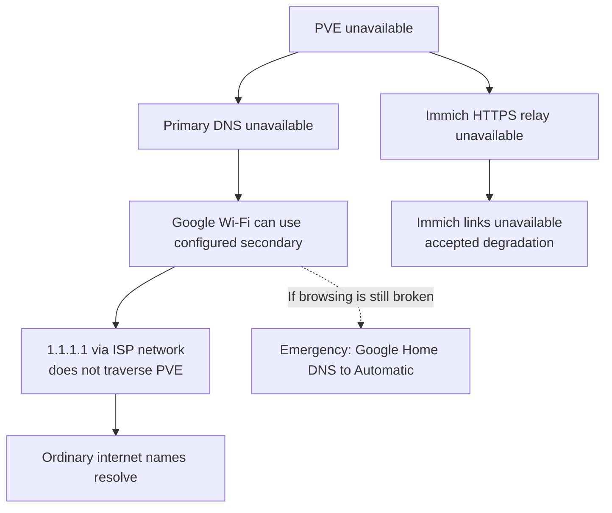
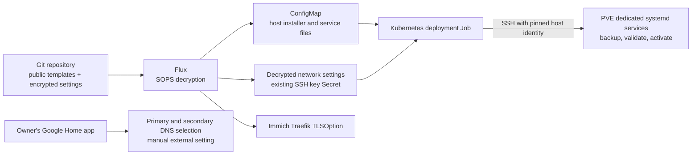

# Google Wi-Fi, Immich, and household DNS availability

Updated 2026-11-26. This is the current Google Wi-Fi addition to the
[homelab topology](../source/md/homelab-network-topology.md) and
[seamless-access architecture](../product/seamless-access/architecture-seamless-access.md).
Exact private addresses, interface names, and host identities are in the
SOPS-encrypted `immich-wifi/network.sops.yaml`; public diagrams use role names.

## Availability decision

Google sign-in uses this same private path: Google's redirect is followed by the
phone or laptop browser, and Immich validates the code over outbound HTTPS.
No inbound Google connection or public port forwarding is required. The
[Google sign-in runbook](../runbooks/immich-google-login.md) covers web and iPhone
callbacks; the [existing photo-pipeline blog](../blog/2026-11-15-taking-my-files-back-from-google-and-onedrive.md#family-access-google-sign-in-while-immich-stays-private)
includes the sequence diagram and credential-free setup screenshot.

**Ordinary household internet access takes priority over photo availability.**
The owner explicitly accepts Immich being unavailable during a PVE failure.
Google Home is configured with PVE's local resolver as primary and **1.1.1.1** as
secondary. The owner confirmed saving both on 2026-11-26.

The secondary is independent of PVE, its virtual machines, the homelab gateway,
Kubernetes, and Flux. Running a second DNS process or VM on PVE would not provide
that independence. PVE's own upstream DNS servers also do not help when PVE itself
is unavailable: the Google router needs its own reachable alternative.

This is **internet DNS redundancy, not highly available Immich**. Resolver
selection must not be assumed to be strict primary-then-secondary failover.
Either server may answer while both are healthy. The public resolver returns the
existing homelab address for Immich; the local resolver returns the reachable
relay address. Consequently, photo access is best-effort with this configuration
and can fail even while PVE is running. Deterministic photo access with redundant
DNS would require an independent local resolver serving the same override, or a
separately reviewed change to the routing/naming architecture.

## DNS path

`dnsmasq` is installed on PVE as `immich-wifi-dns.service`. It is not BIND/named
and provides no DHCP service. Only the Immich name has a local override. Its
upstreams are public resolvers, so it does not forward back to Google Wi-Fi and
create a DNS loop. The public wildcard record remains unchanged.

## HTTPS and photo path

HAProxy runs as `immich-wifi-proxy.service` under the dedicated package user. It
does not hold a certificate or decrypt application requests. The firewall unit
`immich-wifi-firewall.service` scopes only the new DNS and HTTPS listeners. It
does not flush the host firewall or change forwarding routes.

The shared Traefik listener needs two checks: HAProxy restricts the TLS SNI to
Immich, and Immich has a distinct Traefik TLSOption so a mismatched HTTP Host is
rejected with 421. Existing Immich authentication, share-link permissions, and
private middleware remain active. A share link does not grant access to other
albums or make the service internet-accessible.

Immich itself runs on another homelab host, but its Google Wi-Fi access path
depends on PVE. A PVE outage can therefore make photos unreachable even while
Immich's server and database remain running.

## What fails when PVE fails

| Failure | Expected household impact | Response |
| --- | --- | --- |
| PVE off or rebooting | Secondary DNS can serve ordinary websites; photos fail | Keep public secondary configured; recover PVE separately |
| Local dnsmasq fails | Google Wi-Fi can use secondary; Immich answers may be unusable | Check dedicated DNS unit after restoring household access |
| HAProxy, Traefik, or Immich fails | Photos fail; ordinary DNS remains available | Diagnose the photo path without changing household DNS |
| Public secondary fails | Working local resolver can still resolve ordinary names | Check upstream availability; do not assume all resolvers are healthy |
| Both configured resolvers fail | Browsing may appear offline despite Wi-Fi being connected | Use the emergency recovery below |
| Router source address changes | Relay firewall fails closed; public secondary remains independent | Update encrypted inventory through GitOps |
| Google selects public DNS while PVE is healthy | Internet works; Immich can fail intermittently | Accepted best-effort photos; matching independent local DNS is the stronger design |

No deliberate household DNS outage has been performed. Reachability and normal
resolution checks do not establish the router's failover delay or every client's
cache behavior. Do not describe this setup as outage-tested.

After the owner confirmed both DNS settings were saved, checks found that Google
Wi-Fi returned the local Immich relay address over UDP and TCP, ordinary names
resolved through Google Wi-Fi, and the independent public secondary also resolved
ordinary names. The local HTTPS relay returned Immich's `pong` with certificate
verification. No server or router was stopped during these checks.

## Emergency recovery: restore ordinary internet first

1. On a phone, use cellular data if Wi-Fi cannot resolve names.
2. Open **Google Home → Wi-Fi → Network settings → Advanced networking → DNS**.
3. Select **Automatic** and save. This removes the household DNS dependency on
   the lab; Immich may remain unavailable.
4. Reconnect Wi-Fi and test an ordinary website. Recover PVE or the photo service
   afterwards; do not widen firewall access or expose ports to the internet.

This recovery does not require SSH, Kubernetes access, SOPS keys, or knowing the
private relay address. Google documents that its router can remain online even
when clients cannot resolve names, and recommends another internet connection
for changing a broken custom DNS configuration.
[Google Home DNS settings](https://support.google.com/googlehome/answer/6274141).

## GitOps ownership and operating procedure

Flux manages the host bundle through a ConfigMap and Job, and the existing
Traefik resources. Google Home's DNS selection is a documented manual setting;
it is not claimed to be managed by Kubernetes. The Job is deployment-time
convergence, not continuous host drift remediation. Deleting it does not remove
host services; use the explicit rollback procedure.

See the [setup and rollback runbook](../runbooks/immich-google-wifi.md) for unit
names, backups, encrypted settings changes, deployment commands, and evidence.
Use `scripts/immich-wifi/verify-google-dns.sh` for effective DNS checks from the
dual-connected host. Use `check-access.sh` from an actual Google Wi-Fi client for
the complete photo connection path. A real album browser test remains distinct
from the API health check.
