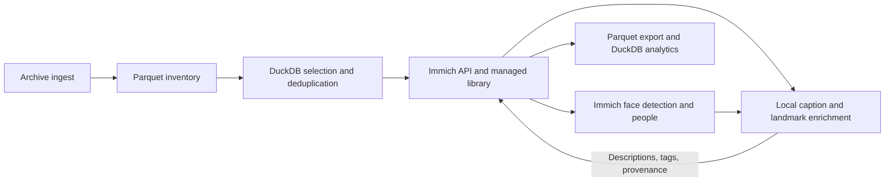

# Knowledge index (DuckDB over Parquet)

One queryable inventory of everything the homelab ingests (issue #212). Phase 1: Google Photos. Drive/OneDrive
adapters and the `copies` refresher are Phase 2; document text search is Phase 3.

Never run index builds or queries inside K3s VM 105 (bulk disk writes there stall etcd). Everything runs **on the host**
via `scripts/knowledge-index/knowledge-index-ctl.sh` (`CB_HOST=root@<host>` from the laptop).

## Layout

```
<host>/local-3TB-backup/knowledge-index/      dataset: recordsize 1M, lz4
  files/<source>/<unit>.parquet               facts, immutable per unit (+ <unit>.versions.parquet for .versions/)
  gphotos_sidecars/<unit>.parquet             raw Takeout sidecar fields, one row per .json
  copies/<location>.parquet                   mutable; Phase 2 (an empty typed file until then)
  knowledge.duckdb                            views only, no data; `ctl rebuild` recreates it
/opt/knowledge-index/                         venv (duckdb 1.5.6), adapters/, kidx.py, knowledge.sql, index-unit.sh
```

`unit` = Takeout archive file name, `backfill-YYYYMMDD` for the one-off pass, a sync-run id for rclone sources.
Parquet is written to `<name>.tmp` and renamed, so re-running a unit replaces its file. When two units deliver the same
path the later one wins in the views (`files`, `gphotos_sidecars`).

## Common schema: `files`

| column | type | meaning |
|---|---|---|
| source | VARCHAR | `gphotos` / `gdrive` / `onedrive` |
| unit | VARCHAR | archive or run that delivered it |
| path | VARCHAR | relative to the source root as stored in the primary, e.g. `Google Photos/Photos from 2023/IMG_1.jpg` (`.versions/<date>/...` for replaced older copies) |
| name, ext | VARCHAR | file name; lower-case extension without dot |
| size_bytes | BIGINT | |
| mtime | TIMESTAMP | mtime in the primary (UTC) |
| kind | VARCHAR | `media` (jpg jpeg heic png gif webp mp4 mov 3gp avi mpg m4v) / `sidecar` (.json) / `other` |
| hash_algo, hash | VARCHAR NULL | only when free (Drive md5, OneDrive sha1/quickxor); not computed for Photos |
| origin_id | VARCHAR NULL | Photos: the sidecar's `url` (on the sidecar row); Drive/OneDrive: rclone `ID` |
| ingested_at | TIMESTAMP | |

`gphotos_sidecars`: `path`, `title`, `target_name` (media file the sidecar describes, `(n)` duplicate suffix re-inserted),
`description`, `upload_ts` (`creationTime`), `taken_ts` (`photoTakenTime`), `geo_lat/lon/alt`, `url`, `device_type`,
`device_folder`, `app_package`, `views`, `favorited`, `people[]`, `parse_error` (unparseable sidecar: NULLs + the error).

## Views (knowledge.sql)

`files`, `gphotos_sidecars`, `copies` (latest-wins / typed), `gphotos_files` (library), `gphotos_versions` (`.versions/`),
`gphotos_media` (every non-sidecar library file joined to its sidecar **across the whole library**, so a photo and sidecar
from different archives still match; exposes `upload_ts`, `taken_ts`, `has_geo`, `album`, `is_edited`),
`gphotos_album_dup`, `gphotos_quota`.

Quota rule (ported exactly from `scripts/backup/host/gphotos-quota-list.py`, which stays the oracle): a file counts when
uploaded on/after 2021-06-01 UTC (`quota_reason = uploaded-on-or-after-cutoff`) or it has no usable sidecar (`no-sidecar`: a
sidecar needs a title and an upload time), excluding album duplicates (a file in a non-`Photos from YYYY` folder with the
same (name, size) as one in a year folder). Like the oracle, every non-`.json` file is a candidate (`kind` `media` or `other`),
and the matched sidecars ride along as `kind = 'sidecar'` rows.

## Adapter contract (source #4 is cheap)

`scripts/knowledge-index/adapters/<source>.py` exposes `emit(unit, root, out_dir)` that

- writes `files/<source>/<unit>.parquet` (+ source-specific tables) with exactly the `files` schema above;
- is idempotent (tmp + atomic rename), reads only from `root` (read-only), never writes outside `out_dir`;
- prints one summary line: `rows=N bytes=B seconds=S`.

The Photos adapter also takes `--paths-from FILE` (index only what an archive just delivered) and `--versions DIR`.

## Operations

```bash
export CB_HOST=root@<host>                          # laptop: DNS is hijacked by a VPN, use the host's address
scripts/knowledge-index/install-duckdb.sh           # once: pinned duckdb venv
scripts/knowledge-index/knowledge-index-ctl.sh install       # copy adapter + SQL, create the dataset (idempotent)
scripts/knowledge-index/knowledge-index-ctl.sh backfill start   # index the existing library as backfill-<date>
scripts/knowledge-index/knowledge-index-ctl.sh backfill status
scripts/knowledge-index/knowledge-index-ctl.sh quota-diff    # index vs gphotos-quota-list.py: must be empty
scripts/knowledge-index/knowledge-index-ctl.sh status        # counts, parquet files, index_pending units
scripts/knowledge-index/knowledge-index-ctl.sh query "SELECT ..."
```

### Ingest hook and `index_pending`

`gphotos-ingest-host.sh` writes the library-relative paths an archive delivered to `_staging/<archive>.moved`, then calls
`/opt/knowledge-index/index-unit.sh` **before** appending to `_ingested.tsv`. If indexing fails the ingest continues, library
and ledger are untouched, and the unit is appended to `<photos dataset>/_index_pending.tsv`. Fix: `ctl backfill start`
re-walks the whole library (latest unit wins, no duplicates) and clears the list. `gphotos-ingest-ctl.sh start` installs the
index files first.

## AI enrichment: photo/video summaries from a local vision model

Spec and design: `openspec/changes/add-media-summaries-enricher/` (OpenSpec; `npx @fission-ai/openspec@1.16.0 validate --strict`).
`scripts/knowledge-index/enrichers/media_summary.py` reads photos and videos read-only on the Proxmox host, asks an
OpenAI-compatible vision server on the LAN (Ollama / llama.cpp serving Qwen2.5-VL on the RTX 3070 in the GPU VM) for a summary
and tags, and writes `summaries/<enricher>/<batch>.parquet` (tmp + rename; ~200 files per batch, so a stop loses little).
Photo = one image (long edge 1024) + context (date, album, people, has-GPS). Video = up to 8 frames across the clip + a
faster-whisper transcript when that package is installed and the clip has audio. A file that cannot be decoded or answered gets
a `status='error'` row and stays queued.

```bash
export CB_HOST=root@<host> KI_ENDPOINT=http://<gpu-vm>:11434     # model server on the LAN (no IPs in the repo)
scripts/knowledge-index/knowledge-index-ctl.sh enrich sample 20   # print 20 summaries, write nothing: judge quality first
scripts/knowledge-index/knowledge-index-ctl.sh enrich start       # background unit knowledge-index-enrich (nice, idle I/O)
scripts/knowledge-index/knowledge-index-ctl.sh enrich status      # unit state, last log lines, rows per enricher/status
scripts/knowledge-index/knowledge-index-ctl.sh enrich stop
```
Prerequisites: `ffmpeg` on the host (`apt-get install ffmpeg`: not installed by the scripts), the model pulled on the GPU VM.
Re-run with a better model or prompt by changing `KI_ENRICHER` (e.g. `qwen25vl-7b-p2`): the whole library is queued again and the old
summaries stay under their own id. **GPU sharing with Frigate:** the 3070 (8 GB) also runs Frigate's detector. The guard
(`--min-free-mib`, via `nvidia-smi`) only works where `nvidia-smi` exists; the host has no driver access (GPU is passed to the VM), so it warns and
continues. Measure Frigate's VRAM first (task 1.1 in the OpenSpec change) and decide how to guard before the full run.

`media_summaries` columns: source, path, `size_bytes` (bytes that were summarized: a changed file re-queues), enricher, model, prompt_version,
summary, tags[], frames_sampled, duration_s, status (`ok`/`error`), error, created_at; latest row per (source, path, enricher) wins.
Queue: `SELECT path FROM gphotos_to_summarize('qwen25vl-3b-p1') LIMIT 500` (a table macro, so a brand-new enricher id works).
Search: `SELECT f.path, s.summary FROM media_summaries s JOIN gphotos_media f USING (path) WHERE s.summary ILIKE '%birthday%'`.

## Metrics, dashboard and alerts (as code)

`export-metrics.py` runs on the host every 5 minutes (systemd timer `knowledge-index-metrics`, installed by `ctl install`) and writes
`/var/lib/prometheus/node-exporter/knowledge_index.prom`; the host's node-exporter (already scraped by Prometheus, job
`proxmox-node-exporter`) serves it. `ctl metrics` runs it now and prints the key series. It exports index counts and bytes, the quota
selection (also by year taken, UTC), pending units, ingest ledger/last run, enrichment rows/queue/last batch, backfill/enricher unit state,
and SMART health per USB/SATA disk (labelled by model: Linux device letters change between boots).

- Dashboard: Grafana > Homelab > **Knowledge Index** (ConfigMap `infrastructure/monitoring/dashboards/knowledge-index.yaml`).
  It is GENERATED: edit `scripts/knowledge-index/gen-dashboard.py`, then `python3 scripts/knowledge-index/gen-dashboard.py > <that yaml>`.
- **Value delivered** (top row): files indexed per minute, summaries per minute, how long the quota question takes now versus the ~38 min
  sidecar scan it replaced (`baseline_s`), index size versus library size, photos and video minutes described, and an **illustrative**
  cloud-equivalent cost. No cloud service does this for a Google Photos library, so the cost prices the same work per photo and per video
  minute with editable assumptions (`price_photo`, `price_video_min` dashboard variables: not quotes).
- **Backfill progress**: `ctl backfill start` passes `--prom` and `--expected` (ledger file count) to the adapter, which writes live phase, files
  listed/read, rate and ETA every ~2 s (`progress.py`); process stats (elapsed, bytes read, CPU) work for any backfill, instrumented or not.
  `ctl backfill status` prints the same numbers. `scripts/knowledge-index/check-promql.sh` runs every dashboard/alert expression against the live Prometheus.
- **GPU and Ollama** section: DCGM exporter metrics (utilization, memory, power, temperature, Xid errors, energy; the `pod` label shows which workload
  holds the GPU), the exporter's reading of Ollama's `/api/ps` (model loaded, share in GPU memory, time until unload: Ollama has no `/metrics`),
  and whether Frigate, Stable Diffusion and `ollama-gpu` are running (a deliberate pause shows as STOPPED). GPU energy x the `kwh_price` variable is an
  illustrative electricity cost to set against the cloud-equivalent cost. The exporter finds Ollama via `KI_OLLAMA_URL` in `/etc/default/knowledge-index` on the host
  (written by `ctl install` from the cluster; not stored in Git).
- Alerts: `infrastructure/monitoring/knowledge-index-alerting-rules.yaml` (exporter stale, units pending, backfill stuck/failed, enrichment stalled / >20% errors, GPU Xid errors / hot GPU, Ollama down / model mostly on CPU,
  disk pending sectors or SMART failed, Proxmox host rebooted).
- `scripts/knowledge-index/test-metrics.sh` checks the exposition format, the numbers, that the committed dashboard equals the generated one,
  and that every metric used by the dashboard and alerts exists. Flux applies dashboard and rules after the change is merged to master.

## Pipeline bottlenecks dashboard

The **Pipeline bottlenecks** row measures the sequential worker itself: select a batch → read/decode → optional
audio transcription → build prompt → Ollama request → parse → next item → write Parquet at the batch boundary.
Use the **Pipeline enricher** filter to select a model/prompt run. Existing totals remain in the Summaries row.

- **Value stream map / time by stage:** percentage of measured wall time in each stage, including in-flight work.
  Edges describe control flow, not independently queued workers. Inference includes request encoding, transport,
  server waiting and inference; it is not a GPU-utilization measurement.
- **Worker activity:** stage and time in that stage. The timeline is sampled at Prometheus scrape cadence; short
  stages may be missed visually, but their duration counters are still recorded. A heartbeat older than 60 seconds
  becomes “No recent telemetry”, including after an abrupt kill. A missing series means no instrumented run yet.
- **Photo/video stage duration:** mean seconds per completed operation, including failed attempts. Queue lookup and
  Parquet write durations are shown separately **per batch**. In-flight durations are excluded from these means.
- **Ollama timings:** native `/api/chat` load, prompt processing, generation and total durations, converted from
  nanoseconds. Total overlaps its components; never add them together. Unsupported/missing response fields stay
  absent. Token throughput is tokens divided by the associated model processing time, not end-to-end throughput.
- **Attempted vs saved items:** attempted items include errors; saved counts advance only after the atomic Parquet
  rename. Normal batching creates bursts in the saved line. Counters reset when the worker restarts; queries use
  `rate()` to handle resets. No per-file paths, transcripts, prompts or summaries enter metric labels.

`enrich start` now supplies `--prom /var/lib/prometheus/node-exporter/knowledge_index_pipeline.prom`.
`enrichers/pipeline_metrics.py` writes that file atomically at stage boundaries and every five seconds, independently
of the five-minute index scan. Publication failures log an error and leave summary processing running. The node-exporter
directory must already exist and be writable by the worker. `enrich sample` writes no metrics, even with `--prom`.

Deployment: merge the generator and generated ConfigMap through GitOps, install both enricher Python files on the host,
then restart the resumable worker with its existing endpoint/model/enricher settings plus `--prom`. A running Python
process does not pick up replaced source files. A forced restart can discard an unfinished in-memory batch; saved Parquet
is retained and those unfinished items remain queued. Do not merge unrelated draft work or stop GPU tenants just to
publish the dashboard. Inspect the deployment first with:

```bash
CB_HOST=root@<inventory-host> bash scripts/knowledge-index/check-pipeline-rollout.sh
python3 scripts/knowledge-index/test-pipeline-metrics.py
bash scripts/knowledge-index/test-enricher.sh
bash scripts/knowledge-index/test-metrics.sh
bash scripts/knowledge-index/check-promql.sh
```

When diagnosing gaps, correlate stage time with CPU saturation, disk latency, GPU activity and memory on both the
Proxmox host and GPU VM; the map identifies where the worker spends time, not which resource caused the delay.

## Example queries (these double as checks)

```sql
-- quota set, same as gphotos-quota-list.py (library-relative paths: the oracle prints them with a "gphotos/library/" prefix)
SELECT path FROM gphotos_quota ORDER BY path;
-- what would deleting a year free (counted media, GB)
SELECT regexp_extract(path,'Photos from ([0-9]{4})',1) y, count(*) n, round(sum(size_bytes)/1e9,2) gb FROM gphotos_quota WHERE kind<>'sidecar' AND regexp_matches(path,'/Photos from [0-9]{4}/') GROUP BY 1 ORDER BY 1;
-- media without a sidecar
SELECT count(*) FROM gphotos_media WHERE upload_ts IS NULL;
-- counted by Google but missing on the SSK (the pre-delete safety check; needs Phase 2 copies)
SELECT q.path FROM gphotos_quota q LEFT JOIN copies c ON c.source='gphotos' AND c.path=q.path AND c.location='ssk' WHERE c.path IS NULL;
```

Per-year uses the "Photos from YYYY" folder and every non-sidecar file, the same definition as `scripts/backup/gphotos-quota-by-year.sh`.

## Golden numbers (2026-11-16) and their verification (2026-11-17)

Library 243,088 files + `.versions` 6,753 = ledger 249,841; media 118,987; `.json` 119,670. Quota selection 18,264 paths / 88,693 MB;
2023 counted media 1,940 files / 26.55 GB.

**Verified on the real library 2026-11-17** (backfill `backfill-20261117`, 249,841 rows in 41 min = the ledger total; index 8.7 MB for 331 GB): library 243,088 + `.versions` 6,753; media 118,987; sidecars 119,670 (0 parse errors); quota 18,264 paths / 88,693 MB; year-folder files 10,633 / 83.35 GB; 2017 1.71, 2018 1.34, 2019 2.20, 2021 2.81, 2022 1.19, 2023 26.55 (1,940 files), 2024 15.07, 2025 18.59, 2026 13.46 GB, all equal to the table above; `SELECT path FROM gphotos_quota` runs in 3.6 s. Path-for-path diff against `gphotos-quota-list.py` (`ctl quota-diff`): **empty, 18,264 paths each**.

## Tests

`scripts/knowledge-index/test-enricher.sh` (stub model server + ffmpeg fixtures, 21 checks) and
`scripts/knowledge-index/test-knowledge-index.sh` (local, python3 + duckdb): same fixture as `test-gphotos-quota-list.sh`
plus cross-archive sidecars, corrupt sidecar, re-run idempotency, later-unit-wins, and the hook's forced-failure path.
# Immich migration pilot (November 2026, issue #217)

Immich is the target photo UI and authority for people, albums and editable
photo metadata. The earlier decision to build a summary worker addressed video
and audio descriptions; it did not establish a reason to replace Immich's gallery.

The isolated pilot is at `https://immich.app.home.panderosystems.com`, deployed by
the existing `photo-enrichment-preview` Flux source. It uses the official Helm
chart 0.12.0 with explicitly pinned Immich v3.4.2 images, a dedicated VectorChord
PostgreSQL database, persistent Valkey/model caches, and copied managed media on
pumped-piglet's Kubernetes VM 105. The existing `gphotos` virtiofs device exposes
the ZFS dataset at `/mnt/gphotos`; the pod mounts its library read-only at
`/external/gphotos`. That path is available for a future external-library import;
the pilot still consists of uploaded copies. The original Photos route and workers
continue operating. The pilot storage template is `YYYY/MM/DD`.

The compatibility boundary is the Immich API, never direct writes to its schema:



The installed v3.4.2 workflow triggers are `AssetCreate`,
`AssetMetadataExtraction`, `AssetOcrExtraction`, and `AssetTagged`. Its core
`immich-plugin-core#webhook` action can POST/PUT an `AssetV1` event to a private
enrichment receiver. Use metadata extraction as the normal enqueue trigger, then
fetch current faces through the API. This release has no face-completion/person
rename workflow trigger. Keep reconciliation for late person changes, existing
assets and missed events. The core webhook ignores HTTP error status and the queue
defaults to one attempt, so successful workflow status alone is not delivery proof.
The receiver must commit a durable job before acknowledgement. The integration
is planned; no enrichment workflow has been enabled against a missing receiver.

Preserve user descriptions: store machine output/provenance separately and only
replace a description under an explicit ownership policy. Native workflow changes
do not supply an atomic human-edit guard.

Use a durable writable queue for claims/retries. DuckDB queries immutable
inventory/snapshot files; it is not a shared transactional job database. Existing
face embeddings remain archived, but Immich computes its own embeddings. Transfer
human-confirmed labels by asset identity and unambiguous normalized box overlap;
preserve missed detections as manual boxes. Do not promote old automatic matches
to human-confirmed annotations. Frigate remains the NVR; the legacy photo worker
uses YuNet/SFace, not Frigate recognition.

`scripts/knowledge-index/immich-pilot.py` provides resumable `initialize`, `export`,
`upload`, `annotate`, `preserve-missing`, `tags`, `verify`, `verify-bytes`, and `health` steps.
Set `CB_HOST=root@192.168.4.175` for export, per inventory. The exporter runs a
read-only repeatable-read PostgreSQL transaction and copies at most 16 selected
photos (25 MiB per file). Private archives and the selected photos’ legacy face embeddings
remain on the source host under `photo-enrichment/migrations/immich-pilot`.
Local credentials, copied samples, target-ID ledger and verification report are
under `/private/tmp/immich-pilot`, outside Git. Preserve these private files before
cleaning temporary storage. The pilot credential is not a production account plan.

The sample test copied 12 photos, transferred 20 human-confirmed faces (19 detected
matches, one manual box), six named people, two albums, captions, GPS and tags.
API read-back checks and browser inspection passed. No full-library cutover has
occurred. Motion-photo metadata in several source JPEGs pointed to invalid video
payloads; still images imported, but motion-video parity needs separate validation.

The storage move is managed by `move-immich-pilot.py`: mount the existing virtiofs
device, quiesce server/ML via GitOps, dump PostgreSQL and archive managed media plus
Valkey, restore into fresh `/var/lib/immich-pilot/{library,postgres,valkey,cache}`
directories, switch to Retain local PVs on piglet, restore the empty database, then
resume through GitOps. The original still-fawn PVCs are retained. Private backups
are in `/private/tmp/immich-pilot/move-to-piglet` and on pumped-piglet at
`/local-3TB-backup/gphotos/.immich-pilot-migration`, outside the source library.
VM fstab was backed up before adding the read-only virtiofs mount. No VM restart,
Frigate pause, or Ollama change is required. The model cache can be regenerated.

Before a production switch, validate a stable source-to-asset ledger at library
scale, backups of both media and database, video/rotation/rescan behavior, automatic
label and rejection provenance, API-based enrichment with human-edit precedence,
and the analytics export plus Grafana value stream map. Pilot metadata writes are
explicit migration operations; do not run `annotate` as a recurring enrichment job
because it deliberately restores source descriptions.

Metrics use Immich's native OTel/Prometheus endpoints. The ServiceMonitor must carry
`release: kube-prometheus-stack`. Immich v3.4.2's OTel exporter 0.300 constructs an
invalid metrics base URL with the default `::` bind address; `IMMICH_HOST=0.0.0.0`
avoids HTTP 400 on this IPv4 cluster. JSON server logging is enabled. Keep metrics
internal and expose only the application through private Traefik TLS.

### Existing-photo visibility

Mounting originals does not register them in Immich. Run
`python3 scripts/knowledge-index/immich-library.py register` to back up the current
Immich database, register the actual `Google Photos/Photos from YYYY` folders,
validate every path, and enqueue the external-library scan. The script reuses the
private pilot credentials and refuses to alter an existing library's import scope.
Use its `status` action to inspect imported photo/video counts. The initial scope
contains 31 year folders; album-only files, Archive, Trash, and Locked Folder are
not included. The originals stay read-only at `/external/gphotos`.

The library belongs to the existing pilot account and appears in its main Photos
timeline. Scanning and thumbnail generation continue asynchronously in Immich's
queues. This makes existing media visible; it does not migrate the remaining
legacy face confirmations, descriptions, or groups. Those records remain in the
original PostgreSQL database; the 12-photo pilot remains separately preserved.

### Missing thumbnails during the initial import

An original opening successfully does not establish thumbnail health. Compare the
original, preview and thumbnail HTTP endpoints with `immich-thumbnail.py`. A 404
for derived images plus a large active queue means the thumbnail is still missing;
zero failed jobs alone is not a reason to promise a short wait.

The initial 2-CPU/4Gi server limit was heavily throttled, with about 34k generated
thumbnails and 52k still waiting after 11 hours. The server now requests 1 CPU/2Gi
and can burst to 4 CPUs/6Gi. Node CPU remains shared with other workloads.

`python3 scripts/knowledge-index/immich-prioritize-thumbnails.py` previews a bounded
selection of missing thumbnails from the newest normal timeline items. Add
`--apply` to move their **existing waiting jobs** forward using BullMQ's supported
`changePriority` operation. It does not create/drop jobs or write to Immich tables.
Default 60 items, hard maximum 100; use sparingly to avoid starving the bulk scan.
It authenticates using the existing kubeconfig, not the temporary pilot credential
file. Verify rendered thumbnails in the browser after processing; remaining bulk
work continues asynchronously.
